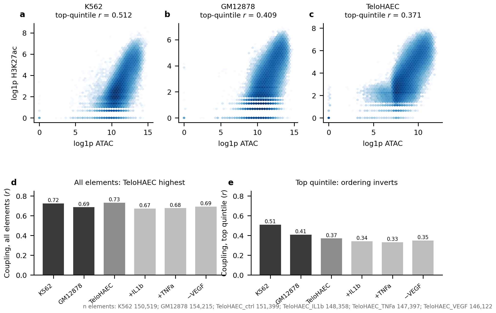
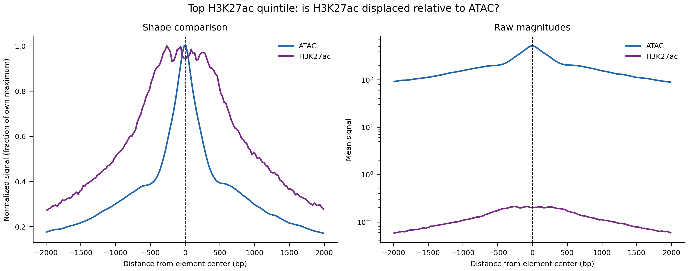
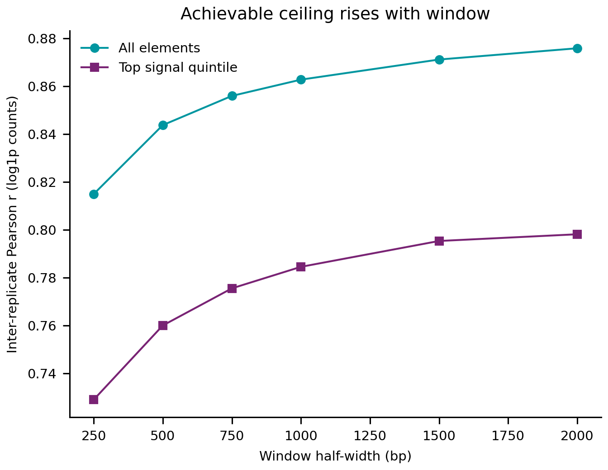
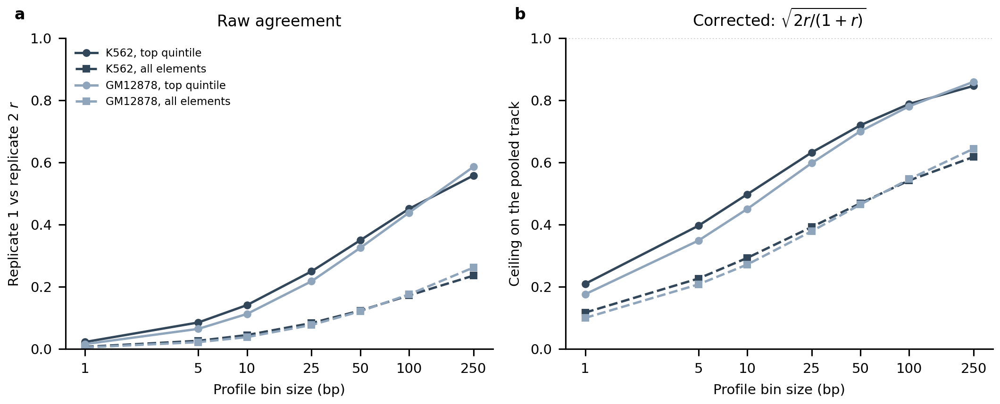
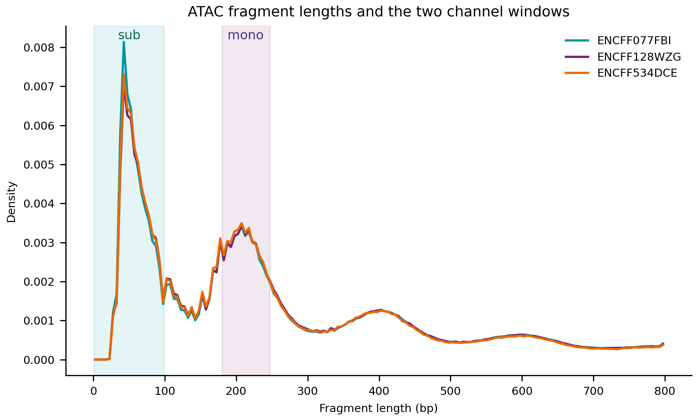

```{=html}
<style>
/* Typography and layout. Present in the document rather than the renderer so the
   report looks the same whether it is built by quarto or by the pandoc fallback
   (Sherlock has pandoc 2.10 and no quarto, which otherwise renders bare Times). */
html { -webkit-text-size-adjust: 100%; }
body {
  font-family: Arial, Calibri, "Helvetica Neue", Helvetica, sans-serif;
  font-size: 15px;
  line-height: 1.6;
  color: #1a1a1a;
  max-width: 980px;
  margin: 0 auto;
  padding: 2.5rem 1.5rem 4rem;
  background: #fff;
}
h1 { font-size: 1.7rem; font-weight: 600; line-height: 1.3; margin: 0 0 .3rem; }
h2 { font-size: 1.15rem; font-weight: 600; margin: 2.6rem 0 .6rem;
     padding-top: 1.1rem; border-top: 1px solid #e4e4e4; }
h3 { font-size: 1rem;   font-weight: 600; margin: 1.6rem 0 .4rem; }
p.date, .date { color: #666; font-size: .85rem; }

/* Figures: never exceed the text column, and centre them. Without this the
   pandoc fallback shows every PNG at natural pixel width and they overflow. */
img {
  display: block;
  max-width: 100%;
  height: auto;
  margin: 1.1rem auto 0.4rem;
}

/* The table of contents pandoc emits as a bare bulleted list */
#TOC, nav#TOC { font-size: .9rem; background: #fafafa; border: 1px solid #eaeaea;
  border-radius: 6px; padding: .8rem 1.2rem; margin: 1.5rem 0 2rem; }
#TOC ul { margin: .2rem 0; padding-left: 1.1rem; }
#TOC a { color: #235; text-decoration: none; }
#TOC a:hover { text-decoration: underline; }

/* Q:/A: lines read as the skimmable layer */
p > strong:first-child { color: #111; }

table { border-collapse: collapse; font-size: .88rem; margin: 1rem 0; width: 100%; }
th, td { border-bottom: 1px solid #e8e8e8; padding: .38rem .6rem; text-align: left;
         vertical-align: top; }
th { background: #f6f6f6; font-weight: 600; }

code, pre { font-family: "SF Mono", Menlo, Consolas, monospace; font-size: .82rem; }
pre { background: #f7f7f8; border: 1px solid #ececec; border-radius: 5px;
      padding: .7rem .9rem; overflow-x: auto; }
code { background: #f2f2f3; padding: .07em .32em; border-radius: 3px; }
pre code { background: none; padding: 0; }

blockquote { border-left: 3px solid #ddd; margin-left: 0; padding-left: 1rem;
             color: #444; }
</style>
```

## Headline figure



**Figure 1 | How much of H3K27ac accessibility can explain is a property of the cell type, and the ordering inverts between strata.** **Headline figure.**

<details>
<summary>Full legend</summary>

Complete legend under Figure 1 below. Source:
`results/atac_vs_h3k27ac_by_celltype.tsv`, `results/coupling_panel_recomputed.tsv`.
</details>

## Summary

- ATAC peaks on the element centre. H3K27ac peaks on the flanking nucleosomes at +/-250 bp and is still at 28% of maximum at +/-2 kb, past the models' ~1.1 kb receptive field (Fig. 2).
- +/-500 bp is the widest counting window with no other element's centre inside it. Widening to +/-2000 bp raises the replicate ceiling on the top quintile (the 20% of elements with the most H3K27ac signal) only from 0.760 to 0.798 (Fig. 3).
- At 1 bp a perfect model of H3K27ac shape reaches only *r* = 0.21 (K562) and 0.18 (GM12878) on the top quintile, and 0.72 and 0.70 at 50 bp bins (Fig. 4). Profile-head scores should be read against that cap.
- Accessibility explains H3K27ac best in K562 (top-quintile *r* 0.51 against 0.33-0.41 elsewhere), and the ordering changes when all elements are scored (Fig. 1). So every evaluation is stratified, and coupling is measured in each new cell type before training.
- K562 ATAC has a clean nucleosomal ladder, with a sub-nucleosomal mode at 42 bp and a mono-nucleosomal peak near 205 bp, so fragment-size channels can be built (Fig. 5).

## Goals

This report describes the H3K27ac and ATAC data and what is predictable from them without a model, including every ceiling in the project. See also Report 2 (evaluation methodology), Report 3 (design decisions: each architecture and input change tried, and its verdict) and `reference/DATA_INVENTORY.md` (every assay across the nine cell types, including files that must not be used).

## Datasets

| Dataset | Assay / system | Source | Used as |
|---|---|---|---|
| **K562 H3K27ac** | H3K27ac ChIP-seq, single-end 36 bp, 2 replicates (ENCFF790GFL, ENCFF817HMW) | ENCODE ENCSR000AKP | Prediction target |
| **K562 ATAC-seq** | ATAC-seq, paired-end, 3 replicates (ENCFF077FBI, ENCFF128WZG, ENCFF534DCE) | ENCODE ENCSR868FGK | Accessibility input |
| **K562 candidate elements** | DNase-derived candidate regulatory elements, n = 150,528, mean width 608 bp | Repo: `reference/K562_DNase_candidate_elements.narrowPeak` | Coordinate system; windows centred on element midpoints |
| **GM12878 H3K27ac** | H3K27ac ChIP-seq, single-end, 2 replicates (ENCFF645BAL, ENCFF865OOP) | ENCODE | Cross-cell-type evaluation target |
| **GM12878 ATAC-seq** | ATAC-seq | ENCODE; repo: `2026_0606_GM12878_transferability/data/atac.bw` | Accessibility input for transfer |
| **GM12878 candidate elements** | Candidate regulatory elements, n = 154,224 | Repo: `2026_0606_GM12878_transferability/reference/` | Transfer coordinate system |
| **K562 p300** | EP300 ChIP-seq, stranded | ENCODE ENCSR000EGE | Reference target for the sequence-margin comparison |
| **K562 DNase** | DNase-seq, ENCSR000EOT (pe + se), and ENCSR000EKS (se); 301.1M usable reads | ENCODE | Alternative accessibility input |
| **GM12878 DNase** | DNase-seq, ENCSR000EMT (se); 53.8M usable reads, 9.5% chrM, count ceiling 0.445 on the top quintile | ENCODE | Alternative accessibility input; a much weaker library than K562's |
| **hg38 CV folds** | Chromosome-holdout 5-fold split | Repo: `reference/hg38_five_folds.json` | Shared by all models so numbers are comparable |
| **Training negative pool** | ChromBPNet genome-wide GC-*annotated* tiling, hg38; n = 3,088,298 bins, 1 kb stride, mean GC 0.389. **Not GC-matched to the positives**, see the negatives section below | Repo: `reference/genomewide_gc_stride_1000_flank_size_1057.gc.bed` | Training negatives only; never evaluated on |

The model is `MultiModalBPNet` (`scripts/multimodal_bpnet.py`), a BPNet variant; only its counts head is analysed here, on log counts. Target counting is in Methods.

## Accessibility explains less of H3K27ac outside K562, and the ordering changes when all elements are scored

The ATAC-only model scores lower in GM12878 because accessibility and H3K27ac are less coupled there. Coupling, the model-free correlation of summed ATAC with summed H3K27ac per element, is the denominator that makes accessibility-based scores comparable across cell types. Relative to it, the model does better in GM12878 than in K562:

| | K562 | GM12878 |
|---|---|---|
| model-free ATAC-H3K27ac coupling | 0.510 | 0.409 |
| ATAC-only model | 0.542 | 0.467 |
| model / coupling | 1.06 | 1.14 |

Sequence-only falls 0.360 -> 0.146 with no such denominator to explain the drop. This sharpens the transfer conclusion: accessibility transfers, only sequence collapses.

> **Superseded (F-016, 2026-09-14):** Scored against the target cell type's own accessibility-only model trained on the same assay (the floor), no transferred sequence+accessibility H3K27ac model beats it in any of six directions, so transfer fails for the full model too.


<details>
<summary>Figure 1 legend</summary>

**Figure 1 | Accessibility-H3K27ac coupling weakens outside K562.** **a-c**, log1p summed ATAC against log1p summed H3K27ac over +/-500 bp element-centred windows, no model; colour is element density (log scale). Top-quintile Pearson **0.512 (K562), 0.409 (GM12878), 0.371 (TeloHAEC)**, n = 150,519 / 154,215 / 151,399 elements. The x-range differs in **c** because TeloHAEC's ATAC library is shallower; correlation is unaffected. **d, e**, Coupling in all six cell types and conditions measured, on all elements (**d**) and the top quintile (**e**). On all elements TeloHAEC is highest (0.73) and all lie within 0.06, because that stratum is dominated by the inactive-versus-active contrast every accessible-element set shares. On the top quintile the range triples. TeloHAEC targets use read 1 only. Sources: `results/atac_vs_h3k27ac_by_celltype.tsv`, `results/coupling_panel_recomputed.tsv`.
</details>

<details>
<summary>Full methods &amp; code</summary>

```bash
pixi run python scripts/0.12.atac_vs_h3k27ac.py --label K562 \
    --elements reference/K562_DNase_candidate_elements.narrowPeak \
    --atac-bw .../atac.bw \
    --h3k27ac-bw data/h3k27ac_5p_plus.bw,data/h3k27ac_5p_minus.bw \
    --outdir results --figdir figures
```
Source: `scripts/0.12.atac_vs_h3k27ac.py`
</details>

## H3K27ac sits on flanking nucleosomes and is far broader than ATAC

ATAC peaks on the element centre (offset −12 bp, no central dip). H3K27ac has shoulders at +/-250 bp on the flanking nucleosomes and is still at 28% of its maximum at +/-2 kb, where ATAC has fallen to 17%. That is the edge of the profiled window, so H3K27ac extends further than measured here.



<details>
<summary>Figure 2 legend</summary>

**Figure 2 | H3K27ac is displaced onto flanking nucleosomes and is much broader than accessibility.** Meta-profiles in 50 bp bins, top H3K27ac quintile (n = 30,000 elements, seed 0), all tracks on the same elements. **a**, Each track normalised to its own maximum. **b**, Raw magnitudes, log scale. Teal, K562 ATAC; orange, K562 H3K27ac 5' ends; dashed line, element centre. Peak offset −12.5 bp (ATAC) against −262.5 bp (H3K27ac); centre-to-peak ratio 1.000 against 0.944 (`results/profile_comparison_summary.tsv`). Source: `results/profile_comparison.tsv`.
</details>

<details>
<summary>Full methods &amp; code</summary>

Window centring and signal reading are in Methods.

```bash
pixi run python scripts/0.6.compare_profiles.py \
    --elements reference/K562_DNase_candidate_elements.narrowPeak \
    --track "ATAC:.../atac.bw" \
    --track "H3K27ac (5-prime):data/h3k27ac_5p_plus.bw,data/h3k27ac_5p_minus.bw" \
    --stratify-by "H3K27ac (5-prime)" --outdir results --figdir figures
```
Source: `scripts/0.6.compare_profiles.py`
</details>

## A 1 kb counting window is the best trade-off between signal and neighbour contamination

Count H3K27ac over +/-500 bp. Wider windows add little signal (top-quintile ceiling 0.760 at +/-500, 0.798 at +/-2000) and increasingly contain another element's centre (41.5% at +/-2000), whose reads cannot be attributed to the centred element. That matters for sequence attribution.



<details>
<summary>Figure 3 legend</summary>

**Figure 3 | The achievable ceiling saturates by +/-1 kb, while neighbour contamination keeps rising.** Pearson correlation of log H3K27ac counts between the two ENCSR000AKP replicates, by counting-window half-width, over all n = 150,526 candidate elements (teal) and the top quintile (purple). Replicate agreement bounds any model of the merged target. Top quintile: 0.729 (+/-250 bp), 0.760 (+/-500), 0.776 (+/-750), 0.785 (+/-1000), 0.795 (+/-1500), 0.798 (+/-2000). Elements with another element's centre in the window: 0% at +/-250 and +/-500 bp, 9.9% at +/-750, 19.9% at +/-1000, 33.1% at +/-1500, 41.5% at +/-2000 (`results/window_tradeoff.tsv`). Source: `results/fiveprime_replicate_ceiling_by_window.tsv`.
</details>

**Method.**

- Per-replicate 5'-end BigWigs built with the same processing as the merged training target.
- Neighbour contamination computed from element-centre spacing per chromosome.

<details>
<summary>Full methods &amp; code</summary>

Converting raw *r* to a bound on model performance is described in Methods.

Excluding the nucleosome-free centre lowers the top-quintile ceiling (excluding +/-125/+/-250/+/-375 bp: 0.760 -> 0.747 -> 0.729 -> 0.717), because the centre still carries ~94% of peak signal. Flanking-only counts correlate 0.93-0.99 with full-window counts, so the full window is kept (`results/flanking_vs_full_window.tsv`).

```bash
pixi run python scripts/0.3.replicate_ceiling_by_window.py \
    --elements reference/K562_DNase_candidate_elements.narrowPeak \
    --rep1-bw data/h3k27ac_rep1_5p_plus.bw,data/h3k27ac_rep1_5p_minus.bw \
    --rep2-bw data/h3k27ac_rep2_5p_plus.bw,data/h3k27ac_rep2_5p_minus.bw \
    --outdir results --figdir figures --label fiveprime_
pixi run python scripts/0.4.flanking_vs_full.py --outer 500 1000 --inner 0 125 250 375
```
Source: `scripts/0.3.replicate_ceiling_by_window.py`, `scripts/0.4.flanking_vs_full.py`
</details>

## H3K27ac has no reproducible base-resolution profile

At 1 bp a perfect model caps at *r* = 0.21 in K562 and 0.18 in GM12878 on the top quintile, so the base-resolution multinomial term of the loss is mostly fitting Poisson noise. The cap rises to 0.72 and 0.70 at 50 bp bins, and 0.79 and 0.78 at 100 bp.



<details>
<summary>Figure 4 legend</summary>

**Figure 4 | The reproducible part of the H3K27ac profile appears only after coarse binning.** Replicate-versus-replicate correlation across positions *within* each element, so only shape counts; 16,148 K562 and 15,589 GM12878 elements, +/-500 bp windows, strands summed. **a**, Raw agreement: 0.023 and 0.016 at 1 bp, top quintile. **b**, Ceiling on the pooled track the model is scored against, `sqrt(2r/(1+r))` (Methods). Solid, top quintile; dashed, all elements; dark, K562; light, GM12878. The curve is close to log-linear in bin size and still rising at 250 bp, so no bin size is preferred. There is no step near the ~180 bp nucleosome repeat, which indicates a broad envelope rather than sharply phased peaks. Source: `results/profile_ceiling_binsize_{k562,gm12878}.tsv`.
</details>

**Method.**

- Elements flat in either replicate are excluded; scoring them as 0 would mix "not reproducible" with "no shape to reproduce".
- 500 bp bins are omitted: a 1 kb window gives only 2 bins.

<details>
<summary>Full methods &amp; code</summary>

```bash
sbatch scripts/0.25.submit.sh
```
Source: `scripts/0.25.profile_ceiling_by_binsize.py`
</details>

## The ATAC library supports fragment-size stratification

K562 ATAC fragments form a clean nucleosomal ladder, but the two channels built so far capture only 50% of fragments. A four-channel input of [all fragments, sub, mono, di] would contain the current flat-accessibility input, so it cannot regress, and would add the higher-order peaks.



<details>
<summary>Figure 5 legend</summary>

**Figure 5 | K562 ATAC fragment lengths show clear nucleosomal laddering.** Fragment-length density from TLEN of properly-paired reads, chr1, ~1.4 million fragments per replicate; the three ENCSR868FGK replicates (ENCFF077FBI, ENCFF128WZG, ENCFF534DCE) superimpose. Modes at 42 bp (sub-nucleosomal), ~205 bp (mono-), ~400 bp (di-) and ~600 bp (tri-); median 201 bp. Shaded: sub-nucleosomal channel 1-99 bp (30.3% of fragments) and mono-nucleosomal channel 180-247 bp (19.7%). **50.0% of fragments are in neither** (100-180 bp and above 247 bp, including both higher-order peaks). Source: `results/atac_fragment_length_summary.tsv`.
</details>

**Method.**

- Each properly-paired fragment counted once, via positive TLEN.
- Fragment lengths need the paired-end BAMs; the per-read Tn5 tagAlign files lose them.

<details>
<summary>Full methods &amp; code</summary>

```bash
pixi run python scripts/0.10.plot_fragment_lengths.py \
    --bams $SCRATCH/atac_pe/ENCFF077FBI.pe.bam $SCRATCH/atac_pe/ENCFF128WZG.pe.bam \
           $SCRATCH/atac_pe/ENCFF534DCE.pe.bam \
    --outdir results --figdir figures
```
Source: `scripts/0.10.plot_fragment_lengths.py`, `scripts/0.9.make_atac_fragment_channels.sh`
</details>

## DNase cut sites are reproducible at base resolution

By the method of Fig. 4, the 1 bp top-quintile ceiling is about four times higher for DNase than for H3K27ac:

| 1 bp, top quintile | DNase | H3K27ac |
|---|---|---|
| K562 | 0.848 | 0.21 |
| GM12878 | 0.686 | 0.18 |

K562 DNase reaches 0.921 at 5 bp and 0.946 at 10 bp, so predicting it at 5-10 bp loses almost nothing.

The downstream model reads accessibility as a base-resolution 5' insertion track, so an ATAC-to-DNase converter that predicted only per-element counts would strip the structure it uses. With a reproducible DNase profile to predict, the profile head becomes the decisive component of a converter, having been near-useless everywhere else in this project.

> **Superseded (F-014, 2026-09-13):** A converter that reproduced the DNase profile at 95% of its inter-replicate ceiling (F-011) still made a worse model input than plain ATAC in every direction tested, so predicting the profile well was not enough.

GM12878's DNase library is much weaker than K562's: top-quintile count ceiling *r* = **0.445** against 0.925 (+/-500 bp windows), 53.8M usable main-chromosome reads against 301.1M (5.6x), and 9.5% mitochondrial reads against 0.075%. The two ATAC libraries are matched (545.7M, 571.4M). DNase comparisons in GM12878 therefore confound assay with library quality, and cross-cell-type DNase comparisons confound it with depth. The K562 in-cell comparison is clean and conservative, because DNase is the *shallower* input there (301.1M against ATAC's 545.7M).

**Method.**

- Same script and procedure as the H3K27ac ceilings, so the numbers share one scale.
- Stranded per-replicate 5' tracks; read 1 only for paired BAMs, with pairing detected per file rather than from the metadata table.

<details>
<summary>Full methods &amp; code</summary>

K562's ENCSR000EOT is listed as pe + se, and a recorded constraint says mixed run types make an inter-replicate ceiling uncomputable (the reason HCT116's H3K27ac was excluded). 5' counting weakens that objection: one cut site per read, read 1 only for paired data, makes PE and SE libraries comparable at the cut-site level. The control, GM12878's ENCSR000EMT (two clean SE replicates), gives the same shape of curve, and K562's replicates agree *better* (0.562 at 1 bp, top quintile) than GM12878's (0.307). The mixed run type is not producing K562's result.

```bash
sbatch scripts/0.33.dnase_profile_ceiling.sh
```
Source: `scripts/0.33`, `scripts/0.25.profile_ceiling_by_binsize.py`,
`results/profile_ceiling_binsize_{k562,gm12878}_dnase.tsv`
</details>

## 5' insertion tracks remove a read-length confound that full-interval coverage carries

Full-interval coverage (`bedtools genomecov -bg` over the tagAlign interval) counts `read_length` bases per read, smearing each Tn5 insertion across ~95 bases in our K562 and GM12878 libraries. 5' insertion counts (`genomecov -bg -5`) count one base per read, so they compare across cell types sequenced at different read lengths. This is the ChromBPNet convention (`chrombpnet/helpers/preprocessing/reads_to_bigwig.py`: `-bg -5`, unstranded, ATAC shift `4-plus_shift, -4-minus_shift`). Our tagAligns are already Tn5-shifted, so the build only adds `-5`; shifting again would double-shift.

`sum(full-interval) / sum(5')` must equal the mean read length: 84.5 and 85.6 for K562 and GM12878 (94-95 bp reads), 30.9-35.5 for the four TeloHAEC conditions (35-36 bp). K562-versus-GM12878 comparisons were never affected, but TeloHAEC's full-interval coverage is a different quantity. With read length removed, the K562-versus-TeloHAEC gap falls from 13-27x to 5.3-12.3x nuclear depth, which is real sequencing depth. The effect of switching to 5' tracks on model performance is in Report 3.

## Element derivation differs between cell types, which is a standing confound

K562 and GM12878 candidate elements are DNase-derived; TeloHAEC's are ATAC-derived (`reference/ELEMENT_DERIVATION.md`). So the two cell types behind most results use elements from a different assay than their input. An ATAC-derived K562 set (`reference/K562_ATAC_candidate_elements.narrowPeak`, same rE2G model type as TeloHAEC's) makes this testable; the test is in Report 3. The ABC candidate regions for the downstream benchmark are ATAC-derived, from observed K562 ATAC.

## The training negative pool is not GC-matched, despite its filename

Training negatives are a uniform random sample of the genome, with mean GC **0.389** against **0.466-0.593** for candidate elements. Retraining on GC-matched negatives changes nothing measurable.

`reference/genomewide_gc_stride_1000_flank_size_1057.gc.bed` is ChromBPNet's GC-*annotated* genome tiling (3,088,298 bins, 1 kb stride, GC in column 4), the *input* to GC matching. Our training code reads only columns 1-3 and samples uniformly from a 50,000-window random subsample, using the same pool for K562 and GM12878.

- Negatives carry their true H3K27ac signal, not a hard zero, and are restricted to each fold's training chromosomes.
- No reported number is computed on them; evaluation uses candidate elements only (Report 2).
- GC-separable negatives can turn a BPNet-style sequence branch into a coarse GC detector (negatives are 10% of every batch, ~0.1 lower in mean GC), so this was tested as the cause of the flat sequence branch. GC-matched negatives give +0.001 in-cell type (*p*=0.76) and -0.002 transferred (*p*=0.33), with the match verified first: mean-GC gap closed 6.6x, largest per-bin discrepancy 5x (Report 3).

Nothing needs re-running. For new models, matched sets are `data/gc_negatives_{k562,gm12878}_h3k27ac.bed` (from `scripts/0.28`); the tiling keeps new numbers comparable with existing ones. The matching tool exits 0 having written nothing when `bedtools` is absent, and hangs when the foreground is GC-rich enough to exhaust the high-GC bins (repository learnings).

Separately, most candidate elements carry no H3K27ac, since the set spans active and inactive elements. That is why every evaluation is stratified.

## Methods

All ChIP-seq targets are counted as **5' read ends** at single-base resolution
(`bedtools genomecov -5 -dz`, stranded), matching the convention already used for the p300
models in this repository. Accessibility inputs exist in both conventions described above;
which one a given result used is recorded per result in `results/TARGET_PROVENANCE.md`.

Ceilings are reported as the raw inter-replicate *r*. Converting one to a bound on model
performance requires two corrections, applied wherever a fraction-of-ceiling is quoted
anywhere in this project: Spearman-Brown for the fact that the model predicts the
two-replicate *merge* rather than one replicate (`rel = 2r/(1+r)`), then a square root,
since a model predicts the expected signal while a replicate is one noisy realisation of it.
At +/-500 bp this converts a raw 0.760 into a bound of 0.929 on the top quintile, and a raw
0.844 into 0.957 over all elements.

Windows are centred on candidate-element midpoints rather than summits, because the H3K27ac
summit sits on a flanking nucleosome (Fig. 2). The `summit` column of
`K562_DNase_candidate_elements.narrowPeak` equals `width/2`, so element-centred windows
require no change to the extraction code. Elements within `flank` of a contig end are
dropped. Signal is read with pyBigWig and `nan` treated as zero.

### Regenerate

```
Environment: pixi env `multimodal`, pixi.lock sha256:069960d36312
```

```bash
# Target and accessibility tracks
sbatch scripts/0.5.make_5prime_bigwigs.sh            # K562 H3K27ac 5' ends, merged + per-replicate
sbatch scripts/0.7.make_gm12878_5prime.sh            # GM12878 H3K27ac 5' ends
pixi run bash scripts/0.20.make_atac_5prime_bigwigs.sh
pixi run python scripts/0.21.validate_atac_5prime.py   # ratio == mean read length
sbatch scripts/0.22.calibrate_tn5_shift.sh
PLUS_DELTA=4 MINUS_DELTA=-5 sbatch scripts/0.23.make_atac_fragment_5p_channels.sh
pixi run python scripts/0.24.validate_atac_fragment_channels.py

# Characterisation
pixi run python scripts/0.6.compare_profiles.py   ...           # Fig 2
pixi run python scripts/0.3.replicate_ceiling_by_window.py ...  # Fig 3
pixi run python scripts/0.4.flanking_vs_full.py --outer 500 1000 --inner 0 125 250 375
sbatch scripts/0.25.submit.sh                                   # Fig 4
pixi run python scripts/0.10.plot_fragment_lengths.py ...       # Fig 5
pixi run python scripts/0.12.atac_vs_h3k27ac.py --label K562 ...  # Fig 1

# This report
python render_report.py report1_data_characterisation.qmd
```

Per-result provenance, including which processing of the target each result file used, is in
`results/TARGET_PROVENANCE.md`.
