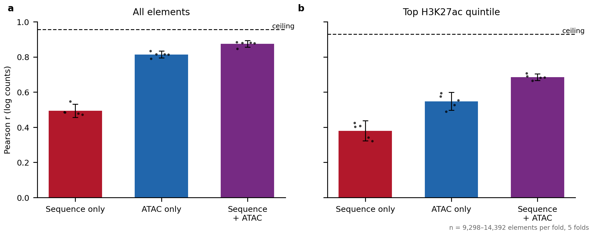
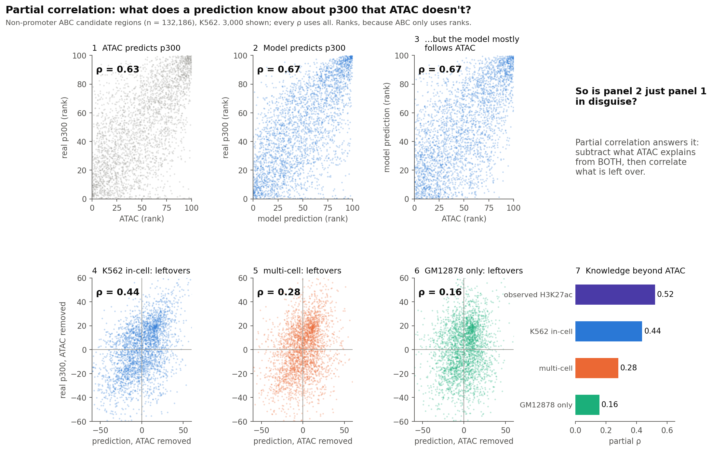

```{=html}
<style>
/* Typography and layout. Present in the document rather than the renderer so the
   report looks the same whether it is built by quarto or by the pandoc fallback
   (Sherlock has pandoc 2.10 and no quarto, which otherwise renders bare Times). */
html { -webkit-text-size-adjust: 100%; }
body {
  font-family: Arial, Calibri, "Helvetica Neue", Helvetica, sans-serif;
  font-size: 15px;
  line-height: 1.6;
  color: #1a1a1a;
  max-width: 980px;
  margin: 0 auto;
  padding: 2.5rem 1.5rem 4rem;
  background: #fff;
}
h1 { font-size: 1.7rem; font-weight: 600; line-height: 1.3; margin: 0 0 .3rem; }
h2 { font-size: 1.15rem; font-weight: 600; margin: 2.6rem 0 .6rem;
     padding-top: 1.1rem; border-top: 1px solid #e4e4e4; }
h3 { font-size: 1rem;   font-weight: 600; margin: 1.6rem 0 .4rem; }
p.date, .date { color: #666; font-size: .85rem; }

/* Figures: never exceed the text column, and centre them. Without this the
   pandoc fallback shows every PNG at natural pixel width and they overflow. */
img {
  display: block;
  max-width: 100%;
  height: auto;
  margin: 1.1rem auto 0.4rem;
}

/* The table of contents pandoc emits as a bare bulleted list */
#TOC, nav#TOC { font-size: .9rem; background: #fafafa; border: 1px solid #eaeaea;
  border-radius: 6px; padding: .8rem 1.2rem; margin: 1.5rem 0 2rem; }
#TOC ul { margin: .2rem 0; padding-left: 1.1rem; }
#TOC a { color: #235; text-decoration: none; }
#TOC a:hover { text-decoration: underline; }

/* Q:/A: lines read as the skimmable layer */
p > strong:first-child { color: #111; }

table { border-collapse: collapse; font-size: .88rem; margin: 1rem 0; width: 100%; }
th, td { border-bottom: 1px solid #e8e8e8; padding: .38rem .6rem; text-align: left;
         vertical-align: top; }
th { background: #f6f6f6; font-weight: 600; }

code, pre { font-family: "SF Mono", Menlo, Consolas, monospace; font-size: .82rem; }
pre { background: #f7f7f8; border: 1px solid #ececec; border-radius: 5px;
      padding: .7rem .9rem; overflow-x: auto; }
code { background: #f2f2f3; padding: .07em .32em; border-radius: 3px; }
pre code { background: none; padding: 0; }

blockquote { border-left: 3px solid #ddd; margin-left: 0; padding-left: 1rem;
             color: #444; }
</style>
```

## Headline figure



**Figure 1 | The same three models give different effect sizes on all elements and on the top quintile.** **Headline figure.**

<details>
<summary>Full legend</summary>

**Figure 1 | Predicting K562 H3K27ac at candidate elements, by input modality.** Pearson *r*
between predicted and observed log counts. **a**, All elements. **b**, Top quintile by
observed H3K27ac. Colour encodes input modality in all three reports: **red sequence only,
blue ATAC only, purple sequence + ATAC**. Dashed line: achievable ceiling, 0.957 in **a** and 0.929 in **b**. Sequence-only
falls from 0.494 to 0.380 and ATAC-only from 0.814 to 0.548, so the gap between modalities is
0.32 in **a** and 0.17 in **b**. The multimodal model's fold sd (0.015) is a third of either
single-input model's (0.041-0.046). Source: `results/fiveprime_stratified_fold_summary.tsv`.
</details>

## Summary

- Lead with the top signal quintile, and wait for the input mode the change targets.
- Compare two models by pairing: within fold upstream, within bootstrap resample downstream.
- Score a transfer in both directions, against the target's ceiling, its model-free coupling and a floor on the same assay as the model.
- Judge a predicted activity track by CRISPR-benchmark AUPRC between the floor and ceiling, not by correlation. Partial correlation with observed signal given ATAC is for exploration only; it has disagreed with the benchmark in both directions (F-031).
- Before reading a result, confirm the metric, control or test could have failed, and test an enrichment by removing the elements carrying the proposed cause.

## Goals

Rules for scoring comparisons in this project, each with the wrong reading that prompted it.
Ceilings and track definitions are in Report 1; results are in Report 3.

## Lead with the top signal quintile, and wait for the input mode the change targets

Lead every model comparison with the top quintile of elements by observed signal; a claim
supported only by all elements is not a finding. Most scored elements (candidate elements
only, never training negatives) carry no H3K27ac, so an all-element correlation mostly
measures the active-versus-inactive contrast that accessibility already resolves.
Readings this has reversed:

- Wider receptive field, sequence-only: a significant +0.043 on all elements, -0.006 on the
  top quintile (*p* = 0.53).
- Residual-multimodal against multimodal: +0.005 and +0.011 with a locally fitted baseline,
  -0.005 transferred; all four significant on all elements, none resolvable on the top
  quintile (*p* = 0.17-0.76).
- TeloHAEC has the highest cross-cell-type coupling on all elements and the lowest on the top
  quintile (Report 1, Fig. 1).

When a change is tested in several input modes, wait for the mode it targets. The
receptive-field question was closed on the sequence-only models and reopened when the
sequence + ATAC models showed a significant gain.

> **Update (F-027):** Report 5 shows no relationship between top-quintile gains and the CRISPR benchmark (r = -0.12, n = 5; 4 of 5 interventions share a sign), so a top-quintile gain does not stand in for AUPRC; F-027's +0.0508 top-quintile gain was -0.0020 AUPRC. The 100-epoch row in that comparison is a second training run whose cause is unresolved (F-019, F-020).

## Pair every comparison within fold

Report the mean over the five chromosome-holdout folds with a t-based 95% CI and the folds as
points, and compare two models by differencing them within each fold. Fold sd is 0.041-0.046
for single-input models (CI half-widths near 0.05; run-to-run variance 0.018), while most
architecture effects are 0.002-0.03. Both models in a fold share the held-out chromosomes, so
pairing removes the between-fold spread; unpaired, none of the fragment-channel, RC-averaging
or receptive-field results would be resolvable. A pooled correlation over concatenated folds
gives no error bar and can be biased when folds differ in mean or scale.

An effect expected below ~0.005 needs more folds or should not be run. State the expected
effect size before submitting.

> **Update (F-020):** Measured on validation count Pearson rather than the top-quintile metric above, the run-to-run sd between two trainings of one configuration is 0.00180, so a single-run comparison with a smaller effect needs seeds before adoption; `1.31.epoch_budget_vs_run_variance.py` measures it from existing training logs.

## Score the residual against an ATAC-only model's prediction, and run its controls

Score the residual as `residual_pearson = r(observed - atac_pred, model_pred - atac_pred)`,
where `atac_pred` is an **ATAC-only model's held-out prediction**, not the raw ATAC track.
Report it with incremental *R^2* against observed signal, stratified by |true residual|.

Because `true_resid = obs - atac_pred`, a prediction anti-correlated with `atac_pred` could
earn residual *r* for free. These controls rule that out:

1. Negative control: an ATAC-input model trained on the residual scores -0.003 [-0.065,
   0.060], incremental *R^2* -0.000, flat across all |residual| quintiles, although its output
   correlates -0.620 with `atac_pred`. A positive value would have made the residual result an
   artifact.
2. Partialling `atac_pred` out of both sides leaves the residual-trained sequence model at
   0.459, against 0.149 to 0.205 for the sequence-on-total model.
3. Incremental *R^2* against observed signal, which cannot be faked out of sample.

**Run `scripts/2.7.diagnose_residual_offset.py` before any residual scoring.**
`MultiModalBPNet.forward()` omits the count offset (only `fit()` adds it), so an offset-trained
model already outputs the residual. The first evaluator subtracted `atac_pred` again and scored
`overall_pearson` on a residual, giving plausible wrong numbers; the `"residual": true` config
key fixes this and keeps earlier results reproducible. The diagnostic checks that a residual
predictor centres near 0 (measured -0.044) and a logcounts predictor near the observed mean
(2.835 against 2.786), with a plain sequence model as the control.

**Do not score a stratum defined by accessibility disagreement with a residualised error.** In
the over-predicted stratum (accessibility high, H3K27ac low), any predictor that does not track
accessibility downward, a constant included, scores as over-predicting; this gave a wrong
verdict in `scripts/4.12`. Score it as fold elevation over each arm's own median, with the
opposite tail as the arm's responsiveness scale (Report 3).

## Screen a predicted activity track by its partial correlation with observed signal given ATAC

Before running ABC, score a predicted activity track by its partial rank correlation with
observed p300 given ATAC (`scripts/4.35.partial_corr_given_atac.py`). This measures what the
prediction knows about p300 that ATAC does not already supply. It is a candidate screen: it
orders models with large differences correctly, and it missed the one small gain it has been
tested on prospectively (below).

> **Update (F-031, 2026-09-25):** Use this screen for exploration only, not to choose which models to benchmark. Neighbour re-ranking raised partial rho by +0.06 to +0.22 with no AUPRC change (F-031), and the 'pair' loss raised it by +0.125 with no resolvable ABC change (Report 6, Fig. 1). With the ranking-loss case below, the screen has now disagreed with the benchmark in both directions.



**Figure 2 | Partial correlation given ATAC separates what a prediction knows beyond ATAC from ATAC re-encoded.**

<details>
<summary>Full legend</summary>

**Figure 2 | Partial correlation with observed p300 given ATAC, K562, non-promoter ABC
candidate regions (n = 132,186).** Values are those ABC used, converted to percentile ranks;
3,000 regions are plotted and every rho uses all of them. **1-3**, ATAC predicts observed p300
(rho 0.628); the K562 in-cell model predicts it slightly better (0.675) but also tracks ATAC
(0.675). **4-6**, the leftovers: each prediction and observed p300 with the ATAC rank regressed
out, for the in-cell, multi-cell and GM12878-only models. **7**, the correlation of the
leftovers, i.e. the partial rho, with observed H3K27ac as a reference. Source:
`scripts/5.2.plot_partial_corr_explainer.py`.
</details>

**How it is computed.** Rank the prediction, observed p300 and ATAC over the candidate regions.
Regress the prediction's ranks on the ATAC ranks and keep the residual; do the same for observed
p300; correlate the two residuals. Ranks, because ABC's qnorm keeps only ranks (F-022). Compute
it separately for promoters and non-promoters, because ABC ranks within those classes.

**Why correlation with observed signal is not enough.** It rewards a prediction for copying
ATAC. The transferred p300 models correlate with observed p300 at 0.56-0.62, no better than
ATAC itself at 0.628, and correlate with ATAC at 0.77-0.80.

| Track (non-promoter, all candidate regions) | rho with observed p300 | rho with ATAC | partial rho given ATAC |
|---|---|---|---|
| observed H3K27ac (reference) | 0.698 | 0.590 | 0.522 |
| predicted p300, K562 in-cell | 0.675 | 0.675 | 0.437 |
| predicted p300, multi-cell | 0.623 | 0.770 | 0.281 |
| predicted p300, GM12878, target-derived normalisation | 0.573 | 0.793 | 0.157 |
| predicted p300, GM12878, own statistics | 0.562 | 0.798 | 0.130 |

**It is the residual metric above, applied at ABC's stage.** Both remove what accessibility
explains and score what is left. `residual_pearson` subtracts an ATAC-only model's prediction
from log counts over the model's peaks; the partial rho regresses out raw ATAC from ranks over ABC's
candidate regions. Both order these models the same way.

**Score it over all candidate regions, never over the CRISPR-tested elements.** The tested
elements are where AUPRC is computed, so selecting a model on them leaks the benchmark into
model choice. `4.35` reports them separately as a diagnostic only.

**Limits.** It matches the benchmark at the extremes: the in-cell model is far above the
transferred ones on both. It does not explain everything. The in-cell model's partial rho
(0.437) is not far below observed H3K27ac's (0.522), yet in ENCODE-rE2G one adds +0.005 AUPRC
and the other +0.083 (F-029). It controls for ATAC at the element only, not for neighbourhood
sums, contact or distance.

**First prospective test: the screen missed a gain (single run, provisional).** The
ranking-loss models (`1.36`) were scored before their benchmark result: partial rho 0.271
(weight 2) and 0.265 (weight 10) against the MSE-only multi-cell model's 0.281, so the screen
predicted no gain. Both scored above the MSE-only model. In ABC, weight 10 beat the MSE-only model by +0.0087 [+0.0006, +0.0179]; in ENCODE-rE2G,
weights 2 and 10 beat it by +0.0143 [+0.0048, +0.0250] and +0.0173 [+0.0072, +0.0294]. The gain
sits at the tested elements, where weight 10's partial rho rose from 0.266 to 0.295, and not
over the candidate set as a whole. Each arm is one training run: weight 10 is the best of five
weights in two frameworks, compared with the lowest-scoring of the MSE-only model's three runs,
so the gain is provisional until it holds over three runs against that model's three-run mean.
**A flat screen score may not rule out a downstream gain** (provisional, resting on this result);
treat the screen as a way to rank large differences, not as a gate.

## Design a transfer evaluation to separate model failure from target difficulty

A raw cross-cell-type correlation cannot tell a model that fails to generalise from a target
that is harder to predict.

**Run both directions.** K562 to GM12878 alone looked like a collapse of the sequence
component, but GM12878-trained models score *higher* on K562 than in their own cell type for
every modality: GM12878 is the harder cell type.

**Score against the ceiling of the cell type being predicted**, using the corrected ceiling
from Report 1.

**Measure the model-free coupling in the target before training there** (minutes of CPU). The
ATAC-only "transfer drop" into GM12878 was entirely weaker accessibility-H3K27ac coupling there
(Report 1, Fig. 1).

**Use the target's own ATAC-only model as the floor**, to show whether the transferred model
beats what the target's own ATAC gives for free.

> **Superseded (F-016, 2026-09-14):** The floor must use the same assay as the model (a DNase-only floor for a DNase-input model); an ATAC-only floor credited F-010's assay swap to the architecture.

**Score architecture changes meant for deployment transferred as well as locally**; the two
rankings differ (Report 3 has the matrix).

## Judge a predicted activity track by CRISPR-benchmark AUPRC

The terminal metric is CRISPR-benchmark AUPRC, not a correlation, because the goal is a
predicted activity track usable in ABC.

> **Update (F-029):** Screen tracks first by partial correlation given ATAC over all candidate regions (see the section above); it costs minutes and never touches the benchmark.

> **Update (F-031, 2026-09-25):** Use that screen for exploration only; it has raised partial rho without moving AUPRC (see the screen section above).

ABC's `activity_base = sqrt(normalized_h3k27ac * normalized_atac)`. Predictions are painted
into a bigwig as `predicted_counts / width` over the ABC candidate regions and replace the
H3K27ac term, with observed ATAC kept. Arms cover the geometric mean with observed ATAC,
predicted H3K27ac as the whole activity term, K562- and GM12878-trained models, and all three
input modalities.

**Only the ordering of a predicted track matters.** `run_qnorm` is rank-based, so any monotone
rescaling of the activity term leaves the quantile-normalised value unchanged and the track's
arbitrary units do not matter. The qnorm reference is built from observed K562 signal, so a
predicted track inherits that shape; a qnorm-off arm is open.

> **Update (F-022):** Rescaling the p300 tracks x1.5 and x1.8 left post-qnorm activity medians at 0.5372 -> 0.5374 and 0.5369 -> 0.5369, so a fix that only rescales a prediction is null without running it; a per-base change can still reorder elements.

**Read each predicted arm between a floor (ATAC-only activity) and a ceiling (ATAC with
observed H3K27ac).** An arm that does not clear the floor has shown nothing, whatever its
correlation.

> **Update (F-024):** Observed p300 is a higher ceiling (+0.0993 against +0.0616 over the floor, paired); the H3K27ac anchor put the ceiling 60% too low.

**Do not use the benchmark to rank two similar arms.** Its unpaired CIs are about +/-0.05
against differences of ~0.02; it can say whether a track reaches the observed-H3K27ac ceiling
or clears the floor. Show it as a forest plot with the CIs visible, not as bars.

> **Superseded (F-024, 2026-09-17):** With the paired bootstrap (below) the CIs are about +/-0.010 to +/-0.020, and the smallest effect this benchmark can evaluate is roughly 0.015.

**Before blaming the model for an AUPRC at the floor, check for compressed dynamic range**,
which displaces ABC's ranking even when predictions are accurate. Compare observed and
predicted `activity_base` percentile ratios and top-decile mean/median ratios on the tested
regions, and count the pairs each arm catches that the other misses.

> **Update (F-021):** Measure such ratios at the raw model output first, adding one pipeline stage at a time: an accessibility-dependent swing of x3.40 on CRISPR-tested pairs was x1.20 in the raw predictions.

## Never read an aggregate statistic as an element-level or causal claim

A group statistic does not show which members carry it, and does not establish cause. Before
calling a stratum *explained*, remove the elements carrying the proposed cause and check whether
the phenotype survives (the attributable-fraction test). Readings that failed this:

- 36.9% of the over-predicted stratum overlaps a CTCF peak against 17.4% typical, with EP300 and
  H3K27ac apparently enriched too, yet quantitative RPKM puts H3K27ac and H3K4me1 *at
  background*.
- The sequence arm sits at 1.55x its own median where the truth is 1.00x, but reaches only
  1.44x on the opposite tail where the truth is 31.3x. It was flat, not accurate.
- CTCF RPKM is 2.6x in the stratum with IgG below background, but the tail's CTCF *median* is
  0.72 against 0.55 typical, only 15.7% of it is CTCF-high, and **removing the CTCF-high
  quarter leaves the rest more over-predicted**. GC correlates with the error 3-4x more
  strongly than CTCF and had never been tested.

Run these tests in order:

1. Report quartiles and the fraction above a threshold, not the mean. A 2.6x mean with an
   unchanged median is a minority effect.
2. Correlate within deciles of the obvious confounder, and put a background track through the
   identical computation.
3. Remove the elements carrying the proposed cause. If the phenotype survives, the cause is a
   passenger however real the enrichment.

## Compare benchmark arms with a paired bootstrap, never with the unpaired intervals

Use `scripts/4.17.paired_auprc_bootstrap.py`: resample the shared element-gene pair set once per
iteration, recompute every arm on that resample, and report the delta, a percentile CI and the
fraction of resamples preserving the sign. The independent per-predictor CIs in
`performance_summary.txt` are ~+/-0.05 wide against differences of 0.004-0.099, so every
interval overlaps every other; pairing removes the shared pair-sampling variance.

The H3K27ac benchmark was read from those intervals as "no arm clears the floor". In the p300
run a +0.055 difference inside two overlapping intervals resolved at 100% sign retention, and a
+0.009 difference was not resolved; its interval, [-0.004, +0.022], includes both no change and a
gain of +0.02. The H3K27ac conclusion awaits a paired re-test.

> **Superseded (F-004, 2026-09-15):** Paired, predicted H3K27ac from the ATAC-input model still does not clear the floor (+0.0121 [-0.0053, +0.0285]); the same architecture with DNase input does (+0.0403 [+0.0230, +0.0563], F-018).

Quote `4.17`'s paired deltas, not its absolute values, which sit a constant +0.0105 above the
pipeline's for every arm because its average-precision estimator handles ties differently.

## Verify a manipulation before reading its result, with the failure condition written first

When an experiment depends on having changed something (matched a distribution, added a
channel, shifted a track), verify the change and code the failure condition before reading the
outcome, so a failed intervention is not read as a null. For GC-matched negatives,
`scripts/0.29` computed GC for both sides with one estimator, printed the elements against the
matched and unmatched pools, and warned if matching closed less than half the mean-GC gap. It
closed 85%, so the +0.001 outcome answers the hypothesis.

**Wrap every external generator in an output assertion (`[[ -s ]]` plus a row count) and a
`timeout`.** `bpnet-gc-background` exits 0 with a 0-byte file when `bedtools` is missing, and
hangs when the foreground is GC-rich enough to exhaust the high-GC bins.

## Make regression gates tolerant of noise and able to fail

**Compare numerical output within a tolerance.** A byte-diff gate on the per-fold tables failed
on 1e-4 differences from cuDNN nondeterminism. `scripts/2.18.compare_perfold_tables.py` is
exact on fold, label, *n* and reference columns and compares metrics within `--tol 1e-3`, set
from the science's noise floor. Added columns are reported and skipped; missing columns fail.

**Make each test assert its own preconditions.** The first asymmetric-loss test passed while
verifying nothing: its sample had no over-predicted elements, and adding the gate consumed
extra RNG draws, so the compared models' initialisations differed. It now asserts
`3 <= n_over <= N-3` and weight-matched initialisation.

**Do not quote a training-log metric as a preliminary result.** The logged validation count
Pearson is unstratified, and one early gain from it vanished on the top quintile. Wait for
`scripts/2.15.perfold_from_config.py`.

## Conventions

- Reverse-complement averaging is on by default in all scoring since 2026-09-03
  (`--no-rc-average` to disable); it is free and helps every model. The `rc_*` tables are the
  re-scored set.
- All scoring (in-cell grids, transfer runs, input-definition swaps) runs from a config JSON
  through `2.15.perfold_from_config.py`, so two results cannot differ by evaluator. Model
  geometry is read per entry from `model.trimming`.
- Report the change, the stratum and the *p* together.
- Non-GPU work goes to the lab's `engreitz` partition; see the repository `CLAUDE.md`.

## Open questions / next steps

- Does the ranking loss at weight 10 still beat the MSE-only model over three runs against that model's three-run mean? This decides whether the screen missed a gain (F-030). Listed in the project TODOLIST under the 2026-10-14 review item.
- Does a qnorm-off ABC arm change how predicted tracks score, given that the qnorm reference is built from observed K562 signal? Listed under Later in the project TODOLIST ("Test removing qnorm in ABC as its own arm").

## Methods

All correlations are on log counts, over element-centred windows of the half-width recorded
per result. Fold assignments come from `reference/hg38_five_folds.json` and are shared across
every model in the project so numbers are comparable. Per-fold tables are written to
`results/*_per_fold.tsv` and summaries to `results/*_fold_summary.tsv`; the paired
differences quoted anywhere in these reports come from the `--pair A B` output of
`2.15.perfold_from_config.py`, which is a t-test on the five within-fold differences.

Numeric claims in these reports are checked against `outputs/numbers.json` by
`render_report.py`, which flags any hand-typed number not registered at its compute site.

### Regenerate

```
Environment: pixi env `multimodal`, pixi.lock sha256:069960d36312
```

```bash
# the one scoring path, driven by a config JSON
pixi run -e multimodal python scripts/2.15.perfold_from_config.py config/<name>_configs.json \
    <prefix>_ <elements.narrowPeak> --pair A B

# regression gates
pixi run -e multimodal python scripts/2.18.compare_perfold_tables.py results/old_per_fold.tsv \
    results/new_per_fold.tsv --tol 1e-3
pixi run -e multimodal python ../scripts/test_asymmetric_loss.py

# residual-metric semantics check, before any residual scoring
pixi run -e multimodal python scripts/2.7.diagnose_residual_offset.py

# this report
python render_report.py report2_evaluation_methodology.qmd
```
