```{=html}
<style>
/* Typography and layout. Present in the document rather than the renderer so the
   report looks the same whether it is built by quarto or by the pandoc fallback
   (Sherlock has pandoc 2.10 and no quarto, which otherwise renders bare Times). */
html { -webkit-text-size-adjust: 100%; }
body {
  font-family: Arial, Calibri, "Helvetica Neue", Helvetica, sans-serif;
  font-size: 15px;
  line-height: 1.6;
  color: #1a1a1a;
  max-width: 980px;
  margin: 0 auto;
  padding: 2.5rem 1.5rem 4rem;
  background: #fff;
}
h1 { font-size: 1.7rem; font-weight: 600; line-height: 1.3; margin: 0 0 .3rem; }
h2 { font-size: 1.15rem; font-weight: 600; margin: 2.6rem 0 .6rem;
     padding-top: 1.1rem; border-top: 1px solid #e4e4e4; }
h3 { font-size: 1rem;   font-weight: 600; margin: 1.6rem 0 .4rem; }
p.date, .date { color: #666; font-size: .85rem; }

/* Figures: never exceed the text column, and centre them. Without this the
   pandoc fallback shows every PNG at natural pixel width and they overflow. */
img {
  display: block;
  max-width: 100%;
  height: auto;
  margin: 1.1rem auto 0.4rem;
}

/* The table of contents pandoc emits as a bare bulleted list */
#TOC, nav#TOC { font-size: .9rem; background: #fafafa; border: 1px solid #eaeaea;
  border-radius: 6px; padding: .8rem 1.2rem; margin: 1.5rem 0 2rem; }
#TOC ul { margin: .2rem 0; padding-left: 1.1rem; }
#TOC a { color: #235; text-decoration: none; }
#TOC a:hover { text-decoration: underline; }

/* Q:/A: lines read as the skimmable layer */
p > strong:first-child { color: #111; }

table { border-collapse: collapse; font-size: .88rem; margin: 1rem 0; width: 100%; }
th, td { border-bottom: 1px solid #e8e8e8; padding: .38rem .6rem; text-align: left;
         vertical-align: top; }
th { background: #f6f6f6; font-weight: 600; }

code, pre { font-family: "SF Mono", Menlo, Consolas, monospace; font-size: .82rem; }
pre { background: #f7f7f8; border: 1px solid #ececec; border-radius: 5px;
      padding: .7rem .9rem; overflow-x: auto; }
code { background: #f2f2f3; padding: .07em .32em; border-radius: 3px; }
pre code { background: none; padding: 0; }

blockquote { border-left: 3px solid #ddd; margin-left: 0; padding-left: 1rem;
             color: #444; }
</style>
```

## Headline figure

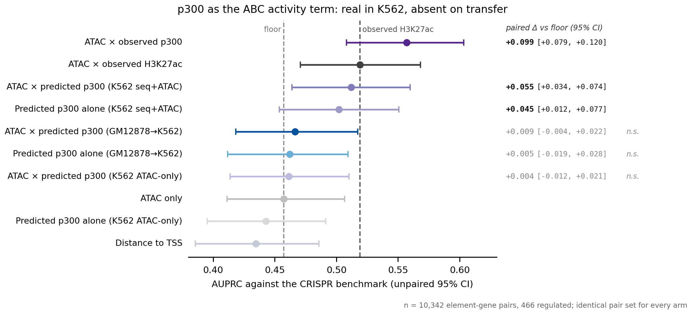

**Figure 1 | Predicted p300 clears the ABC benchmark floor in the training cell type and not on transfer.**

> **Superseded (F-025, 2026-09-19):** the GM12878-trained arm was trained on a BPNet model's predicted plus strand; retrained on the observed target it scores +0.0135 [-0.0003, +0.0270] over the floor, still not resolvable, with a transfer penalty of +0.0414 [+0.0256, +0.0558].

<details>
<summary>Full legend</summary>

**Figure 1 | p300 as the ABC activity term, K562 CRISPR benchmark, nine arms plus
distance-to-TSS.** 10,342 element-gene pairs, 466 regulated, every arm scored on the same
pair set. Error bars are the pipeline's **unpaired** 95% intervals, which overlap for every
arm; the paired-bootstrap delta against the floor is printed at the right (bold if
resolvable, grey `n.s.` if not). Dashed lines: ATAC-only floor (0.457)
and observed H3K27ac (0.519). Observed p300 is highest at **0.557** (+0.099 [+0.079, +0.120]
over the floor); K562-trained predicted p300 reaches **0.512**, matching measured H3K27ac; the
GM12878-trained arm applied to K562 (**0.466**) sits at the floor with the K562 ATAC-only p300
model. Fig. 10 is the H3K27ac equivalent. Source:
`CRISPR_comparison_v3/.../results/2026_0906_p300_all/performance_summary.txt`, paired deltas
from `scripts/4.17`.
</details>

## Summary

- In K562, predicted p300 from a sequence + ATAC model beats the floor (ABC with ATAC alone as its activity term) by **+0.055 [+0.034, +0.074]** CRISPR-benchmark AUPRC, matching measured H3K27ac, and observed p300 beats observed H3K27ac by +0.038 [+0.019, +0.058] (Fig. 1; F-008, F-024). Predicted H3K27ac from the same architecture reading ATAC does not clear the floor (+0.025 [-0.003, +0.052]); reading DNase, it does, by +0.0403 [+0.0230, +0.0563] (F-018).
- On transfer (training in one cell type, predicting in another) the p300 gain is lost. The GM12878 -> K562 arm was trained on a corrupted target; retrained it scores +0.0135 [-0.0003, +0.0270] with a transfer penalty of +0.0414, and the p300 transfer asymmetry reported here (+0.207 against +0.006) was measured with the corrupted model (F-025).
- DNase in place of ATAC as the model's input gains +0.037 top-quintile Pearson (on the 20% of elements with the most observed signal) in-cell K562 and +0.086 in GM12878. The transfer result is withdrawn: the transferred model is -0.045 [-0.080, -0.010] below an assay-matched DNase-only floor, and no H3K27ac model transfers in any of six directions over three cell types (F-010, F-016).
- In-cell architecture gains do not travel: no architecture beats the simplest on transfer (best +0.016, *p*=0.066), and fragment channels are exactly null in both directions. Sequence-gated accessibility, an asymmetric count loss, GC-matched negatives and p300 as an auxiliary head all failed.
- The over-predicted elements are accessible but unacetylated, and CTCF is a passenger: CTCF-high elements are 27% of that tail and the rest are over-predicted more. Predicted H3K27ac is accurate (Spearman 0.794) but compressed at regulated elements, and ABC's rank-based quantile normalisation (qnorm) discards scale, so rescaling fixes are null by construction (F-022).

## Goals

This report records each architecture and input change tried on the H3K27ac target and its
verdict, then the downstream ABC/CRISPR results. Ceilings are in Report 1; scoring rules are
in Report 2, which should be read before quoting a number from here.

The decision table quotes reverse-complement-averaged values (the scoring default since
2026-09-03); figures and section text quote single-pass values. They differ by +0.002 to
+0.016 and change no verdict (Methods lists every pair).

## Decision table

Effect is the paired within-fold change in top-quintile Pearson *r* on K562 H3K27ac unless
stated; between-fold `sd` is 0.041-0.046 (Report 2). Architecture rows are one training run
per condition; F-020 later measured a run-to-run sd of 0.00180 in validation count Pearson
between two trainings of one configuration, so effects of that order need repeat seeds.

| Change | Effect on the top quintile | Verdict |
|---|---|---|
| **Inputs: sequence only** | 0.397 [0.344, 0.451] absolute | reference |
| **Inputs: ATAC only** | 0.551 [0.500, 0.601] absolute | reference |
| **Inputs: sequence + ATAC** | 0.695 [0.677, 0.713] absolute | **adopted** |
| **Target: p300 instead of H3K27ac** | sequence margin +0.304 against +0.127 | p300 is the better substrate for sequence; H3K27ac is the required target (superseded, F-024: p300 is now the default target) |
| **Objective: residual instead of total** | sequence +0.254, multimodal **-0.018** | attribution work only; joint training predicts better |
| **Receptive field ~1.1 -> ~4.2 kb** | multimodal **+0.028** (*p*=0.004); GM12878 +0.016 (*p*=0.023); ATAC-only +0.017; sequence-only -0.007 (*p*=0.40) | **adopted for accessibility-input models**; the gain is accessibility neighbourhood, not sequence context |
| **Accessibility: 5 fragment-size channels vs flat** | **+0.016** (*p*=0.002); GM12878 +0.006 (*p*=0.031) | **adopted** |
| **Both: wide + fragments** | +0.034 vs narrow+flat; **+0.007 on top of wide alone** (*p*=0.053) | sub-additive (~79%); take the receptive field, fragments are nearly redundant with it |
| **Inference: reverse-complement averaging** | +0.008 multimodal, +0.016 sequence-only, +0.002 ATAC-only (n.s.) | **adopted as the default** |
| **Accessibility: 5' insertion counts vs full-interval** | ATAC-only **+0.033** (*p*=0.010); multimodal +0.004 (n.s.) | **adopted**, to remove the cross-cell-type read-length confound (Report 1) |
| **Elements: ATAC-derived instead of DNase-derived** | -0.001 [-0.015, +0.013] (*p*=0.83) | no measurable effect |
| **Counting window +/-500 bp** | ceiling nearly saturated, zero neighbour contamination | keep (Report 1, Fig. 3) |
| **`count_loss_weight` = 10** | only the extremes 1 and 1000 are resolvable | keep; flat region |
| **Profile head at 1 bp** | ceiling 0.21; models reach 0.114-0.171 | uninformative; removal untested |
| **Architecture choice on transfer** | no arm beats narrow+flat resolvably (best +0.016, *p*=0.066) | in-cell gains do not travel |
| **Predicted H3K27ac as the ABC activity term** | AUPRC 0.482 against a floor of 0.457 and a ceiling of 0.519 | does not clear the floor; deployment arms at or below it (superseded, F-018, F-019: a DNase-input model and an ATAC-input retrain clear it) |
| **Predicted p300 as the ABC activity term, in-cell** | **+0.055 [+0.034, +0.074]** over the floor, paired | real; matches measured H3K27ac |
| **Predicted p300 as the ABC activity term, GM12878 -> K562** | **+0.009 [-0.004, +0.022]** over the floor | **null** (superseded, F-025: corrupted target; retrained +0.0135, still null) |
| **Predicted p300, correlation metric, K562 -> GM12878** | **+0.207 [+0.158, +0.257]** over the target's ATAC-only model; 83% of local | transfers; the benchmark cannot test this direction (superseded, F-025: the asymmetry's other arm is the corrupted GM12878 model) |
| **Observed p300 instead of observed H3K27ac as the activity term** | **+0.038 [+0.019, +0.058]** | use p300 where measured |
| **p300 as a second head alongside H3K27ac** | predicted p300 1.83x against a 2.10x input control at the H3K27ac failure elements | **dropped**; p300 as the *primary* target is the version that works |
| **DNase instead of ATAC as the accessibility input** | **+0.037** in-cell K562, **+0.086** in-cell GM12878, **+0.043** transferred; clears the target's floor by **+0.056** | **adopted**; first model to clear the floor on transfer (superseded, F-016: below an assay-matched floor) |
| **Sequence-gated accessibility, and asymmetric count loss** | in-cell null; **-0.013 (*p*=0.039) transferred when combined** | **closed** |
| **GC-matching the training negatives** | +0.001 (*p*=0.76) in-cell; -0.002 (*p*=0.33) transferred | **closed**; GC-shortcut explanation refuted |

## Accessibility carries most of the H3K27ac signal, and sequence adds a small real complement

**Q:** How much of H3K27ac at candidate elements is predictable from sequence, from
accessibility, and from both?

**A:** Accessibility carries most of it: on the top quintile ATAC alone reaches 0.551
[0.500, 0.601], sequence alone 0.397 [0.344, 0.451] and both 0.695 [0.677, 0.713], so
sequence adds +0.144 over accessibility and accessibility adds +0.298 over sequence.

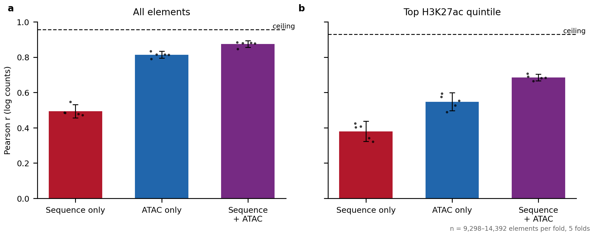

<details>
<summary>Figure 2 legend</summary>

**Figure 2 | Predicting K562 H3K27ac at candidate elements, by input modality.** Pearson *r*
between predicted and observed log counts. **a**, All elements. **b**, Top quintile by
observed H3K27ac. Colour encodes input modality in all three reports: **red sequence only,
blue ATAC only, purple sequence + ATAC**. Dashed line is the ceiling (Report 1): 0.957 all
elements, 0.929 top quintile. Plotted single-pass top-quintile values: sequence 0.380 [0.323,
0.437], ATAC 0.548 [0.497, 0.599], both 0.685 [0.667, 0.704], all intervals disjoint. The
multimodal model's fold-to-fold sd (0.015) is a third of either single-input model's
(0.041-0.046). Target K562 H3K27ac (ENCSR000AKP), 5' end counts, 1 kb element-centred window.
Source: `results/{,rc_}fiveprime_stratified_fold_summary.tsv`.
</details>

Sequence + ATAC is the baseline for every later comparison: 75% of the corrected ceiling on
the top quintile, against 59% for ATAC alone and 43% for sequence alone. The all-elements and
top-quintile panels give different effect sizes (Report 2).

**Method.** Three input modes, five chromosome-holdout folds each, everything else identical;
reported on the top quintile by observed signal, with all elements alongside.

<details>
<summary>Full methods &amp; code</summary>

```bash
sbatch scripts/2.2.submit_evaluate.sh
sbatch scripts/2.22.submit_rc_rescore.sh    # the rc_ values quoted in the decision table
```
Source: `scripts/2.2.evaluate_stratified.py`, `scripts/2.15.perfold_from_config.py`
</details>

## Sequence contributes less to H3K27ac than to p300, by a factor of 2.2

**Q:** Does sequence add as much information beyond accessibility for H3K27ac as for p300?

**A:** No: sequence adds +0.304 over accessibility for p300 and +0.127 for H3K27ac, a
difference of 0.177 +/- 0.027 (about 6.6 SE), although H3K27ac scores higher overall.

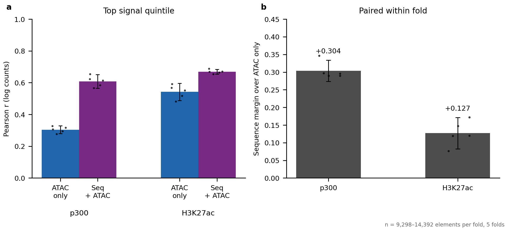

<details>
<summary>Figure 3 legend</summary>

**Figure 3 | H3K27ac is the easier target but the weaker substrate for sequence.** Top quintile by observed signal. **a**, ATAC-only (blue) and sequence + ATAC (purple) per target; bars are the fold mean, whiskers the 95% CI, points the folds. p300 (ENCSR000EGE, stranded 5' ends): 0.304 [0.280, 0.329] and 0.608 [0.566, 0.651]. H3K27ac (ENCSR000AKP): 0.542 [0.489, 0.596] and 0.669 [0.654, 0.684]. **b**, Sequence margin (sequence + ATAC minus ATAC-only), computed within fold and then averaged; the intervals do not overlap. No p300 sequence-only model exists in this format (those are bpnet-refactor/TensorFlow checkpoints). Same K562 DNase candidate elements and +/-500 bp windows for both targets. Caveat: the p300 models were trained on ENCSR000EGE peak summits and are evaluated on element centres, which likely understates p300 and so widens rather than closes the gap. Source: `results/p300_vs_h3k27ac_stratified_per_fold.tsv`.
</details>

**Method.** Same elements, windows, folds and metric for both targets. The accessibility-only
control makes the sequence margin identifiable; on joint-model correlation alone the two
targets rank in the opposite order.

<details>
<summary>Full methods &amp; code</summary>

p300 models: `2026_0529_multimodal_p300_model/models/atac` (sequence + ATAC, despite the name) and `models/atac_only` (ATAC only).

```bash
pixi run python scripts/2.2.evaluate_stratified.py \
    --config-json config/compare_configs.json --out-prefix p300_vs_h3k27ac_ \
    --elements reference/K562_DNase_candidate_elements.narrowPeak \
    --fold-json reference/hg38_five_folds.json --outdir results --figdir figures
```
Source: `scripts/2.2.evaluate_stratified.py`
</details>

## The residual objective helps only a sequence-blind input, replicated in two cell types

**Q:** Does sequence carry information that accessibility cannot supply?

**A:** Yes, but only a residual objective exposes it: the same sequence-only input scores
0.149 [0.076, 0.222] on the accessibility residual when trained on total signal and 0.459
[0.421, 0.496] when trained on the residual, `observed − atac_pred` (what an
accessibility-only model fails to explain).

Trained on total signal, the sequence model spends its capacity on the
accessibility-correlated component. The same switch costs a model that already sees
accessibility, and both results reproduce in GM12878 (Fig. 4).

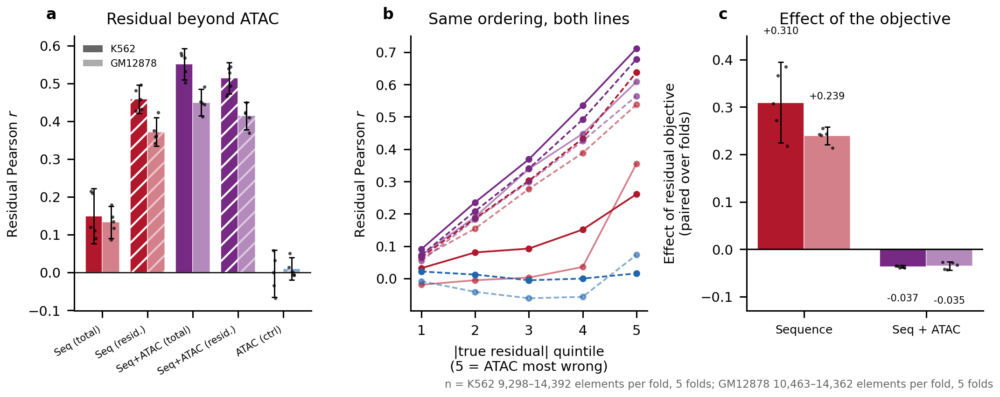

<details>
<summary>Figure 4 legend</summary>

**Figure 4 | The residual objective helps a sequence-blind input and costs a multimodal one, in two cell types.** Baseline is each cell type's own accessibility-only model. Hatched = trained on `observed − atac_pred`; solid K562, pale GM12878; bars of the same colour and shade have identical inputs. **a**, Residual Pearson *r*, K562 / GM12878: sequence-on-total 0.149 / 0.133; sequence-on-residual 0.459 / 0.372; multimodal-on-total 0.551 / 0.449; multimodal-on-residual 0.514 / 0.414; ATAC control −0.003 / +0.010. **b**, Residual *r* by quintile of |true residual| (5 = accessibility most wrong); every informative model rises monotonically and the ATAC control stays at zero in all ten strata. **c**, Paired effect of switching objective, within fold: sequence-only **gains** +0.310 [0.224, 0.395] (K562, *p*=5×10⁻⁴) and +0.239 [0.220, 0.258] (GM12878, *p*<10⁻⁴); multimodal **loses** −0.037 [−0.039, −0.034] (*p*<10⁻⁴) and −0.035 [−0.044, −0.026] (*p*=4×10⁻⁴), negative in all ten folds. n = 58,655 (K562) and 57,144 (GM12878) element-fold observations. Source: `results/{,gm12878_}residual_grid_{per_fold,fold_summary,residual_evaluation}.tsv`.
</details>

**The residual objective costs the multimodal model.** A multimodal model can already learn
whatever transform of ATAC it needs, and a fixed offset removes that freedom. Joint training
remains the best predictor, beating residual-trained sequence by +0.093 [0.072, 0.113].

**The metric is not manufacturing the effect.** An ATAC-input model trained on the residual
scores −0.003 [−0.065, 0.060], incremental *R²* −0.000, flat across all |residual| quintiles.

**GM12878 reproduces every sign and ordering**, with the multimodal cost within 0.002,
despite weaker ATAC-H3K27ac coupling (0.409 vs 0.510) and a higher ceiling (0.832 vs 0.760).

Use residual training for attribution, where forcing the model onto signal accessibility
cannot supply is the goal, and joint training for prediction.

**Method.** Baseline is the accessibility-only model's held-out prediction. Performance is
stratified by |true residual|, so it is scored where accessibility fails; mean +/- 95% CI
over folds.

<details>
<summary>Full methods &amp; code</summary>

**Artefact check.** Because `true_resid = obs − atac_pred`, anything anti-correlated with `atac_pred` could score for free. The ATAC control correlates −0.620 with `atac_pred` and still scores −0.003; the residual-trained sequence model correlates only −0.090 with it, and partialling `atac_pred` out of both sides leaves 0.459 unchanged (against 0.149 -> 0.205 for sequence-on-total, at +0.477).

**Trap for re-runs.** `MultiModalBPNet.forward()` does **not** add the count offset (only `fit()` does), so an offset-trained model's raw output *is* the residual. `2.4.evaluate_residual.py` originally subtracted `atac_pred` again, giving plausible wrong numbers; the fix sits behind a `"residual": true` config key. The evaluator refuses mismatched windows and folds lacking `training_complete.json`. `2.7.diagnose_residual_offset.py` checks the semantics first: a residual predictor centres near 0 (measured −0.044), a logcounts predictor near the observed mean (2.835 vs 2.786).

For p300 the same metric gives residual *r* = 0.654 and incremental *R²* = +0.265, against 0.551 and +0.102 for H3K27ac, and 0.260 against 0.091 in the quintile where accessibility is nearly right. p300 has **not** been re-run with the residual objective.

```bash
# semantics check, then the pooled evaluation
pixi run python scripts/2.7.diagnose_residual_offset.py
pixi run python scripts/2.4.evaluate_residual.py \
    --config-json config/residual5p_eval_configs.json --out-prefix residual5p_ \
    --elements reference/K562_DNase_candidate_elements.narrowPeak \
    --genome $GEN --signal-bw data/h3k27ac_5p_plus.bw \
    --accessibility-bw $ATAC --fold-json reference/hg38_five_folds.json \
    --outdir results --figdir figures

# the full grid: 3 standard + 3 residual-objective models
pixi run python scripts/2.4.evaluate_residual.py \\
    --config-json config/residual_grid_eval_configs.json --out-prefix residual_grid_ ...
# per-fold CIs + artifact controls, then the figure
pixi run python scripts/2.8.residual_perfold_and_artifact.py residual_grid_
pixi run python scripts/3.3.plot_residual_figure.py
```
Source: `scripts/2.4.evaluate_residual.py`, `scripts/2.7.diagnose_residual_offset.py`, `scripts/2.8.residual_perfold_and_artifact.py`, `scripts/3.3.plot_residual_figure.py`
</details>

## A wider receptive field helps only when accessibility is an input

**Q:** Does widening the receptive field from ~1.1 kb to ~4.2 kb help, given that the mark
extends well past ~1.1 kb (Report 1, Fig. 2)?

**A:** Only with accessibility as an input: sequence + ATAC gains +0.027 (K562) and +0.014
(GM12878) on the top quintile, while sequence alone gains nothing there (−0.006 and +0.010,
p = 0.53 in both).

Sequence alone gains only on all elements (+0.043 and +0.045). Sequence + ATAC lifts its
accessibility residual from 0.502 to 0.547 (K562) and from 0.397 to 0.469 (GM12878), so the
useful long-range information is in the accessibility track.

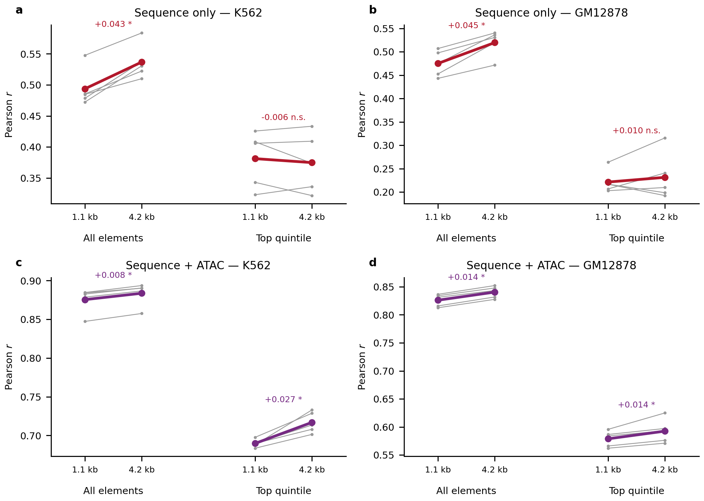

<details>
<summary>Figure 5 legend</summary>

**Figure 5 | Quadrupling the receptive field helps sequence + ATAC on the elements carrying the mark and sequence alone not at all.** `n_layers` 8 (trimming 557, 2,114 bp input, ~1.1 kb receptive field) against `n_layers` 10 (trimming 2,093, 5,186 bp input, ~4.2 kb). Grey lines are folds, coloured line the mean; paired within fold. **a**, **b**, Sequence only: all elements 0.494 -> 0.537 in K562 (p = 0.003) and 0.475 -> 0.520 in GM12878 (p = 0.005); top quintile 0.381 -> 0.375 and 0.221 -> 0.232. **c**, **d**, Sequence + ATAC, top quintile: 0.690 -> 0.717 in K562 (p = 0.006) and 0.579 -> 0.593 in GM12878 (p = 0.025), all five folds rising in both. Scored on the intersection of regions both models accept; in K562 the per-fold element counts are identical at both sizes (10,143 / 14,392 / 12,801 / 12,021 / 9,298). Only `n_layers` and the derived window geometry differ between arms. Source: `results/wide_{k562,gm12878}_per_fold.tsv`.
</details>

**Method.** The wide scripts are the existing submit scripts with three edits (`n_layers`,
the derived trimming sum, the output directory), scored on the intersection of valid regions.

<details>
<summary>Full methods &amp; code</summary>

```bash
pixi run python scripts/make_wide_scripts.py
for M in sequence multimodal atac; do for F in 0 1 2 3 4; do
    sbatch scripts/1.13.submit_training_5prime_wide.sh $M $F
    sbatch scripts/1.14.submit_training_gm12878_wide.sh $M $F
done; done
sbatch scripts/2.17.submit_regression_and_wide.sh wide
```
Source: `scripts/make_wide_scripts.py`, `scripts/2.17.submit_regression_and_wide.sh`
</details>

## Fragment-size-stratified accessibility adds real information

**Q:** Does adding fragment length, which flat ATAC coverage discards and which separates
nucleosome-free from nucleosome-occupied DNA, improve prediction?

**A:** Yes, on the top quintile: +0.0135 [+0.0075, +0.0195], p = 0.0034, taking sequence +
ATAC from 0.690 to 0.703, with the accessibility residual rising from 0.502 to 0.516.

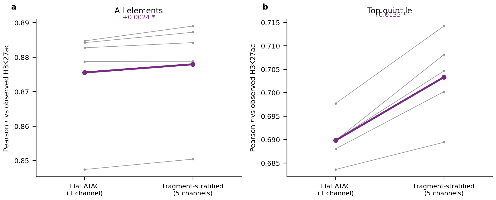

<details>
<summary>Figure 6 legend</summary>

**Figure 6 | Five fragment-size accessibility channels beat one flat channel on the elements carrying H3K27ac.** K562 sequence + ATAC, 5 folds, paired within fold. Accessibility input is `[all, sub ≤139, mono 140–329, di 330–620, poly ≥621]` bp, each a single-base Tn5 insertion count. **a**, All elements 0.876 -> 0.878 (paired +0.0024, p = 0.030). **b**, Top quintile, every fold rising. The four length bins sum exactly to the flat 5' track (zero discrepancy across 545,661,218 insertions; zero largest single-base difference over 2 Mb), so the input is a strict superset of the baseline. Bin edges sit in the troughs of the fragment-length distribution (Report 1, Fig. 5); the earlier full-fragment `sub`/`mono` channels are superseded. The Tn5 shift was measured against the existing track (*r* = 1.0000 at +4/−5). Source: `results/fragchan_k562_per_fold.tsv`.
</details>

**Method.** Channels come from the paired-end BAMs (fragment length is in TLEN) and the flat
track from tagAligns; agreement to the base confirms they hold the same reads. `n_acc_filters`
stays 8, so the merged representation is still 64 + 8 wide.

<details>
<summary>Full methods &amp; code</summary>

```bash
sbatch scripts/0.22.calibrate_tn5_shift.sh
PLUS_DELTA=4 MINUS_DELTA=-5 sbatch scripts/0.23.make_atac_fragment_5p_channels.sh
pixi run python scripts/0.24.validate_atac_fragment_channels.py
pixi run python scripts/make_fragchan_scripts.py
for F in 0 1 2 3 4; do sbatch scripts/1.15.submit_training_fragchan.sh multimodal $F; done
sbatch scripts/2.17.submit_regression_and_wide.sh fragchan
```
Source: `scripts/0.23`, `scripts/0.24`, `scripts/1.15`, `scripts/3.9`
</details>

## Test-time reverse-complement averaging is free and always helps

**Q:** Training already augments with reverse complements; does averaging each prediction
with its reverse complement at inference add anything?

**A:** Yes, in proportion to reliance on sequence: +0.0162 for sequence only, +0.0081 for
sequence + ATAC, and +0.0016 for ATAC only, the negative control and the one non-significant
result.

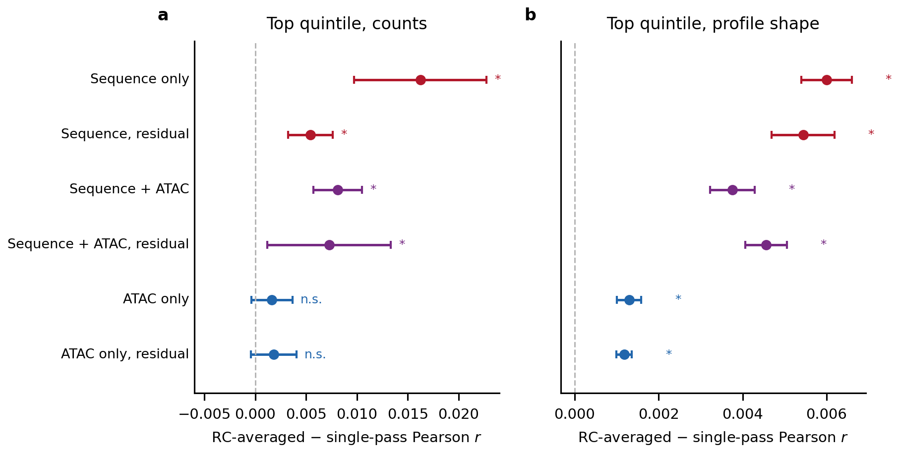

<details>
<summary>Figure 7 legend</summary>

**Figure 7 | Reverse-complement averaging at inference, paired within fold, ordered by reliance on sequence.** K562 residual grid, 5 folds; points are mean paired differences, bars t-based 95% CIs. **a**, Top quintile counts: sequence only +0.0162 [+0.0097, +0.0227], p = 0.0023; sequence + ATAC +0.0081 [+0.0057, +0.0105], p = 0.0007; residual-trained sequence +0.0054 and multimodal +0.0073, both significant; ATAC only +0.0016 [−0.0004, +0.0036], p = 0.086, and its residual counterpart +0.0018, p = 0.090. **b**, Top quintile profile shape, significant for every model, +0.0012 to +0.0060. RC averaging cancels strand asymmetry in the sequence branch, so an unstranded-accessibility-only model has nothing to gain. Predictions are averaged in probability space over the flattened strand-and-position multinomial. Cost is one extra forward pass. Source: `results/prof_{,rc_}residual_grid_per_fold.tsv`.
</details>

**Method.** The reverse complement flips the one-hot channel and position axes; accessibility
is reversed along position only, and profiles are un-flipped with strands swapped before
averaging. A wrong control that reverses without complementing agrees with the forward pass
at *r* = 0.9485, against 0.9918 for the correct transform. Enabled with `--rc-average`.

<details>
<summary>Full methods &amp; code</summary>

```bash
sbatch scripts/2.19.submit_profile_and_rc.sh
pixi run python scripts/3.10.plot_rc_averaging.py
```
Source: `scripts/2.15.perfold_from_config.py` (`--rc-average`), `scripts/2.20.paired_delta_between_runs.py`
</details>

## A sharper accessibility input helps the ATAC-only model and nothing else

**Q:** Our accessibility tracks use `genomecov -bg` over the whole tagAlign interval, so
coverage scales with read length; ChromBPNet uses single-base 5' insertion counts. Does the
convention matter?

**A:** Only for the model whose sole input is accessibility: ATAC-only gains +0.032 (K562)
and +0.023 (GM12878) on the top quintile, and sequence + ATAC is unchanged in both.

A 94-95 bp interval smears each insertion across ~95 bases. A model with only accessibility
feels that blur; a model that also sees sequence already has the positional detail.

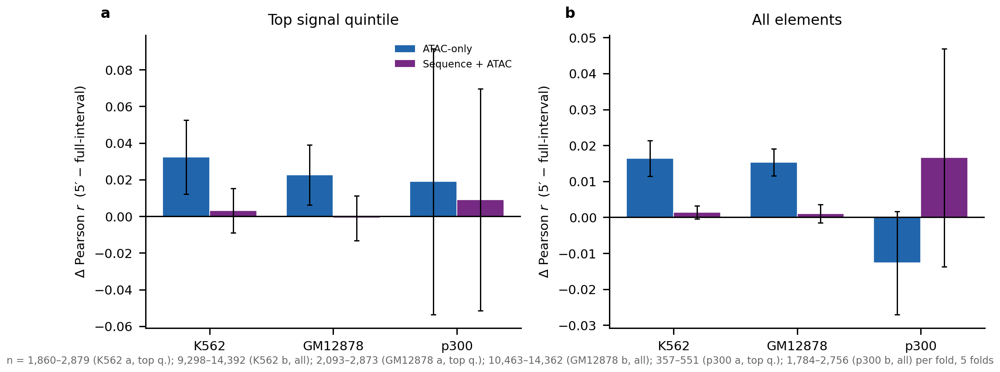

<details>
<summary>Figure 8 legend</summary>

**Figure 8 | Sharpening the accessibility input helps only a model with no other input.** Every ATAC-input model retrained on `bedtools genomecov -bg -5` single-base insertion counts, paired within fold against its full-interval counterpart. **a**, Top quintile. ATAC-only: K562 **+0.032** [0.012, 0.053] *p*=0.011; GM12878 **+0.023** [0.006, 0.039] *p*=0.019; p300 +0.019 [−0.054, 0.092] *p*=0.51. Sequence + ATAC: +0.003, −0.001, +0.009, none significant. **b**, All elements: ATAC-only +0.016 (*p*=0.001) and +0.015 (*p*<0.001), multimodal +0.001 in both. p300 is underpowered (11,412 elements pooled against 57,144 for H3K27ac, intervals roughly 5× wider). Source: `results/accs5p_{k562,gm12878,p300}_stratified_per_fold.tsv`.
</details>

**Method.** Training scripts differ only in the accessibility path and output directory. Both
arms are scored in one run, each with its own input and saved normalisation statistics.

<details>
<summary>Full methods &amp; code</summary>

The convention matters across cell types: K562 and GM12878 tagAligns are 94-95 bp, TeloHAEC's 35-36 bp, and 5' tracks are read-length independent. Check: `sum(full-interval) / sum(5′)` equals the mean read length; measured 84.5 and 85.6 for K562/GM12878 and 30.9-35.5 for the four TeloHAEC conditions. With read length removed, the K562-vs-TeloHAEC gap falls from 13-27× to 5.3-12.3× nuclear depth.

ChromBPNet's convention (`chrombpnet/helpers/preprocessing/reads_to_bigwig.py`): `bedtools genomecov -bg -5`, unstranded, with ATAC shift `4-plus_shift, -4-minus_shift` and DNase `-plus_shift, 1-minus_shift`, applied before `-5`. Our tagAligns are already Tn5-shifted, so the build reduces to adding `-5`; shifting again would double-shift. Mixing the two inputs across results is invalid.

```bash
pixi run bash scripts/0.20.make_atac_5prime_bigwigs.sh    # build *_atac_5p.bw
pixi run python scripts/0.21.validate_atac_5prime.py      # ratio == mean read length
pixi run bash scripts/2.10.submit_accs5p_comparison.sh    # paired evaluation
pixi run python scripts/3.5.plot_accs5p_figure.py         # Fig 8
```
Source: `scripts/0.20`, `0.21`, `2.10`, `3.5`; training scripts `1.11`, `1.12` (H3K27ac), and `1.1b`, `1.3b` (p300), generated by `scripts/make_accs5p_scripts.py`.
</details>

## GM12878 is the harder cell type to predict, in both transfer directions

**Q:** Does the sequence component fail to generalise across cell types, or is one cell type
harder to predict?

**A:** Mostly the latter: GM12878-trained models score higher on K562 than in GM12878 for
every modality (sequence 34% vs 23% of ceiling).

Sequence is still weak in all four settings (15-41% of ceiling against 50-59% for
accessibility), and its margin over accessibility shrinks on transfer in both directions
(+0.138 -> +0.044; +0.086 -> +0.061). The inter-replicate ceiling cannot show which cell type
is harder: it measures how reproducibly the target is measured, not how strongly the inputs
determine it.

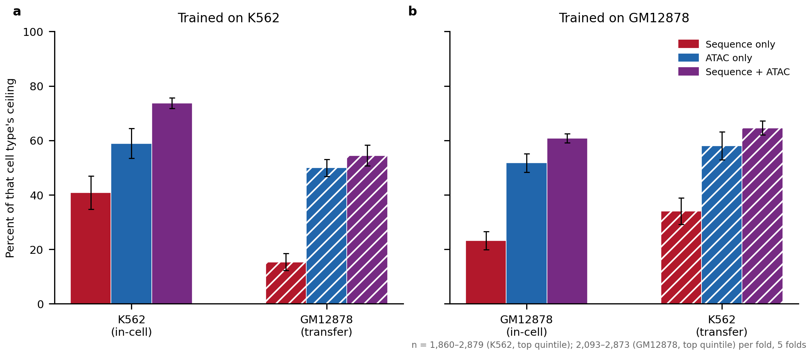

<details>
<summary>Figure 9 legend</summary>

**Figure 9 | Both transfer directions, each scored against the ceiling of the cell type being predicted.** Top-quintile Pearson as a percentage of that cell type's corrected ceiling. Solid = in the training cell type, hatched = transferred. **a**, Trained on K562. **b**, Trained on GM12878 with identical settings. Absolute values (sequence / ATAC / both): K562->K562 0.380 / 0.548 / 0.685; K562->GM12878 0.146 / 0.476 / 0.519; GM->GM 0.221 / 0.493 / 0.579; GM->K562 0.317 / 0.539 / 0.600; as % of ceiling 41/59/74, 15/50/54, 23/52/61, 34/58/65. Sources: `results/{fiveprime,k562_to_gm_5p,gm_incell,gm_to_k562}_stratified_fold_summary.tsv`.
</details>

**Method.** Both transfer directions and both in-cell references, each against the ceiling
of the cell type being predicted. The GM12878 ceiling agrees across both target processings
(top quintile 0.832 on 5' ends, 0.834 otherwise).

<details>
<summary>Full methods &amp; code</summary>

```bash
pixi run python scripts/2.2.evaluate_stratified.py \
    --config-json config/gm_transfer_configs.json --out-prefix gm12878_transfer_ \
    --elements 2026_0606_GM12878_transferability/reference/GM12878_candidate_elements.narrowPeak \
    --fold-json reference/hg38_five_folds.json --outdir results --figdir figures
```
Source: `scripts/2.2.evaluate_stratified.py`, `scripts/0.7.make_gm12878_5prime.sh`
</details>

## For a new cell type with only ATAC, transfer the multimodal model

**Q:** In the intended application the new cell type has ATAC but no H3K27ac. Which model
should be transferred?

**A:** The multimodal one: it matches the residual alternative on the top signal quintile and
needs no offset model shipped alongside it.

**Top signal quintile, deployable configuration** (everything transferred; only target ATAC used):

| | ATAC-only | sequence only | multimodal | residual multimodal |
|---|---|---|---|---|
| K562 -> GM12878 | 0.477 | 0.147 | **0.520** | 0.512 |
| GM12878 -> K562 | 0.541 | 0.317 | **0.602** | 0.600 |

Every sequence-containing model beats transferred ATAC-only by 0.04-0.06 on the top quintile.

> **Superseded (F-016, 2026-09-14):** scored against the target's own locally trained DNase-only model, no sequence + DNase H3K27ac model beats it on transfer in any of six directions over three cell types; the 0.04-0.06 here is over a transferred ATAC-only model, not a local one.

Accessibility must be measured in the target: transferring the ATAC baseline costs only
~0.017 against fitting it locally (0.494 -> 0.477), while sequence-only transfer is useless.

A shallow target H3K27ac library, enough to fit an ATAC-only model, would make the residual
architecture preferable: with the baseline fitted in the target, residual beats multimodal by
+0.005 to +0.011 on all elements (*p* < 0.01 both directions).

**Method.** Two offset variants per direction: the target's own ATAC model (an upper bound,
since it needs target H3K27ac) and the transferred source ATAC model (deployable). Scored
against observed H3K27ac in the target, paired within fold.

<details>
<summary>Full methods &amp; code</summary>

On all elements, residual-multimodal beats multimodal by +0.005 (K562->GM, *p*=0.009) and +0.011 (GM->K562, *p*=0.003) with a locally fitted baseline and loses by −0.005 (*p*=0.012, 0.022) with a transferred one. None of it is resolvable on the top quintile (*p* = 0.17-0.76); all-elements correlation is dominated by the dead-versus-active contrast accessibility already resolves.

```bash
pixi run bash scripts/2.13.submit_residual_transfer.sh    # upper bound: local offset
pixi run bash scripts/2.14.submit_deployment_transfer.sh  # deployable: transferred offset
pixi run bash scripts/2.16.submit_transfer_perfold.sh     # per-fold CIs + paired tests
```
Per-fold scoring uses `scripts/2.15.perfold_from_config.py`, driven by the same config JSON as `2.4`, so in-cell grids and transfer runs share one code path.
</details>

## No architecture transfers better than the simplest

**Q:** The receptive-field and fragment-channel gains were measured in the training cell
type. Which architecture should be deployed to a new cell type?

**A:** None beats the simplest: every transferred architecture lands within 0.016 of it on
the top quintile in both directions, the two in-cell gains lose significance, and the richer
models have the *larger* transfer drops.

**Top-quintile Pearson, transferred against the target cell type's own ATAC-only model:**

| | K562 -> GM12878 | GM12878 -> K562 |
|---|---|---|
| target's own ATAC-only model (the floor) | 0.518 | 0.584 |
| narrow + flat, transferred | 0.531 | 0.614 |
| wide + flat, transferred | 0.542 | 0.620 |
| narrow + fragments, transferred | 0.530 | 0.611 |
| wide + fragments, transferred | 0.547 | not run |
| *best locally trained model, for scale* | *0.602* | *0.733* |

**Paired within-fold differences against narrow + flat, transferred:**

| | K562 -> GM12878 | GM12878 -> K562 |
|---|---|---|
| wide + flat | +0.0115 [-0.0059, +0.0288] *p*=0.14 | +0.0053 [-0.0161, +0.0268] *p*=0.53 |
| narrow + fragments | -0.0012 [-0.0185, +0.0162] *p*=0.86 | -0.0029 [-0.0267, +0.0208] *p*=0.75 |
| wide + fragments | +0.0159 [-0.0017, +0.0335] *p*=0.066 | not run |

**Fragment channels do not travel**, despite a real in-cell gain (*p*=0.002). Fragment-length
structure belongs to a particular ATAC library as much as to the chromatin, and a paired
in-cell test cannot separate the two.

**The wider receptive field is directionally positive but not significant.** It is the only
arm worth carrying forward.

**The better in-cell models lose more on transfer.** Local minus transferred, top quintile:
narrow + flat +0.0546 and +0.0847, wide + flat +0.0593 and +0.1073, narrow + fragments +0.0613
and +0.1033 (all *p* < 0.006). Every change that helped locally fitted cell-type-specific
structure.

**Transfer buys +0.013 to +0.036 over the target's own ATAC-only model**, against locally
trained models at 0.602 and 0.733. Transferred `residual_pearson` is 0.212-0.262 where a
local model reaches 0.406-0.481: about half of what a model extracts beyond accessibility is
lost.

**Method.** One config JSON per direction through `2.15.perfold_from_config.py`; each
direction includes the target's ATAC-only floor and each architecture's local counterpart;
all arms RC-averaged.

<details>
<summary>Full methods &amp; code</summary>

Pairings: transferred against `atac_LOCAL` (does transfer beat the target's own accessibility?); wide against narrow and fragments against flat, both transferred (does each gain travel?); local against transferred per architecture (the transfer drop). There is no GM12878 wide + fragment model, because GM12878's paired-end BAMs arrived later.

```bash
sbatch scripts/2.24.submit_transfer_matrix.sh
```
Source: `scripts/make_transfer_matrix.py`, `scripts/2.24.submit_transfer_matrix.sh`,
`results/txmatrix_{k562_to_gm12878,gm12878_to_k562}_{per_fold,fold_summary}.tsv`
</details>

## Predicted H3K27ac does not improve ABC

> **Superseded (F-018, 2026-09-15):** this holds for the ATAC-input model only; the same architecture reading DNase clears the floor by +0.0403 [+0.0230, +0.0563] with ATAC in the geomean, and a 100-epoch ATAC-input retrain clears it by +0.0208 [+0.0039, +0.0373], a gain whose cause is unresolved (F-019, F-020).

**Q:** Substituted for observed H3K27ac in ABC's activity term, do the predictions recover
CRISPR-benchmark performance?

**A:** No: the best predicted arm reaches AUPRC 0.482 [0.437, 0.530] against a floor of
0.457 (ATAC-only activity) and a ceiling of 0.519 (ATAC x observed H3K27ac), and the two
GM12878-trained deployment arms land at 0.455 and 0.452.

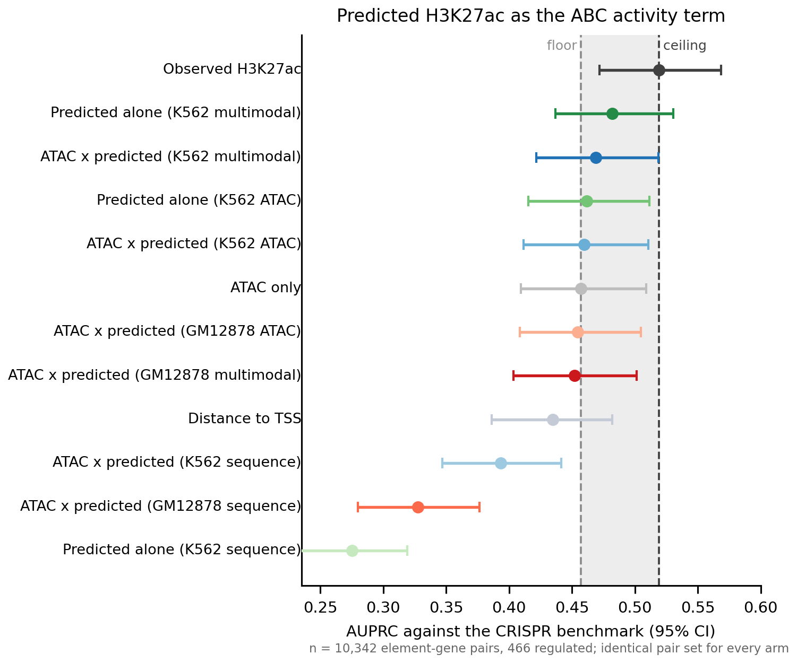

<details>
<summary>Figure 10 legend</summary>

**Figure 10 | CRISPR-benchmark AUPRC for eleven predicted-H3K27ac arms, K562.** Same layout,
floor and ceiling as Fig. 1; the two runs agree on both shared anchor arms to 1e-4. The best
arm uses predicted H3K27ac from the K562 multimodal model as the entire activity term; its
geometric mean with observed ATAC scores 0.469. Every sequence-only arm is below
distance-to-TSS (0.435), the opposite of p300. Source:
`.../results/2026_0904_predicted_activity/performance_summary.txt`,
`results/paired_auprc_h3k27ac.tsv`.
</details>

Observed H3K27ac itself is only 0.062 above the floor, so a predicted replacement has little
room. Paired bootstrap over the shared pairs:

| comparison | delta | paired 95% CI | sign kept |
|---|---|---|---|
| observed H3K27ac - floor | +0.062 | [+0.044, +0.080] | 100% |
| best predicted arm - floor | **+0.025** | **[-0.003, +0.052]** | 95.3% |
| ATAC x predicted - floor | +0.012 | [-0.005, +0.029] | 91.0% |
| best predicted - observed H3K27ac | -0.037 | [-0.062, -0.013] | 99.9% |
| GM12878 deployment arm - floor | -0.005 | [-0.022, +0.011] | 72.7% |

The best arm's interval includes zero and it is resolvably below observed H3K27ac; the
deployment arms are null. Sequence-only arms score 0.393 (geometric mean with ATAC) and 0.275
(predicted alone), below distance-to-TSS: worse than no activity information.

**Method.** Predictions painted over the ABC candidate regions as `predicted_counts / width`
and substituted for the H3K27ac term, observed ATAC retained; floor and ceiling run in the
same invocation; per-chromosome fold assembly from `val` union `test`, so no region is scored
by a model that trained on its chromosome.

<details>
<summary>Full methods &amp; code</summary>

Nine biosample arms plus the two anchors. `run_qnorm` is rank-based, so only the ordering of a painted track matters, but its reference is built from observed K562 signal. `4.3.setup_abc_arms.py` staggers the `Peaks` file mtimes along the rule chain, because Snakemake 7 requires outputs newer than inputs and a copied results tree has uniform timestamps.

```bash
pixi run python scripts/4.1.predict_h3k27ac_for_abc.py ...   # or 4.4 for the CPU sweep
pixi run python scripts/4.3.setup_abc_arms.py
bash scripts/4.5.submit_abc.sh
pixi run python scripts/4.6.setup_crispr_comparison.py
bash scripts/4.7.submit_crispr_comparison.sh
pixi run python scripts/4.8.plot_crispr_benchmark.py
```
Source: `scripts/4.1`, `4.3`-`4.8`
</details>

## The ranking is displaced rather than inaccurate

**Q:** Is the benchmark result caused by inaccurate predictions, or by accurate predictions
whose dynamic range is too compressed for ABC's ranking?

**A:** Accurate but compressed: predicted and observed H3K27ac agree at Spearman 0.79 over
all 153,545 ABC regions, but on regions carrying a regulated pair the predicted activity
term's p99/p50 is 4.03 against 6.00 observed, and its top-decile mean/median 4.23 against
6.46.

> **Superseded (F-022, 2026-09-17):** ABC's rank qnorm keeps only each element's within-arm rank, so the compression describes the failure but no rescaling of the predicted track can fix it; only per-element ordering reaches ABC.

| stratum | *n* | Spearman | Pearson (log) |
|---|---|---|---|
| all regions | 153,545 | 0.794 | 0.848 |
| CRISPR-tested regions | 3,016 | 0.824 | 0.785 |
| regions of regulated pairs | 339 | 0.663 | 0.666 |

Agreement is worst on the regions of regulated pairs, the strongly acetylated ones that
decide the benchmark. Of 429 regulated pairs scored by all three arms, observed catches 322
and predicted 325; 12 are caught by observed and missed by predicted, 15 the other way. At
those 12, observed H3K27ac RPM has a median of 22.79 against a predicted 0.71, where the
genome-wide medians are 0.59 and 0.11: observed calls them 39x elevated and predicted 6x,
enough to move them out of the top of ABC's ranking.

**Method.** Joined on ABC's `EnhancerList.txt` per arm by reconstructed `chr:start-end`
coordinates (the `name` column is `class|chr:start-end` there and bare coordinates in
`pred_elements`, so a join on `name` is silently empty); every stratum asserted to hold more
than 100 regions.

<details>
<summary>Full methods &amp; code</summary>

```bash
sbatch scripts/4.9.submit_diagnose.sh
```
Source: `scripts/4.9.diagnose_abc_gap.py`
</details>

## The mis-predicted elements are accessible but unacetylated, and CTCF explains a quarter of them

**Q:** Do the over- and under-predicted elements have a chromatin signature, and is the
over-prediction the CTCF-site pattern, open but not acetylated?

**A:** The over-predicted elements are accessible but unacetylated, and CTCF is a passenger:
CTCF-high elements are only **27%** of that tail, and the other 73% are over-predicted more
(median error 0.82 against 0.76; predicted fold 3.8x against 1.6x).

The under-predicted tail is canonical active enhancer: EP300 3.4x and H3K4me1 3.3x above
typical, with zero H3K27me3. Strata are defined by the multimodal model's
accessibility-residualised prediction error over the 153,545 ABC regions.

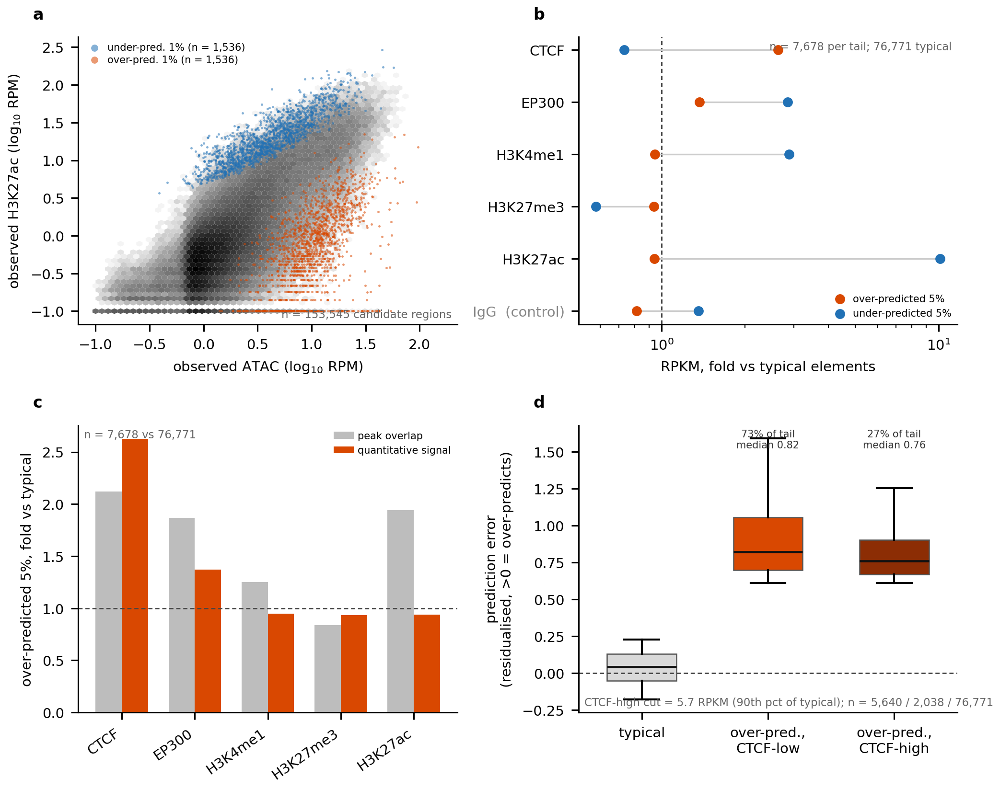

<details>
<summary>Figure 11 legend</summary>

**Figure 11 | The two error tails, what marks them, and why CTCF does not explain the
over-predicted one.** The 1% tails are n = 1,536 each; the typical stratum is the middle 50%,
n = 76,771. **a**, The phenotype in (accessibility, H3K27ac) space; grey is all regions. **b**,
RPKM by mark as fold change over the typical stratum, log axis, IgG as background; a
*pooled* per-stratum statistic. **c**, Peak overlap against quantitative signal for the
over-predicted tail: peaks report enrichment for every mark, signal for CTCF only. **d**,
Splitting the over-predicted tail at the 90th percentile of typical-stratum CTCF gives 27%
CTCF-high and 73% CTCF-low; both are over-predicted, CTCF-low more so. Source:
`results/error_strata_{rpkm,peak_overlap,elements,ctcf_elements}.tsv`.
</details>

**Composition (`results/prediction_error_strata.tsv`):**

| stratum | *n* | observed | predicted | ATAC | ATAC/H3K27ac | GC | CpG o/e | % promoter |
|---|---|---|---|---|---|---|---|---|
| under-predicted 1% | 1,536 | 18.56 | 0.65 | 3.90 | 0.21 | 0.466 | 0.289 | 15.6 |
| under-predicted 5% | 7,678 | 11.09 | 0.59 | 3.58 | 0.33 | 0.475 | 0.317 | 18.5 |
| typical (middle 50%) | 76,771 | 0.44 | 0.09 | 0.93 | 2.20 | 0.490 | 0.277 | 13.1 |
| over-predicted 5% | 7,678 | 0.52 | 0.35 | 5.23 | 9.09 | 0.574 | 0.475 | 25.0 |
| over-predicted 1% | 1,536 | 0.59 | 0.80 | 9.93 | 13.25 | 0.593 | 0.551 | 31.6 |

The `ATAC/H3K27ac` ratio spans a factor of 60. The over-predicted tail is GC-rich, CpG-rich
and promoter-enriched; the under-predicted tail is GC-*poor* and distal.

**Peak overlap suggests enrichment for everything (CTCF 2.1x, EP300 1.9x, H3K27ac 1.9x);
quantitative signal does not.** Fraction of each stratum overlapping a peak:

| stratum | CTCF | EP300 | H3K4me1 | H3K27me3 | H3K27ac |
|---|---|---|---|---|---|
| over-predicted 1% | 23.4% | 16.5% | 30.4% | 8.1% | 33.3% |
| over-predicted 5% | 36.9% | 16.4% | 35.5% | 9.6% | 30.6% |
| typical | 17.4% | 8.8% | 28.3% | 11.5% | 15.8% |
| under-predicted 1% | 9.3% | 57.7% | 86.8% | 0.0% | 100.0% |
| under-predicted 5% | 10.8% | 52.3% | 83.2% | 0.0% | 99.6% |

RPKM from the same BAMs, with an IgG control:

| stratum | CTCF | EP300 | H3K4me1 | H3K27me3 | H3K27ac | IgG |
|---|---|---|---|---|---|---|
| over-predicted 1% | 3.34 | 1.07 | 0.97 | 0.44 | 0.94 | 0.33 |
| over-predicted 5% | **4.69** | 1.16 | 1.24 | 1.17 | 1.17 | 0.39 |
| typical | 1.79 | 0.85 | 1.31 | 0.53 | 1.24 | 0.48 |
| under-predicted 1% | 1.20 | **2.90** | **4.35** | 0.31 | **17.52** | 0.68 |
| under-predicted 5% | 1.31 | 2.42 | 3.78 | 0.31 | 12.57 | 0.65 |

**The 2.6x CTCF enrichment is a pooled statistic, set by a minority of strongly bound
elements.** Element by element, the over-predicted 1% has a CTCF median of 0.72 RPKM against
0.55 typical (1.3x), and only 15.7% of it exceeds the 90th percentile of typical-stratum CTCF (10.0%
of typical by definition); for the over-predicted 5% the figures are 26.5% and a median of
1.10. Splitting the over-predicted 5% at that threshold:

| subset | *n* | % of tail | observed fold | predicted fold | median error | CTCF median |
|---|---|---|---|---|---|---|
| whole tail | 7,678 | 100 | 0.87 | 3.10 | 0.800 | 1.10 |
| CTCF-high | 2,038 | 26.5 | 0.74 | 1.63 | 0.759 | 13.46 |
| **CTCF-low** | **5,640** | **73.5** | 0.94 | **3.83** | **0.821** | 0.65 |
| typical | 76,771 |, | 0.74 | 0.78 | 0.042 | 0.55 |

**GC content tracks the error more closely than CTCF does.** Within accessibility deciles,
Spearman rho(error, CTCF) is 0.02 to 0.23 (median 0.084) and rho(error, GC) 0.24 to 0.37 in
every decile. Partialling out accessibility, GC, CpG and promoter class leaves
rho(error, CTCF) at +0.191, but the IgG control gives -0.126 rather than zero, so that number
is suggestive at best.

The over-predicted elements carry no more H3K27ac (0.9x) or H3K4me1 (0.95x) than a random
element despite 5-10x more accessibility, and IgG is below typical (0.39 against 0.48), so
this is not an antibody-accessibility artefact. In the under-predicted tail IgG is elevated
only 1.4x, H3K27me3 is depleted (0.31 against 0.53) and CTCF is depleted (0.67x).

**Method.** Error residualised on accessibility before defining strata. Enrichment computed
as peak overlap (`bedtools`) and as RPKM from the same BAMs with mapped-read totals as
denominators and an IgG control; quote the RPKM version.

<details>
<summary>Full methods &amp; code</summary>

Mapped-read totals used as RPKM denominators: CTCF 9,231,994; EP300 24,485,729; H3K4me1
8,476,072; H3K27me3 73,060,514; H3K27ac 6,335,377; IgG 24,933,797. Track sources are in
`reference/DATA_INVENTORY.md`.

```bash
sbatch scripts/4.10.characterize_prediction_errors.py --emit-beds
sbatch scripts/4.11.annotate_error_strata.sh    # peak overlaps
sbatch scripts/4.13.quantify_error_strata.sh    # RPKM + IgG
```
Source: `scripts/4.10`, `4.11`, `4.13`
</details>

## The sequence branch does not separate either error tail

**Q:** CpG islands and CTCF motifs are strong local sequence signals, and the 21 bp first
convolution can see a 19 bp CTCF motif. Does the sequence branch know these elements are
unacetylated and get overridden by accessibility?

**A:** No, it does not see the signature: the sequence-only arm puts the two tails at nearly
the same fold elevation, 1.55x over-predicted and 1.44x under-predicted (ratio 1.07), where
the truth separates them by a factor of 31 (ratio 0.032).

**Fold elevation against each arm's own genome-wide median**, over the 153,545 ABC regions:

| stratum | *n* | observed | sequence | ATAC only | multimodal |
|---|---|---|---|---|---|
| under-predicted 1% | 1,536 | **31.33** | 1.44 | 5.01 | 5.81 |
| under-predicted 5% | 7,678 | 18.72 | 1.52 | 4.64 | 5.30 |
| typical (middle 50%) | 76,771 | 0.74 | 0.93 | 0.79 | 0.78 |
| over-predicted 5% | 7,678 | 0.87 | 1.17 | 4.19 | 3.10 |
| over-predicted 1% | 1,536 | **1.00** | 1.55 | 8.41 | 7.12 |

Over-1% elevation divided by the same arm's under-1% elevation (scale-free within an arm):
**observed 0.032, sequence 1.07, multimodal 1.22, ATAC-only 1.68.**

Read alone, the over-predicted row makes sequence look nearly right (1.55x against a truth of
1.00x, where multimodal is 7.12x). The under-predicted row shows it is flat everywhere
(1.44x where the truth is 31x). A predictor this flat over ABC regions cannot rank them,
which is what AUPRC 0.275 for predicted-sequence-alone reflects. The indicated fix is
representational: explicit GC and CpG-density channels or motif-derived features.

**Method.** Fold elevation against each arm's **own** median, since the painted tracks have
medians of 0.11-0.18 against 0.59 for observed RPM; the opposite tail is each arm's
responsiveness scale, so a compressed predictor cannot pass by being flat.

<details>
<summary>Full methods &amp; code</summary>

A first version used accessibility-residualised error and gave the opposite verdict. The over-predicted stratum is *defined* by high accessibility and low H3K27ac, so any predictor that does not track accessibility downward, including a constant, scores as over-predicting there (Report 2).

```bash
srun -p engreitz -t 20 --mem=24G python scripts/4.12.can_sequence_see_it.py
```
Source: `scripts/4.12.can_sequence_see_it.py`
</details>

## p300 is not learnable where H3K27ac fails, so it cannot be a second target

**Q:** The under-predicted elements are EP300-enriched. Would a p300-target model, or a
multi-head model predicting both, recover them?

**A:** No: where the H3K27ac model fails, observed p300 is 4.89x elevated but its input
control is 2.10x (real enrichment about 2.3x), and the p300 models predict 1.83x (multimodal)
and 1.55x (ATAC-only), *below* that control.

**Fold elevation against each track's own genome-wide median:**

| stratum | *n* | observed H3K27ac | predicted H3K27ac | observed p300 | p300 input control | predicted p300 (mm) | predicted p300 (ATAC) |
|---|---|---|---|---|---|---|---|
| H3K27ac under-predicted 1% | 1,536 | 31.33 | 5.81 | **4.89** | **2.10** | **1.83** | 1.55 |
| H3K27ac under-predicted 5% | 7,678 | 18.72 | 5.30 | 3.88 | 1.80 | 1.76 | 1.53 |
| typical (middle 50%) | 76,771 | 0.74 | 0.78 | 0.79 | 0.90 | 0.80 | 0.85 |
| H3K27ac over-predicted 5% | 7,678 | 0.87 | 3.10 | 1.33 | 0.80 | 1.59 | 1.60 |
| H3K27ac over-predicted 1% | 1,536 | 1.00 | 7.12 | 1.36 | 0.50 | 1.92 | 1.79 |

Peak overlap put EP300 at 6.6x in this stratum; against its input control the elevation is
2.3x. The p300 models also over-predict the accessible-but-unmarked tail (1.92x and 1.79x,
where observed p300 is 1.36x and its control 0.50x), so the failure is not specific to the
H3K27ac target. Both p300 ideas are dropped: the multi-head model and predicted p300 as an
input feature. p300 remains the better substrate for sequence attribution (Fig. 3).

**Method.** Existing p300 models scored over the same ABC regions through the same prediction
path (`4.4` with environment overrides), with p300's input control carried through every
stratum. The verdict threshold was set before the run: predicted p300 must reach half of
observed p300's elevation for the multi-head idea to proceed.

<details>
<summary>Full methods &amp; code</summary>

p300 checkpoints predate the `mode` attribute; `4.1` sets `m.mode = mode` when it is absent. Models: `2026_0529_multimodal_p300_model/models/atac` (multimodal, despite the name) and `models/atac_only`. Target and control tracks: `2025_0703_retrain_p300_model/data/ENCSR000EGE_{plus,minus}.bigWig` and `ENCSR000EGE_control_{plus,minus}.bigWig`.

```bash
MODEL_ROOT=... OUT_PREFIX=predp300 sbatch scripts/4.4.submit_predict_h3k27ac_cpu.sh atac 0
sbatch --dependency=afterok:... scripts/4.14.p300_at_h3k27ac_failures.py
```
Source: `scripts/4.4`, `scripts/4.14.p300_at_h3k27ac_failures.py`
</details>

## Predicted p300 improves ABC in the training cell type, and not on transfer

**Q:** Does predicted p300 do better than predicted H3K27ac as ABC's activity term, is
observed p300 a better activity term, and does either survive transfer to a cell type with
only ATAC?

**A:** In K562 yes to both; on transfer the gain disappears.

A sequence + ATAC model predicting p300 beats the ATAC-only floor by **+0.055 [+0.034,
+0.074]** (sign kept in 100% of paired resamples) and is indistinguishable from measured
H3K27ac. Observed p300 beats observed H3K27ac by **+0.038 [+0.019, +0.058]**. A
GM12878-trained p300 model applied to K562 lands at +0.009 [-0.004, +0.022] over the floor;
the transfer drop removes 83% of the in-cell gain. Deployment therefore fails for both
targets (H3K27ac arms 0.455 and 0.452, p300 0.466, floor 0.457), so the barrier is transfer,
as the architecture work also found (F-005).

> **Superseded (F-025, 2026-09-19):** the GM12878 p300 model was trained on a BPNet model's predicted plus strand; retrained on the observed target it scores +0.0135 [-0.0003, +0.0270] over the floor and the transfer penalty is +0.0414 [+0.0256, +0.0558], so the loss is a real transfer effect.

**AUPRC on the CRISPR benchmark, 10,342 element-gene pairs, 466 regulated:**

| arm | AUPRC | unpaired 95% CI |
|---|---|---|
| ATAC x **observed p300** | **0.557** | [0.506, 0.605] |
| ATAC x observed H3K27ac | 0.519 | [0.468, 0.567] |
| ATAC x **predicted p300**, sequence + ATAC model | **0.512** | [0.463, 0.560] |
| predicted p300 alone, sequence + ATAC model | 0.502 | [0.454, 0.550] |
| **ATAC x predicted p300, GM12878 model -> K562** | **0.466** | [0.420, 0.516] |
| predicted p300 alone, GM12878 model -> K562 | 0.462 | [0.416, 0.512] |
| ATAC x predicted p300, ATAC-only model | 0.461 | [0.415, 0.511] |
| ATAC only (floor) | 0.457 | [0.408, 0.507] |
| predicted p300 alone, ATAC-only model | 0.443 | [0.394, 0.491] |
| distance to TSS | 0.435 | [0.386, 0.485] |

Every unpaired interval overlaps every other. Because the arms share one pair set, resampling
pairs once and recomputing every arm removes the shared variance:

| comparison | delta | paired 95% CI | sign kept |
|---|---|---|---|
| observed p300 - observed H3K27ac | **+0.038** | [+0.019, +0.058] | 99.9% |
| observed p300 - floor | **+0.099** | [+0.079, +0.120] | 100% |
| **predicted p300 (seq + ATAC) - floor** | **+0.055** | **[+0.034, +0.074]** | **100%** |
| predicted p300 (seq + ATAC) - observed H3K27ac | -0.007 | [-0.032, +0.017] | 71% |
| predicted p300 alone (seq + ATAC) - floor | +0.045 | [+0.012, +0.077] | 99.6% |
| predicted p300 (ATAC-only model) - floor | +0.004 | [-0.012, +0.021] | 70% |
| predicted p300, seq + ATAC - ATAC-only model | **+0.051** | [+0.032, +0.069] | 100% |
| **transferred (GM12878 -> K562) - floor** | **+0.009** | **[-0.004, +0.022]** | 91% |
| transferred, predicted-alone - floor | +0.005 | [-0.019, +0.028] | 65% |
| **local - transferred (the transfer drop)** | **+0.046** | [+0.030, +0.061] | 100% |
| transferred - observed H3K27ac | -0.053 | [-0.074, -0.032] | 100% |

**Sequence is what makes p300 work.** The multimodal p300 model beats the ATAC-only p300
model in every resample, and the ATAC-only p300 model sits at the floor. For H3K27ac the
sequence-containing arms were the worst in the panel (0.393 and 0.275). With architecture,
accessibility input and benchmark fixed, the target was the binding constraint.

> **Superseded (F-018, 2026-09-15):** predicted H3K27ac clears the floor when the model reads DNase, so for H3K27ac the input assay, not only the target, limits this benchmark.

Observed p300 has more headroom over the floor (0.099 against 0.062), and the K562 model
captures 55% of it, against a non-resolvable fraction for H3K27ac.

### Both p300 models fit their own cell type equally well, and transfer is asymmetric

Top-quintile Pearson, each cell type's own EP300 as target:

| | evaluated on K562 | evaluated on GM12878 |
|---|---|---|
| K562-trained p300 | **0.619** (local) | **0.507** (transferred) |
| GM12878-trained p300 | **0.312** (transferred) | **0.608** (local) |
| that cell type's ATAC-only p300 | 0.306 (floor) | 0.299 (floor) |

| paired within-fold comparison | delta | 95% CI | *p* |
|---|---|---|---|
| K562 local - K562 floor | +0.313 | [+0.286, +0.340] | <1e-4 |
| GM12878 local - GM12878 floor | +0.309 | [+0.263, +0.355] | 1e-4 |
| **K562 -> GM12878, transferred - GM12878 floor** | **+0.207** | **[+0.158, +0.257]** | 3e-4 |
| **GM12878 -> K562, transferred - K562 floor** | **+0.006** | **[-0.038, +0.050]** | **0.72** |
| K562 -> GM12878 drop (transferred - local) | -0.102 | [-0.121, -0.083] | 1e-4 |
| GM12878 -> K562 drop (transferred - local) | -0.307 | [-0.327, -0.286] | <1e-4 |

K562 -> GM12878 keeps 83% of the local advantage, with a positive accessibility residual
(+0.139 [+0.067, +0.210]). GM12878 -> K562 is at K562's floor with a **negative** residual
(-0.088 [-0.140, -0.035]), worse than the accessibility baseline at what the baseline already
does. CRISPR data exist only for K562, so the benchmark can only test GM12878 -> K562, the
failing direction. The +0.207 is top-quintile Pearson on p300, not AUPRC, so it does not show
that predicted p300 deploys.

> **Superseded (F-025, 2026-09-18):** the GM12878-trained model in these tables was trained on a BPNet model's predicted plus strand, so the GM12878 -> K562 row and the asymmetry built on it describe a corrupted-target model, and whether the GM12878 evaluation target is the same file has not been checked.

**Training-signal volume does not explain the asymmetry.**

| | K562, ENCSR000EGE | GM12878, ENCSR000DZG | ratio |
|---|---|---|---|
| peaks | 28,532 | 21,068 | 1.35x |
| mapped reads (pooled) | 51,127,010 | 30,001,681 | 1.70x |
| reads in peaks | 3,590,540 | 1,562,462 | **2.30x** |
| FRiP (pooled) | 0.070 | 0.052 | 1.35x |
| FRiP (per replicate) | 0.053, 0.086 | 0.067, 0.038 |, |

FRiP does not separate them: the within-experiment spread (1.6x K562, 1.8x GM12878) exceeds
the 1.35x pooled difference. Retraining K562 on GM12878's exact budget (30.0M mapped reads,
21,068 peaks; `scripts/0.31` and `1.21`) leaves transfer unchanged:

| | in-cell K562 | transferred to GM12878 |
|---|---|---|
| full-depth K562 model | 0.619 | 0.507 (+0.207 [+0.158, +0.257] over GM12878's floor) |
| depth-matched K562 model | 0.599 | **0.501 (+0.202 [+0.147, +0.257] over that floor)** |
| paired difference | -0.020 [-0.040, +0.001] (*p*=0.056) | **-0.005 [-0.021, +0.010]** (*p*=0.40) |

With 41% fewer reads and 26% fewer peaks the K562 model still transfers. Peak geometry is
also excluded: both training sets are summit-centred fixed-width
(316 bp K562, 350 bp GM12878), the trainer centres on `start + summit`, and GM12878's summits
are the tighter (|summit - midpoint| p90 of 0 bp against 6 bp). In `0.31` the full-depth
rebuild matched the existing target at *r* = 1.0000 on both strands (sum ratio 0.9984), so
the existing K562 model is the full-depth arm.

With two cell types, "K562-trained models are portable" and "K562 happens to transfer to
GM12878" cannot be separated, so a third cell type is required.

> **Superseded (F-016, 2026-09-14):** a third cell type (THP-1) was run for DNase-input H3K27ac models and neither "K562 is a good training cell type" nor "K562 -> GM12878 is a good pair" survives; F-017 then traced that asymmetry to accessibility-library depth.

**Method.** Own ABC results directory and config, reusing the July floor and observed-H3K27ac
anchors; observed p300 as this target's ceiling; paired bootstrap over the shared pair set,
2,000 resamples.

<details>
<summary>Full methods &amp; code</summary>

The shared anchors reproduce across the independent pipeline runs (floor 0.4573 against 0.4572, observed H3K27ac 0.5192 against 0.5192), which licenses comparing 0.512 here with 0.482 there. `4.17` reports 0.5673 / 0.5296 / 0.4680 for observed p300 / observed H3K27ac / floor where the pipeline reports 0.5569 / 0.5192 / 0.4573, a constant +0.0105 from the estimator that leaves every delta unchanged; the paired table quotes deltas and the unpaired table the pipeline's values. The ABC driver stalled at 18 of 21 steps on a QC plot and aggregation that nothing downstream reads; the five `EnhancerPredictionsAllPutative.tsv.gz` files were verified as valid gzip at 10.1-10.3M rows each before the benchmark ran.

```bash
pixi run python scripts/4.3.setup_abc_arms.py --arms p300 \
    --results-dir results/2026_0905_p300_activity
ABC_CFG=config/mine/config_p300_activity.yaml ABC_ARMS=p300 \
    ABC_RESULTS_DIR=results/2026_0905_p300_activity sbatch scripts/4.5.submit_abc.sh
pixi run python scripts/4.6.setup_crispr_comparison.py --arms p300
CC_CFG=.../config/config_p300_activity.yml sbatch scripts/4.7.submit_crispr_comparison.sh
pixi run python scripts/4.17.paired_auprc_bootstrap.py <merged.txt.gz> --pair A B ...
```
Source: `scripts/4.3`, `4.5`-`4.7`, `4.17.paired_auprc_bootstrap.py`
</details>

## DNase beats ATAC as the accessibility input, and it is the first H3K27ac model to clear the floor on transfer

**Q:** DNase couples to H3K27ac better than ATAC, and observed DNase already beats observed
ATAC inside ABC. Does that carry into a model's input?

**A:** Yes, in every arm, and by more where DNase is the shallower library: in-cell DNase
gains **+0.037 [+0.019, +0.056]** in K562 and **+0.086 [+0.076, +0.095]** in GM12878, and
transferred from K562 to GM12878 it gains **+0.043 [+0.003, +0.084]** over the ATAC-input
model and clears GM12878's own ATAC-only floor by **+0.056 [+0.014, +0.099]**, where the
ATAC-input model manages +0.013 (*p*=0.25).

> **Superseded (F-016, 2026-09-14):** a DNase-input model must be compared with a DNase-only floor; against GM12878's (0.615, against 0.518 for ATAC-only) the transferred model's 0.570 is -0.045 [-0.080, -0.010] (*p*=0.023) below it. The in-cell gains stand.

| top-quintile Pearson | ATAC input | DNase input |
|---|---|---|
| in-cell K562 | 0.699 | **0.736** |
| in-cell GM12878 | 0.585 | **0.671** |
| K562 -> GM12878, transferred | 0.531 | **0.574** |
| GM12878's own ATAC-only floor | 0.518 | 0.518 |

| paired within-fold comparison | delta | 95% CI | *p* |
|---|---|---|---|
| in-cell K562, DNase - ATAC | +0.037 | [+0.019, +0.056] | 0.005 |
| in-cell GM12878, DNase - ATAC | +0.086 | [+0.076, +0.095] | <1e-4 |
| transferred, DNase - ATAC | +0.043 | [+0.003, +0.084] | 0.041 |
| **transferred DNase - GM12878's ATAC-only floor** | **+0.056** | **[+0.014, +0.099]** | **0.020** |
| transferred ATAC - that same floor | +0.013 | [-0.014, +0.041] | 0.25 |

Transferred, the DNase-input model scores accessibility residual *r* = 0.236 [0.211, 0.262],
the ATAC-input model 0.041 [0.003, 0.079], and the floor arm 0.026.

**Depth runs against the result.** DNase is the shallower input in both cell types (301.1M
usable reads against ATAC's 545.7M in K562; 53.8M against 571.4M in GM12878; Report 1), and
GM12878's DNase is the weaker library by its own count ceiling (0.445 against K562's 0.925).
DNase wins by more where it is 10.6x shallower (+0.086) than where it is 1.8x shallower
(+0.037), so depth-matching would be expected to widen the gap.

This supplied the premise for an ATAC-to-DNase converter: DNase is the better input, the
advantage survives transfer, and DNase has a reproducible base-resolution profile to target
(Report 1).

> **Superseded (F-014, 2026-09-13):** the converter was built and closed; its converted track is resolvably worse than plain ATAC as an input in every direction tested, and F-016 withdrew the "survives transfer" premise.

**Method.** Each scoring entry carries its own accessibility bigwig, so DNase-trained models
always get DNase, transferred included. `1.22` and `1.23` are `1.11` and `1.12` with two
changes each (accessibility bigwig, output directory), verified by diff on the
comment-stripped scripts.

<details>
<summary>Full methods &amp; code</summary>

DNase inputs are `genomecov -bg -5` unstranded, built like `atac_5p.bw`. Replicates are pooled by merging the filtered BAMs and calling `genomecov` once. An earlier version summed per-replicate bedGraphs through `bedtools merge`, which collapses bookended intervals and produced a K562 track with 34x the correct signal that exited 0; the build now asserts that the track sum equals the main-chromosome read count, with contigs read from the same chrom-sizes file the track filters on.

```bash
sbatch scripts/0.32.make_dnase_5prime.sh
for F in 0 1 2 3 4; do
    sbatch scripts/1.22.submit_training_dnase_k562.sh multimodal $F
    sbatch scripts/1.23.submit_training_dnase_gm12878.sh multimodal $F
done
sbatch scripts/2.29.submit_dnase_swap_eval.sh
```
Source: `scripts/0.32`, `1.22`, `1.23`, `2.29`
</details>

## GC-matching the training negatives changes nothing

**Q:** Does GC-matching the training negatives help? The current pool, ChromBPNet's
genome-wide GC-*annotated* tiling passed straight to `--negatives` (Report 1), has mean GC
0.389 against 0.466-0.593 for candidate elements and is 10% of every batch, so a sequence
branch could meet much of the contrast with a coarse GC detector.

**A:** No: **+0.0011 [-0.0080, +0.0102]** in-cell (*p*=0.76) and **-0.0024 [-0.0083,
+0.0036]** transferred to GM12878 (*p*=0.33).

| | matched negatives | unmatched (baseline) | paired difference |
|---|---|---|---|
| in-cell K562 | 0.700 [0.689, 0.711] | 0.699 [0.695, 0.703] | +0.0011 (*p*=0.76) |
| K562 -> GM12878 | 0.529 [0.501, 0.556] | 0.531 [0.500, 0.562] | -0.0024 (*p*=0.33) |
| transferred vs the target's own ATAC-only model | +0.0108 (*p*=0.28) | +0.0132 (*p*=0.25) |, |

The transfer arm, where a GC shortcut should cost most, moved by -0.002.

The match was verified before the result was read (`scripts/0.29`, one GC estimator for both
sides): the mean-GC gap to the elements fell from 0.0842 to 0.0128 (6.6x closer) in K562 and
from 0.0655 to 0.0141 in GM12878, and the largest per-bin discrepancy from 0.072 to 0.015.
The matched pool still undershoots the GC-rich tail (p90 0.570 against the elements' 0.590),
so a shortcut confined to the extreme high-GC end is not excluded; closing 85% of the mean
gap and 80% of the per-bin discrepancy moved the metric by 0.001.

Training-element composition is closed as an explanation for the sequence branch's flatness.

**Method.** `1.20` is `1.11` with two changes, the negatives file and the output directory,
verified by diff. Negatives built with `bpnet-gc-background`, the tool used for the p300 v3
negatives in Oct 2025. Scored in-cell and transferred, paired within fold, RC-averaged.

<details>
<summary>Full methods &amp; code</summary>

`residual_pearson` in these runs is against the unmatched multimodal model, not an ATAC-only model, so it is not quoted. `bpnet-gc-background` exits 0 with a 0-byte file when `bedtools` is absent, and hangs (93% in 15 seconds, then no progress for two hours) when the foreground exhausts the high-GC bins; subsampling the foreground to 50,000 regions, the trainer's `--max-negatives` cap, fixes the second.

```bash
sbatch scripts/0.28.make_gc_matched_negatives.sh
pixi run python scripts/0.29.verify_gc_match.py      # before reading the retrain
for F in 0 1 2 3 4; do sbatch scripts/1.20.submit_training_gcmatched.sh multimodal $F; done
sbatch scripts/2.26.submit_gcmatch_eval.sh
```
Source: `scripts/0.28`, `0.29`, `1.20`, `2.26`
</details>

## Sequence-gated accessibility and an asymmetric count loss do not help, and together they hurt on transfer

**Q:** The multimodal trunk merges the sequence and accessibility branches additively, so it
cannot withhold accessibility where accessibility misleads. Does a sequence-driven gate on
the accessibility representation, or a loss that penalises over-prediction more, help?

**A:** Neither helps, and together they hurt on transfer: in-cell all three arms match the
ungated symmetric baseline, and transferred to GM12878 the combination is **significantly
worse**.

**Paired within-fold difference in top-quintile Pearson against the matched ungated baseline:**

| arm | in-cell K562 | K562 -> GM12878 |
|---|---|---|
| gate | -0.0001 [-0.0152, +0.0151] *p*=0.99 | -0.0015 [-0.0190, +0.0159] *p*=0.82 |
| asymmetric loss | +0.0001 [-0.0122, +0.0124] *p*=0.98 | -0.0078 [-0.0183, +0.0026] *p*=0.11 |
| both | -0.0032 [-0.0157, +0.0092] *p*=0.51 | **-0.0128 [-0.0246, -0.0010]** *p*=0.039 |

On transfer the gated model and the ungated baseline sit at the same place relative to the
target's own ATAC-only model (+0.0117, *p*=0.21; +0.0132, *p*=0.25).

Both interventions assume the sequence branch knows which elements are unacetylated. It does
not (1.55x at the over-predicted tail and 1.44x at the under-predicted, against a truth of
1.00x and 31.3x), and a gate or a reweighted loss cannot surface information the branch lacks.
This outcome was predicted and recorded before scoring. Both are closed; further work here
must first make the sequence branch discriminative.

**Design.** A 2x2 factorial against a matched ungated symmetric baseline (same accessibility
bigwig, `n_layers` and `count_loss_weight`).

- **GATE.** `X_acc = X_acc * sigmoid(gate_conv(X_seq))`, a 21 bp convolution from the
  sequence representation to the accessibility channels, initialised open (`weight = 0`,
  `bias = 4.0`, gate 0.982), so the model starts as its own baseline and learns per position
  how much to weight accessibility.
- **ASYM.** `overprediction_weight = 3.0`: squared count error tripled where the prediction
  exceeds the target. The default `log1pMSE` is already about 400x more sensitive to missing
  signal than to inventing it in this regime.
- **GATE + ASYM**.

**Method.** Both flags live in `scripts/multimodal_bpnet.py` and
`scripts/train_multimodal_bpnet.py` behind `--gate-accessibility` and
`--overprediction-weight`, guarded by `scripts/test_asymmetric_loss.py`, a four-check
regression gate.

<details>
<summary>Full methods &amp; code</summary>

The asymmetric loss mirrors bpnetlite's `_mixture_loss`, so `overprediction_weight = 1.0` reproduces it; both train and validation paths use `getattr(self, "overprediction_weight", 1.0)`, so pre-gate checkpoints load and score identically. Regression checks: weight 1.0 matches bpnetlite to a relative tolerance of 1e-5; a weight above 1 raises the loss by exactly the predicted amount, with `3 <= n_over <= N-3` asserted; a pre-gate checkpoint loads and is deterministic; a **weight-matched** gate comparison differs by 0.39% (unmatched initialisations differ by 108%, because `gate_conv` consumes extra RNG draws).

```bash
pixi run python scripts/test_asymmetric_loss.py
pixi run python scripts/make_gate_scripts.py
for F in 0 1 2 3 4; do
    sbatch scripts/1.19.submit_training_gate.sh multimodal $F
    sbatch scripts/1.19.submit_training_asym.sh multimodal $F
    sbatch scripts/1.19.submit_training_gate_asym.sh multimodal $F
done
sbatch scripts/2.25.submit_gate_factorial.sh
```
Source: `scripts/multimodal_bpnet.py`, `scripts/train_multimodal_bpnet.py`,
`scripts/1.19.*`, `scripts/2.25.submit_gate_factorial.sh`
</details>

## Open questions / next steps

p300 is now the project's default target (F-024).

**Still open, in order of expected value**

1. **A downstream test outside K562.** CRISPR data exist only for K562, so no transfer into
   another cell type, including K562 -> GM12878, can be benchmarked downstream.
2. **Improve element ranking, not prediction spread.** Scale-only fixes are null in ABC
   (F-022), and the ranking of the CRISPR-tested elements carries 62% (in-cell) and 80%
   (transferred) of the gap between predicted and observed p300 (F-028). Predicting the
   composite `geomean(DHS, H3K27ac)` from sequence + ATAC is a candidate, baselined against
   the two-step route on the same composite (not `geomean(accessibility, H3K27ac)` with the
   input assay, which would make half the target readable off the input).
3. **Give the model the sequence features it is not learning**: explicit GC-content and
   CpG-density channels, with an indicator-channel control for the extra capacity;
   motif-derived channels are the heavier version.
4. **Reweight accessible-but-unacetylated elements**, already in the positive set with
   near-zero targets, and measure the over-predicted tail. `negative_ratio` and the
   50,000-window cap, inherited from the p300 setup, have never been swept.
5. **Motif syntax, never started.** SHAP / TF-MoDISco / FiNeMo on the **residual-trained**
   model with the +/-500 bp window. Expect less attributable signal than p300 (Fig. 3).
6. **Re-measure the p300 transfer asymmetry with the corrected GM12878 model.** The +0.006 was
   measured on the corrupted-target model (F-025). F-026's GM12878 single-source arm may
   already answer this if it used the corrected target.

**Also open, smaller**

- A qnorm-off ABC arm: the qnorm reference is built from observed K562 signal, so a predicted
  track inherits that distribution's shape.
- Remove the profile head, or bin its target to 20-50 bp (ceiling 0.21 -> about 0.72; input
  stays single-base); the base-resolution term largely fits Poisson noise (Report 1, Fig. 4).
  F-015 swapped its target to DNase instead; removal is untested.
- Characterise the twelve threshold-level false negatives individually.
- Repeat the residual-objective comparison for p300 (residual *r* already 0.654).
- Train the p300 models with whichever multimodal architecture wins.

**Closed, do not reopen without new evidence**

- p300 as a second head or a stacked input: not predictable where H3K27ac fails.
- Element derivation: ATAC-derived against DNase-derived training elements, *p* = 0.83.
- Fragment channels for deployment: null transferred in both directions.
- GC-matching the negatives: +0.001 in-cell, -0.002 transferred.
- Paired re-test of the H3K27ac benchmark deltas: done; the ATAC-input arms stay at the floor
  (F-004).
- Dynamic-range diagnostic on the p300 arms: moot, since rank qnorm discards scale (F-022).
- ATAC-to-DNase converter: worse than ATAC as a model input (F-014) and not resolvably better
  in ABC (F-012).
- A third cell type and multi-cell-type training: THP-1 added for H3K27ac (F-016); pooling
  four source cell types for p300 does not beat single-source transfer downstream (F-027).

## Methods

Model is `MultiModalBPNet` (`scripts/multimodal_bpnet.py`), a BPNet variant with a
dilated-convolution trunk, a profile head trained with multinomial negative log-likelihood,
and a counts head trained with log1p mean-squared error; total loss is
`profile_loss + w * count_loss`. All results here concern the counts head unless a profile
metric is named. Baseline training uses `n_layers = 8` (a ~1.1 kb receptive field), a
+/-500 bp counting window with the required 2,114 bp input window, `w = 10`,
reverse-complement augmentation, chromosome-holdout 5-fold cross-validation, and a random
50,000-window subsample of the genome-wide negative pool, which is **not** GC-matched to the
positives (Report 1). Negatives are 10% of each batch and are never evaluated on. The wide arm uses `n_layers = 10`, whose trimming of
2,093 requires a 5,186 bp input window for the same output; the trimming is
`47 + sum(2^i for i in 1..n_layers)`.

`w = 10` was chosen from a single-fold sweep over 1, 3, 10, 100 and 1,000. Only the extremes
are resolvable at the measured noise level: 10 clearly beats 1 (0.437) and 1,000 (0.464),
while 3, 10 and 100 are within run-to-run variance of one another. With between-fold `sd` of
0.041-0.046, a single-fold sweep could not resolve those differences, so this choice rests on
a flat region rather than a measured optimum.

Scoring rules, metric definitions and the paired-test procedure are in Report 2; ceilings,
track definitions and the data inventory are in Report 1.

### Single-pass against reverse-complement-averaged, for every result where it matters

Test-time RC averaging became the scoring default on 2026-09-03. The decision table quotes
the RC values; the figures and section prose quote single-pass. Every difference:

| result, top quintile | single-pass | RC-averaged |
|---|---|---|
| sequence only, absolute | 0.380 | 0.397 |
| ATAC only, absolute | 0.548 | 0.551 |
| sequence + ATAC, absolute | 0.685 | 0.695 |
| wider receptive field, multimodal, K562 (paired) | +0.027 | +0.028 |
| wider receptive field, multimodal, GM12878 (paired) | +0.014 | +0.016 |
| fragment channels, K562 (paired) | +0.0135 | +0.0157 |
| residual *r*: sequence only | 0.149 | 0.148 |
| residual *r*: sequence + ATAC | 0.551 | 0.559 |
| residual *r*: residual-trained sequence | 0.459 | 0.470 |
| residual *r*: residual-trained multimodal | 0.514 | 0.529 |
| residual *r*: ATAC negative control | -0.003 | -0.002 |

Every RC value is equal or larger except the sequence-only residual *r*, and the negative
control stays at zero, as expected for a change that removes strand-asymmetry noise rather
than adding signal. No sign, ordering or significance verdict differs between the two
columns. Source: `results/{,rc_}{fiveprime,wide_*,fragchan_*,residual_grid_*}_*.tsv`.

**The figures stay single-pass.** `3.1` and `3.4` read the `2.2`-evaluator table format, for
which no `rc_*` equivalent exists (the RC re-scoring ran through `2.15`); migrating them is
riskier than the 0.002-0.016 it would correct. Recorded as open.

### Regenerate

```
Environment: pixi env `multimodal`, pixi.lock sha256:069960d36312
```

```bash
# Models: 3 modes x 5 folds, plus each architecture arm
for MODE in atac multimodal sequence; do for F in 0 1 2 3 4; do
    sbatch scripts/1.4.submit_training_5prime.sh $MODE $F        # K562 baseline
    sbatch scripts/1.8.submit_training_gm12878.sh $MODE $F       # GM12878 baseline
    sbatch scripts/1.9.submit_training_residual.sh $MODE $F      # residual objective
    sbatch scripts/1.13.submit_training_5prime_wide.sh $MODE $F  # wide receptive field
done; done
for F in 0 1 2 3 4; do
    sbatch scripts/1.15.submit_training_fragchan.sh multimodal $F   # fragment channels
    sbatch scripts/1.19.submit_training_gate.sh multimodal $F       # gate
done

# Evaluation: one code path, one config JSON per comparison
sbatch scripts/2.22.submit_rc_rescore.sh          # the rc_* tables the decision table quotes
sbatch scripts/2.23.submit_final_comparisons.sh   # factorial + element-derivation arms
sbatch scripts/2.24.submit_transfer_matrix.sh     # transfer matrix
sbatch scripts/2.25.submit_gate_factorial.sh      # gate 2x2

# Downstream: ABC + CRISPR benchmark, then the diagnostics
pixi run python scripts/4.3.setup_abc_arms.py && bash scripts/4.5.submit_abc.sh
pixi run python scripts/4.6.setup_crispr_comparison.py
bash scripts/4.7.submit_crispr_comparison.sh
sbatch scripts/4.9.submit_diagnose.sh
sbatch scripts/4.13.quantify_error_strata.sh

# Figures and this report
pixi run python scripts/3.7.build_numbers_manifest.py
python render_report.py report3_design_decisions.qmd
```

Per-result provenance, including which processing of the target each result file used, is in
`results/TARGET_PROVENANCE.md`.
