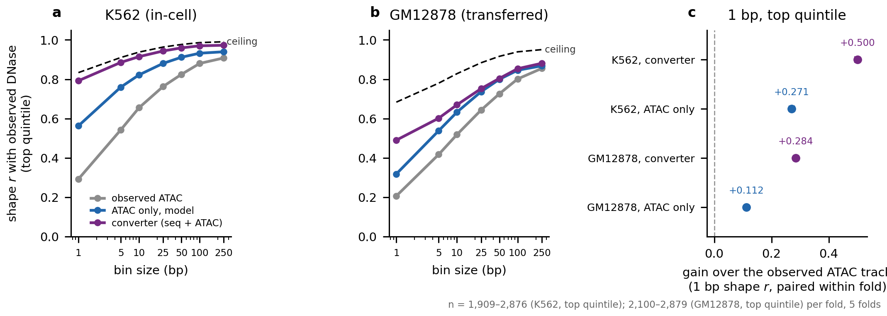

```{=html}
<style>
/* Typography and layout. Present in the document rather than the renderer so the
   report looks the same whether it is built by quarto or by the pandoc fallback
   (Sherlock has pandoc 2.10 and no quarto, which otherwise renders bare Times). */
html { -webkit-text-size-adjust: 100%; }
body {
  font-family: Arial, Calibri, "Helvetica Neue", Helvetica, sans-serif;
  font-size: 15px;
  line-height: 1.6;
  color: #1a1a1a;
  max-width: 980px;
  margin: 0 auto;
  padding: 2.5rem 1.5rem 4rem;
  background: #fff;
}
h1 { font-size: 1.7rem; font-weight: 600; line-height: 1.3; margin: 0 0 .3rem; }
h2 { font-size: 1.15rem; font-weight: 600; margin: 2.6rem 0 .6rem;
     padding-top: 1.1rem; border-top: 1px solid #e4e4e4; }
h3 { font-size: 1rem;   font-weight: 600; margin: 1.6rem 0 .4rem; }
p.date, .date { color: #666; font-size: .85rem; }

/* Figures: never exceed the text column, and centre them. Without this the
   pandoc fallback shows every PNG at natural pixel width and they overflow. */
img {
  display: block;
  max-width: 100%;
  height: auto;
  margin: 1.1rem auto 0.4rem;
}

/* The table of contents pandoc emits as a bare bulleted list */
#TOC, nav#TOC { font-size: .9rem; background: #fafafa; border: 1px solid #eaeaea;
  border-radius: 6px; padding: .8rem 1.2rem; margin: 1.5rem 0 2rem; }
#TOC ul { margin: .2rem 0; padding-left: 1.1rem; }
#TOC a { color: #235; text-decoration: none; }
#TOC a:hover { text-decoration: underline; }

/* Q:/A: lines read as the skimmable layer */
p > strong:first-child { color: #111; }

table { border-collapse: collapse; font-size: .88rem; margin: 1rem 0; width: 100%; }
th, td { border-bottom: 1px solid #e8e8e8; padding: .38rem .6rem; text-align: left;
         vertical-align: top; }
th { background: #f6f6f6; font-weight: 600; }

code, pre { font-family: "SF Mono", Menlo, Consolas, monospace; font-size: .82rem; }
pre { background: #f7f7f8; border: 1px solid #ececec; border-radius: 5px;
      padding: .7rem .9rem; overflow-x: auto; }
code { background: #f2f2f3; padding: .07em .32em; border-radius: 3px; }
pre code { background: none; padding: 0; }

blockquote { border-left: 3px solid #ddd; margin-left: 0; padding-left: 1rem;
             color: #444; }
</style>
```

## Headline figure



**Figure 1 | The converter predicts the DNase profile at base resolution, and the gain over the ATAC track survives transfer.**

<details>
<summary>Full legend</summary>

**Figure 1 | ATAC-to-DNase conversion, K562 and transferred to GM12878, 5 folds.** Within-element
shape correlation with observed DNase, top signal quintile, mean over 5 chromosome-holdout folds.
**a**, **b**, Against bin size. Grey, observed ATAC track, no model (the input the converter would
replace). Blue, ATAC-only model on the same target (control for sequence). Purple, the converter,
sequence + ATAC. Dashed, DNase inter-replicate ceiling on the same held-out windows and estimator.
**c**, Gain over the observed ATAC track at 1 bp, differenced within fold; 95% t intervals on 5
folds (see Limits). Source: `results/converter_profile_{converter5f,ataconly5f}_{k562,gm12878}.tsv`,
`results/atac_vs_dnase_profile_baseline.tsv`, paired deltas from `scripts/2.35`.
</details>

## Summary

- In K562 the converter predicts the 1 bp DNase profile at **0.792**, where two DNase replicates agree at 0.834: **95% of the ceiling**. Observed ATAC reaches 0.292.
- Sequence adds **+0.229**: the same model without its sequence branch reaches 0.563. The leading explanation is DNase I cleavage bias, which the sequence branch can learn because no bias model is used.
- In GM12878, without retraining, the converter reaches **72%** of the ceiling (0.490 against 0.684) and still beats that cell type's ATAC track by **+0.284**. A new cell type is where a converter would be used, so 72% is the number that counts.
- **Current status: the converter has not been shown to help downstream.** As the ABC activity term, real DNase beats real ATAC by +0.0709, and the converted track's +0.0208 [-0.0049, +0.0441] is not resolved; the interval includes no change (F-012); as the H3K27ac model's input it is worse than ATAC in every direction tested, which closed it as a model input (F-013, F-014).

## Goals

The converter takes sequence + ATAC and predicts DNase; it is trained in K562 and applied
unchanged to GM12878. It was built because Report 3 found DNase the better accessibility input,
with the advantage surviving transfer, while most cell types have only ATAC.

> **Superseded (F-016, 2026-09-14):** the "advantage surviving transfer" premise was withdrawn; scored against the target's own DNase-only floor, no sequence + DNase H3K27ac model beats it on transfer in any of six directions over three cell types.

## The converter reaches 95% of the DNase profile ceiling in K562

At 1 bp the converter scores **0.792** against a ceiling of **0.834**; the observed ATAC track
scores 0.292. The metric is shape correlation: the Pearson correlation of predicted and observed
per-base signal within each element, averaged over the top fifth of elements by signal. The
ceiling is the same correlation between two DNase replicates.

| 1 bp, top quintile | K562 | GM12878, transferred |
|---|---|---|
| observed ATAC track | 0.292 | 0.206 |
| ATAC-only model | 0.563 | 0.318 |
| **converter (sequence + ATAC)** | **0.792** | **0.490** |
| DNase inter-replicate ceiling | 0.834 | 0.684 |
| converter, as % of ceiling | 95% | 72% |

| paired within-fold, vs the observed ATAC track | delta | 95% CI | *p* |
|---|---|---|---|
| K562, converter | +0.500 | [+0.492, +0.508] | <1e-4 |
| K562, ATAC-only model | +0.271 | [+0.263, +0.278] | <1e-4 |
| GM12878, converter | +0.284 | [+0.279, +0.289] | <1e-4 |
| GM12878, ATAC-only model | +0.112 | [+0.110, +0.114] | <1e-4 |

The downstream model is currently fed ATAC, so the deployment bar is the ATAC track, which is
lower than the ceiling. `0.35` measures this directly, and the converter clears it in both cell
types.

> **Superseded (F-014, 2026-09-13):** clearing this bar did not make a better input; fed to the H3K27ac model, the converted track is resolvably worse than ATAC in every direction tested, e.g. -0.0105 [-0.0202, -0.0007] in-cell K562.

The gain is largest at 1 bp, the resolution the downstream accessibility branch reads (a
base-resolution track over 2,114 bp). It falls from +0.500 at 1 bp to +0.135 at 50 bp as both
tracks approach the ceiling (Fig. 1a).

**Method.**

- `1.24` is `1.11` with the target bigwigs, element set and output directory changed.
- Elements are **ATAC-derived**, unlike every other K562 model here, because at deployment only
  ATAC exists to call them. Element derivation made no difference on the H3K27ac task (*p*=0.83).
- The target is `0.34`'s pooled stranded DNase (merged BAMs, `genomecov` once per strand). The
  strands sum exactly to the main-chromosome read count (301,112,388 in K562) and match `0.32`'s
  independently built unstranded track to the read.

## Sequence adds +0.229 over an ATAC-only model, consistent with learned DNase I cleavage bias

Removing the sequence branch, with target and elements unchanged, drops the K562 score from 0.792
to 0.563; transferred, sequence adds **+0.172**. The ATAC-only model beats raw ATAC by +0.271,
which is normalisation needing no sequence, and the converter roughly doubles that. The counts
head (predicted total reads per element) shows the same ordering:

| paired within-fold, counts head | delta | 95% CI | *p* |
|---|---|---|---|
| top-quintile Pearson, converter - ATAC-only | +0.064 | [+0.047, +0.082] | 0.0005 |
| all elements, converter - ATAC-only | +0.025 | [+0.016, +0.034] | 0.0016 |

The leading explanation for the sequence gain is DNase I cleavage bias. Base-level DNase I cuts
are dominated by the enzyme's sequence preference, the target is not bias-corrected, and a
sequence branch can learn that preference directly. It is also the likely reason the converted
track made a worse H3K27ac model input than ATAC (F-014): if most of the per-base gain is enzyme
bias, the track matches DNase better without carrying more information about H3K27ac. If the
converter is reopened, train it on a bias-factorised target, with a DNase I bias model fitted
first as ChromBPNet does, so that it predicts accessibility without the enzyme's preference.

**Method.** The ATAC-only arm is `1.24` with `MODE=atac`, which drops the genome input. `2.15`
scores it as the config baseline, so `incremental_r2` and `residual_pearson` are measured against
it.

## In GM12878 the converter keeps its margin over ATAC but reaches only 72% of the ceiling

Transferred, the converter reaches 0.490 against GM12878's ceiling of 0.684 (**72%**, against 95%
in K562). It beats GM12878's ATAC track by **+0.284 [+0.279, +0.289]**, and its sequence margin
keeps **91%** of the in-cell size (25.1 against 27.5 percentage points of ceiling). Most other
in-cell gains in this project were null or negative on transfer (Report 3).

Because a converter is only used where there is no DNase, 0.490 is the operating point, and it is
well short of what a GM12878 DNase experiment would give.

With two cell types, "K562-trained converters are portable" cannot be told apart from "K562
happens to transfer well to GM12878"; F-009 left the same question open for p300. F-016 and F-017
later tested transfer over three cell types with depth-matched DNase, for H3K27ac models only; the
converter was not retested.

## Limits

**All numbers here are correlations with observed DNase.** At the time of writing, no test had
checked whether a more DNase-like input improves the H3K27ac model, for the converted track or
for real DNase.

> **Superseded (F-013, 2026-09-12):** the test has been run; real DNase beats ATAC as the H3K27ac model's input by +0.0379, and the converted track is worse than ATAC by -0.0099 [-0.0175, -0.0023].

> **Superseded (F-012, 2026-09-11):** as the ABC activity term, the converted track's +0.0208 [-0.0049, +0.0441] over real ATAC does not resolve, against +0.0709 for real DNase.

**Every "% of ceiling" is optimistic.** The ceiling comes from the two ENCSR000EOT replicates
(142M reads), projected to their pooled depth with the Spearman-Brown formula. The training target
is the 3-BAM pool at 301M reads, which is less noisy and has a higher true ceiling.

**The confidence intervals only measure stability across chromosome holdouts.** Fold-to-fold
variation in a mean over roughly 10,000 elements is small, so they are narrow. They say nothing
about a third cell type, the larger uncertainty.

**GM12878's DNase is the weaker library**: 53.8M usable reads against K562's 301.1M, hence the
lower ceiling. Compare the cell types by fraction of ceiling; their raw correlations are not comparable.

## Open questions / next steps

None open: the converter is closed as a model input (F-014; Settled in the project TODOLIST). If it
is reopened, the first steps are a bias-factorised target (above) and a transfer test on a third
cell type, which F-016 and F-017 ran for H3K27ac models but not for the converter.

## Methods

Architecture, training schedule and cross-validation are as in Report 3: `MultiModalBPNet`,
`n_layers = 8`, +/-500 bp counting window with a 2,114 bp input window, `w = 10`,
reverse-complement augmentation, chromosome-holdout 5-fold cross-validation, negatives at 10%
of each batch and never evaluated on. The only changes are the target and the element set.

**The profile metric here is not the project's usual one, and the two are not comparable.**
`2.15`'s `profile_pearson` comes from bpnetlite's `calculate_performance_measures` with
`kernel_sigma = 7, kernel_width = 81`, so both profiles are Gaussian-smoothed before
correlating. The DNase ceiling in Report 1 is a raw within-element correlation at 1 bp from
`0.25`. Reading one against the other would compare different estimators on different scales:
on the same fold-0 model the smoothed metric reads 0.774 where the raw 1 bp value is 0.799 and
the ceiling is 0.831. `2.31` therefore scores the model with `0.25`'s `shape_corr` unchanged
and computes the ceiling on the same held-out windows in the same run, leaving no estimator or
element-set difference between the model number and the ceiling beside it.

Shape correlation centres each element before correlating, so the element total divides out
and any positive rescaling of the prediction is invisible. Counts are scored separately by
`2.15`.

**Count loss weight.** `w = 1` and `w = 10` were both trained on fold 0. They differ by 0.001
in shape correlation at every bin size and `w = 10` is slightly better on counts (0.904
against 0.895 overall Pearson), so the project standard is kept and no sweep was run. The
profile head being the deliverable did not move the optimum.

**All-elements stratum.** Figure 1 shows the top quintile only. At 1 bp on all elements the
converter reaches 0.506 against a ceiling of 0.585 in K562 (observed ATAC 0.151), and 0.282
against 0.455 in GM12878 (observed ATAC 0.107). The ordering is the same and the margins are
smaller, as they are for every metric in this project, because low-signal elements carry
little reproducible shape.

Track definitions, library depths and the DNase profile ceilings are in Report 1; scoring
rules and the paired-test procedure are in Report 2.

### Regenerate

```
Environment: pixi env multimodal, pixi.lock sha256:069960d36312
```

```bash
# Target: pooled stranded DNase, both cell types
sbatch scripts/0.34.make_pooled_dnase_stranded.sh

# Models: the converter and its ATAC-only control, 5 folds each
for MODE in multimodal atac; do for F in 0 1 2 3 4; do
    sbatch scripts/1.24.submit_training_converter.sh $MODE $F
done; done

# Scoring: counts paired against the ATAC-only control, then raw shape against the
# ceiling, in-cell and transferred
sbatch scripts/2.34.submit_converter_full.sh

# The deployment comparator: observed ATAC vs observed DNase, per fold, model-free
sbatch scripts/0.35.atac_vs_dnase_profile_baseline.sh

# Paired delta against that comparator, and the figure
pixi run -e multimodal python scripts/2.35.converter_vs_atac_paired.py --label converter5f --label ataconly5f
pixi run -e multimodal python scripts/3.13.plot_converter.py

# Render this report
pixi run -e multimodal python render_report.py report4_atac_to_dnase_converter.qmd
```
