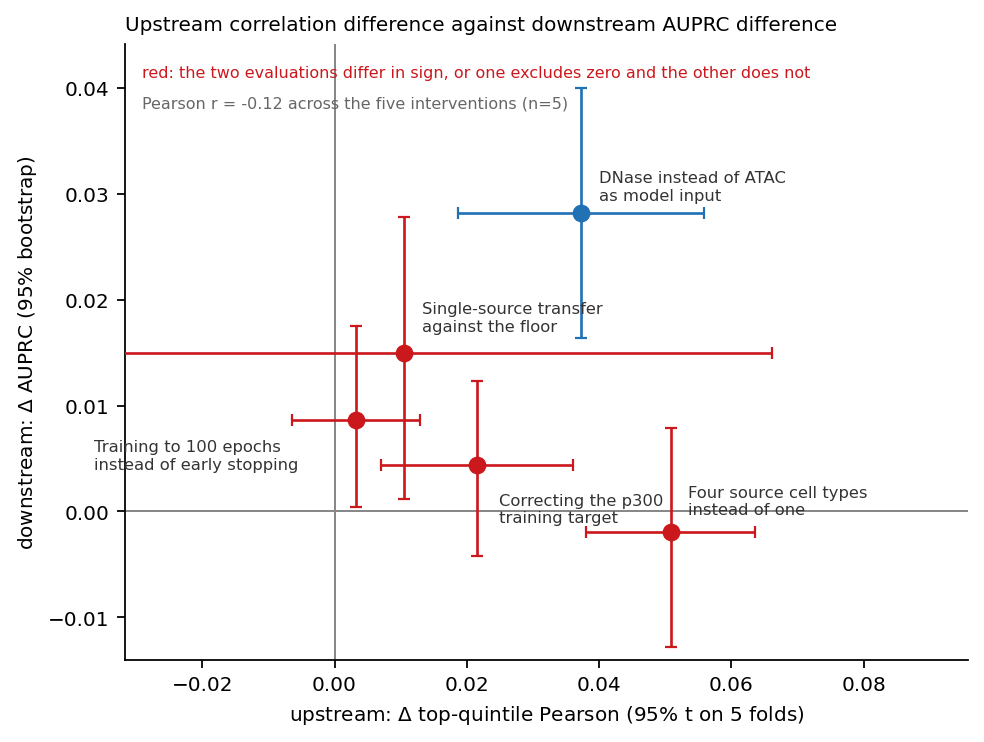
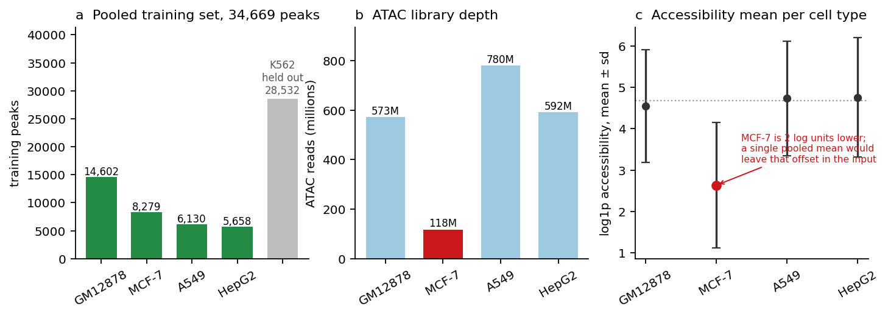
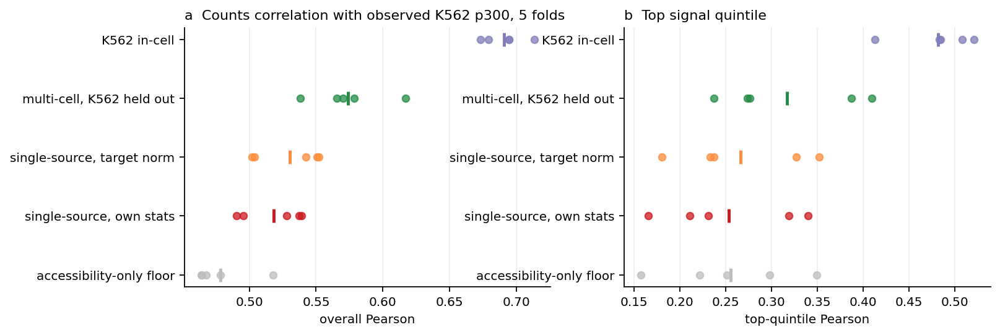
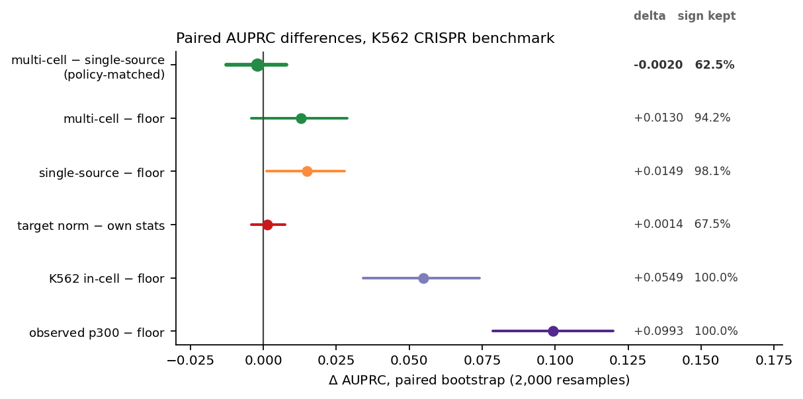
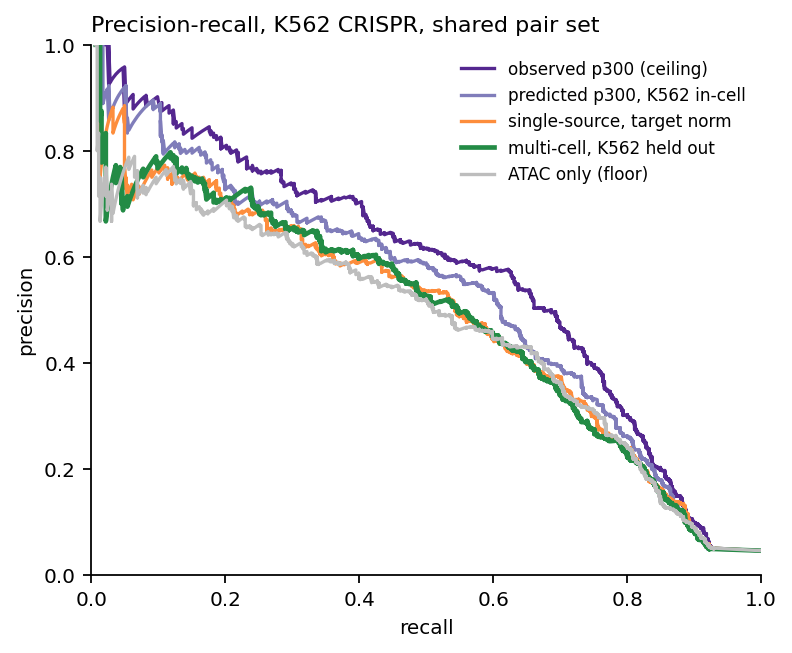
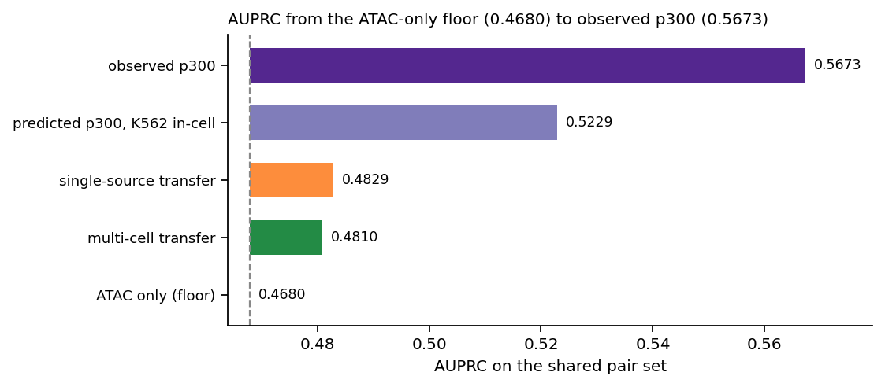
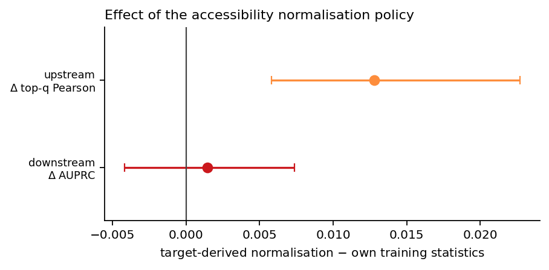

```{=html}
<style>
html { -webkit-text-size-adjust: 100%; }
body {
  font-family: Arial, Calibri, "Helvetica Neue", Helvetica, sans-serif;
  font-size: 15px;
  line-height: 1.6;
  color: #1a1a1a;
  max-width: 980px;
  margin: 0 auto;
  padding: 2.5rem 1.5rem 4rem;
  background: #fff;
}
h1 { font-size: 1.7rem; font-weight: 600; line-height: 1.3; margin: 0 0 .3rem; }
h2 { font-size: 1.15rem; font-weight: 600; margin: 2.6rem 0 .6rem;
     padding-top: 1.1rem; border-top: 1px solid #e4e4e4; }
h3 { font-size: 1rem;   font-weight: 600; margin: 1.6rem 0 .4rem; }
p.date, .date { color: #666; font-size: .85rem; }

img {
  display: block;
  max-width: 100%;
  height: auto;
  margin: 1.1rem auto 0.4rem;
}

#TOC, nav#TOC { font-size: .9rem; background: #fafafa; border: 1px solid #eaeaea;
  border-radius: 6px; padding: .8rem 1.2rem; margin: 1.5rem 0 2rem; }
#TOC ul { margin: .2rem 0; padding-left: 1.1rem; }
#TOC a { color: #235; text-decoration: none; }
#TOC a:hover { text-decoration: underline; }

p > strong:first-child { color: #111; }

table { border-collapse: collapse; font-size: .88rem; margin: 1rem 0; width: 100%; }
th, td { border-bottom: 1px solid #e8e8e8; padding: .38rem .6rem; text-align: left;
         vertical-align: top; }
th { background: #f6f6f6; font-weight: 600; }

code, pre { font-family: "SF Mono", Menlo, Consolas, monospace; font-size: .82rem; }
pre { background: #f7f7f8; border: 1px solid #ececec; border-radius: 5px;
      padding: .7rem .9rem; overflow-x: auto; }
code { background: #f2f2f3; padding: .07em .32em; border-radius: 3px; }
pre code { background: none; padding: 0; }

blockquote { border-left: 3px solid #ddd; margin-left: 0; padding-left: 1rem;
             color: #444; }
</style>
```

## Headline figure



**Figure 1 | Upstream top-quintile Pearson difference against downstream AUPRC difference, for
every intervention measured both ways: no relationship is shown (n = 5; 4/5 share a sign).** **Headline figure.**

<details>
<summary>Full legend</summary>

**Figure 1 | Five interventions, two evaluations.** Each point is one intervention. The x
value is the difference in top-quintile Pearson against observed signal, paired within
chromosome-holdout fold, with a 95% *t* interval on the 5 fold differences. The y value is
the difference in AUPRC on the K562 CRISPR benchmark, from a paired bootstrap over the shared
element-gene pair set, with a 95% percentile interval. Red marks a row where the two
evaluations differ in sign, or where one interval excludes zero and the other does not.
The single-source row uses the single-source model normalised on the target cell type
(K562), as in the downstream arm. The 100-epoch row is a second training run of the same
configuration; its cause is unresolved (F-019/F-020).
Upstream sources: `results/dnaseswap_k562_per_fold.tsv`,
`results/multitask_k562_per_fold.tsv`, `results/p300_multicell_k562_per_fold.tsv`.
Downstream sources: `results/dnase_input_crispr_paired.tsv`,
`results/multitask_crispr_paired_controlled.tsv`, `results/p300_corrected_paired.tsv`,
`results/2026_0922_multicell_auprc_pairs.tsv`. All produced by `scripts/4.17`.
</details>

## Summary

- A multimodal (ATAC + sequence) p300 model trained on A549, GM12878, HepG2 and MCF-7, with K562 held out of training, predicts held-out K562 p300 better than the same architecture trained on GM12878 alone, both normalised on K562: **+0.0508 top-quintile Pearson, *p*=0.0004**.
- Substituted into ABC's activity term and scored against the K562 CRISPR data, the same comparison is **-0.0020 AUPRC [-0.0128, +0.0079]**, not resolved.
- Both transferred models keep about a quarter of the in-cell model's **+0.0549** gain over the ATAC-only floor, with lower bounds at or just above zero: multi-cell **+0.0130 [-0.0041, +0.0287]** (not resolved), single-source with target normalisation **+0.0149 [+0.0012, +0.0278]** (resolvable). Observed p300 is **+0.0993** over the same floor.
- Across the five interventions this project has evaluated both ways, no relationship between upstream top-quintile Pearson and downstream AUPRC is shown (**r = -0.12, n = 5; 4/5 share a sign**).
- Normalising accessibility on the target cell type rather than on the model's training statistics changes AUPRC by **+0.0014 [-0.0042, +0.0074]**. It was measured because the multi-cell model requires target normalisation and the comparison would otherwise confound training set with normalisation policy.

## Goals

ABC predicts enhancer-gene links from an activity term times 3D contact. This report tests whether a p300 model trained on several source cell types (A549, GM12878, HepG2, MCF-7) transfers to a held-out cell type, K562, better than a model trained on GM12878 alone, first on correlation with observed K562 p300 and then as ABC's activity term on the K562 CRISPR benchmark. It also asks whether the upstream correlation metric predicts the downstream benchmark across the interventions this project has scored both ways.

## No relationship between upstream correlation and downstream ABC performance is shown

The project has run five interventions through both evaluations: an upstream correlation
against observed signal over held-out chromosomes, and the CRISPR benchmark after
substitution into ABC. Figure 1 plots one against the other. Both axes are computed from the
stored per-fold tables and bootstrap outputs, not transcribed from earlier reports.

| intervention | upstream $\Delta$ top-q Pearson | downstream $\Delta$ AUPRC | same sign? | both resolved alike? |
|---|---|---|---|---|
| DNase instead of ATAC as input | +0.0373 [+0.0187, +0.0559] | +0.0282 [+0.0164, +0.0400] | yes | yes |
| Second training run (100 epochs), cause unresolved (F-019/F-020) | +0.0033 [-0.0064, +0.0130] | +0.0086 [+0.0005, +0.0175] | yes | no |
| Corrected p300 training target | +0.0215 [+0.0071, +0.0360] | +0.0044 [-0.0042, +0.0123] | yes | no |
| Single-source transfer (target normalisation) against the floor | +0.0106 [-0.0450, +0.0661] | +0.0149 [+0.0012, +0.0278] | yes | no |
| Four source cell types instead of one | +0.0508 [+0.0380, +0.0636] | -0.0020 [-0.0128, +0.0079] | no | no |

Across the five, the correlation between the two axes is **r = -0.12** (95% interval about
-0.91 to +0.85 by Fisher's z on n = 5), and four of the five rows share a sign. The largest
upstream effect in the set produced the only negative downstream point.

Two consequences:

- **Top-quintile Pearson has not been shown to predict which models gain downstream, so it should not decide which models get benchmarked.** It has been used that way.
- **Multi-cell training gained +0.0508 upstream and -0.0020 [-0.0128, +0.0079] downstream.** The 100-epoch row, a gain downstream with none upstream, is a second training run whose cause F-020 left unresolved, so it is not evidence that upstream correlation discards changes that work.

The DNase-input row is the only one where both evaluations resolve alike, and that
intervention is not deployable: DNase exists for fewer cell types than ATAC, which is why the
models here read ATAC.

## What was trained, and what holding out K562 removed

**Q:** What did the multi-cell model train on, and how do the source cell types differ?

**A:** Four cell types and 34,669 pooled peaks, with GM12878 contributing the most peaks and MCF-7 the smallest ATAC library and an accessibility mean about 2 log units below the others.

Four cell types, 34,669 pooled training peaks. K562's 28,532 peaks were not used in training.
K562 enters only at evaluation: its ATAC track is the accessibility input and its observed
p300 is the target being predicted. All five chromosome folds were verified to have read only
the four source cell types' tracks. This holds for the models in this report; later design
choices for the transferred model (the GATA error target, removing CTCF from the TF list,
the panel selection rule and the choice of tissue panel, reports 6 and 7) did use K562's
observed p300.



**Figure 2 | Training peaks, ATAC library depth, and accessibility mean per source cell type.**

<details>
<summary>Full legend</summary>

**Figure 2 | Panel composition. a**, Training peaks per source cell type. These are ~31%
smaller than the peak files on disk because the trainer drops peaks whose window runs off a
contig or into the blacklist. GM12878 contributes 2.58x as many peaks as HepG2 (14,602
against 5,658). Grey is K562, held out. **b**, Total ATAC reads per cell type summed over
replicates, from `results/panel_depth_audit.tsv`. MCF-7's library is 6.6x smaller than
A549's. The counts come from different file types: GM12878 and K562 reads are counted from
tagAlign files, A549, HepG2 and MCF-7 reads from BAMs. **c**, log1p
accessibility mean and standard deviation over each cell type's own training windows. MCF-7
centres at 2.63; the other three at 4.55-4.76. Source:
`models/p300_multicell_holdK562_hw500_clw10/fold0/acc_normalization_stats.json`.
</details>

**Method.**

- Training peaks per cell from F-026's ledger; ATAC reads from `results/panel_depth_audit.tsv`; accessibility statistics from the fold-0 model's `acc_normalization_stats.json`.
- Plotted by `scripts/5.1` (`fig18_multicell_panel`).

Panel c is why accessibility is standardised within each cell type before pooling. With a
single pooled mean, MCF-7's 2-log-unit offset would remain in the input, and the model could
use the accessibility level to identify which cell type a window came from. That is the
mechanism F-017 measured.

This has a direct consequence for evaluation: a multi-cell model has no single training
statistic for accessibility, so it must be normalised using the target cell type's own
accessibility measured over the regions it will predict (log1p mean 3.7232, sd 1.1428 over
the ABC candidate regions, from `scripts/4.26`).

MCF-7 was not depth-matched to the others. F-017's caveat is that depth-matching is the right
control for a transfer question and the wrong choice for a model intended for use.

## Upstream: multi-cell transfer beats single-source transfer and clears the floor

**Q:** On correlation with observed K562 p300, does pooling four source cell types beat one, and does either clear the accessibility-only floor?

**A:** Multi-cell beats single-source by +0.0508 top-quintile Pearson (*p*=0.0004) and clears the floor by +0.0614 (*p*=0.036); single-source does not resolve over the floor on top-quintile Pearson under either normalisation.



**Figure 3 | Pearson correlation with observed K562 p300, five chromosome-holdout folds.**

<details>
<summary>Full legend</summary>

**Figure 3 | Upstream evaluation.** Small points are individual folds; the vertical tick is
the mean. **a**, Pearson correlation of predicted against observed log counts over all K562
EP300 peaks. **b**, The same restricted to the top signal quintile. The floor is K562's own
accessibility-only p300 model, which is the assay-matched comparator F-016 requires. Source:
`results/p300_multicell_k562_per_fold.tsv`, from `scripts/2.15` via `scripts/2.43`.
</details>

**Method.**

- `scripts/2.15` via `scripts/2.43`: five chromosome-holdout folds, K562 EP300 peaks, K562 ATAC as input, contrasts paired within fold.
- Plotted by `scripts/5.1` (`fig19_multicell_upstream`).

| paired contrast | overall | top-quintile |
|---|---|---|
| multi-cell $-$ single-source (target normalisation) | +0.0436 (*p*=0.0092) | +0.0508 (*p*=0.0004) |
| multi-cell $-$ accessibility-only floor | +0.0954 (*p*=0.0002) | +0.0614 (*p*=0.036) |
| single-source (own training statistics) $-$ accessibility-only floor | +0.0396 (*p*=0.016) | -0.0022 (*p*=0.91) |
| in-cell $-$ multi-cell | +0.1169 (*p*=0.0004) | +0.1650 (*p*=0.006) |

The multi-cell model is always normalised on the target. The single-source row against the
floor uses the model's own training statistics; Figure 1 uses the same model normalised on the
target, which gives +0.0106 [-0.0450, +0.0661] top-quintile over the floor. Arm labels are
listed under Methods.

On these numbers, pooling source cell types is the first intervention in the project to
produce a transferred model that beats an assay-matched floor on top-quintile Pearson. That
is F-026. The single-source rows reproduce F-016: single-source transfer does not resolve over
the floor on top-quintile Pearson under either normalisation.

## Downstream: the difference between the two transferred models is not resolved

**Q:** As ABC's activity term on the K562 CRISPR benchmark, does the multi-cell model beat the single-source model?

**A:** The difference is -0.0020 AUPRC [-0.0128, +0.0079], not resolved; both transferred models keep about a quarter of the in-cell model's +0.0549 gain over the floor.



**Figure 4 | Paired AUPRC differences on the K562 CRISPR benchmark.**

<details>
<summary>Full legend</summary>

**Figure 4 | Paired bootstrap, 2,000 resamples.** All arms scored on one shared set of 10,342
element-gene pairs, 466 regulated (4.51%), with the same resample applied to every arm on
every draw. Points are the observed difference, bars the 95% percentile interval. "Sign kept"
is the fraction of resamples preserving the observed ordering. Every single-source row
except "target norm $-$ own stats" uses the single-source model normalised on the target
(K562 ATAC over the ABC candidates). Source:
`results/2026_0922_multicell_auprc_pairs.tsv`, from `scripts/4.17`.
</details>

**Method.**

- Predictions in ABC's activity term (`scripts/4.3`, `scripts/4.5`), scored on the K562 CRISPR benchmark (`scripts/4.6`, `scripts/4.7`).
- Paired bootstrap over the shared pairs, `scripts/4.17`; plotted by `scripts/5.1` (`fig21_multicell_auprc_forest`, `fig20_multicell_prc`, `fig24_multicell_ladder`).



**Figure 5 | Precision-recall curves on the shared pair set.** The two transferred arms
overlap each other and sit near the floor across the recall range.



**Figure 6 | AUPRC of each arm, drawn from the ATAC-only floor.** Bar length is the AUPRC
recovered above the floor; the full distance from floor to observed p300 is 0.0993. The
single-source bar uses target normalisation.

The difference between the two transferred models is -0.0020, with the sign preserved in
62.5% of resamples. The intervals overlap almost completely.

**On the size of effect this benchmark can resolve:** the whole distance from the
accessibility-only floor to the observed-p300 ceiling is 0.0993 AUPRC, determined by 466
regulated pairs. A difference of -0.0020 with an interval of [-0.0128, +0.0079] does not show
that multi-cell training is worse. It shows that any difference is smaller than this
benchmark resolves, which rules out the effect size the upstream result implied.

## The accessibility normalisation policy accounts for none of it

**Q:** Does normalising the single-source model on the target, rather than on its own training statistics, change the result?

**A:** Not resolvably downstream: +0.0014 AUPRC [-0.0042, +0.0074], against +0.0128 top-quintile Pearson upstream.

The multi-cell model must be normalised on the target. The single-source model does not have
to be, and in earlier runs was not. Comparing the two directly would leave two differences
between the arms: the training set and the normalisation policy. So the corrected
single-source model was re-predicted under the multi-cell model's normalisation and scored
alongside it.



**Figure 7 | Target-derived normalisation minus the model's own training statistics, in both
evaluations.**

<details>
<summary>Full legend</summary>

**Figure 7 | The normalisation contrast.** The same corrected single-source GM12878 model
predicted twice: once with the statistics saved at training time, once with statistics
derived from K562 accessibility over the ABC candidate regions. Upstream the interval is the
fold-to-fold range over 5 folds; downstream it is the 95% bootstrap interval. Upstream
+0.0128 top-quintile (range +0.0058 to +0.0227), downstream +0.0014 [-0.0042, +0.0074], sign
kept 67.5%.
</details>

**Method.**

- The corrected GM12878 model predicted twice with `scripts/4.4`, once with `--acc-mean 3.7232 --acc-std 1.1428` from `scripts/4.26`; both scored upstream and downstream as above.
- Plotted by `scripts/5.1` (`fig23_normalisation_policy`).

The policy is worth +0.0014 AUPRC, which this benchmark cannot resolve. Running it cost one
extra prediction job and it is what makes the headline comparison interpretable: without it,
the unresolved downstream difference would be consistent both with "pooling cell types does
not help" and with "the two arms were normalised differently".

## What this changes

- **The 2-vs-4 cell-type ladder is no longer worth running to break the confound.** F-026 noted that the pool has 2.4x GM12878's peaks, so cell-type count and training-set size are entangled, and proposed training on two cell types and then four to separate them. The downstream difference between them, -0.0020 [-0.0128, +0.0079], is not resolved, so there is no resolved effect to attribute to either.
- **F-024 is unaffected.** Observed p300 beats observed H3K27ac as ABC's activity term by +0.0377, a comparison between observed tracks. p300 remains the right default target for architecture work.
- **Transferred models keep about a quarter of the in-cell gain over the assay-matched floor downstream, with lower bounds at or just above zero.** The single-source model with target normalisation clears the floor by a resolvable margin, +0.0149 [+0.0012, +0.0278], from a single run; the multi-cell model's +0.0130 [-0.0041, +0.0287] is not resolved. Future transfer work should be run to the benchmark before it is written up.
- **The remaining gap is in-cell to transfer, not architecture to architecture.** The in-cell model recovers +0.0549 of the +0.0993 available; no transferred model has exceeded +0.0149. The interventions tried so far have varied architecture, objective, input assay and training set, which makes model capacity an unlikely explanation for what remains.

## Limits

- **One held-out cell type.** K562, because it is the only cell type with an assay-matched accessibility-only p300 floor. The other four leave-one-out models are trained but unscored; scoring them requires 15 more training runs to build their floors.
- **One benchmark, 466 regulated pairs.** Every downstream number here is bounded by a benchmark whose full floor-to-ceiling range is 0.0993 AUPRC.
- **Five points in Figure 1.** r = -0.12 on n = 5 is a description of the five cases; its 95% interval runs from about -0.91 to +0.85. The claim it supports is that no relationship has been shown, not that the true correlation is zero.
- **Single run per condition.** F-020 measured run-to-run variance at sd 0.0018 count Pearson upstream, below the upstream effects reported here.

> **Update (F-038, 2026-09-30):** Three training runs of the multi-cell model score 0.4810, 0.4832 and 0.4842 in ABC (sd 0.0017), and same-configuration replicate differences reach +0.0032, so single-run downstream differences under about 0.005 ABC AUPRC are not evidence. The multi-cell arm in this report is the lowest of its three runs.
- **Upstream metrics differ from those in earlier reports.** Figure 1 uses top-quintile Pearson for every row so the x axis is one quantity. Earlier findings sometimes quoted overall Pearson (F-013, F-019) or training-time validation count Pearson (F-025), which is why some values here differ from those in the findings file. See the note under Methods.

## Open questions / next steps

- Score the other four leave-one-out models, which needs 15 more training runs to build their floors. A second held-out cell would also test design choices that used K562 information.
- Does the single-source floor-clearing (+0.0149 [+0.0012, +0.0278]) hold over three training runs?
- Record each panel cell's ATAC read length, since the coverage input scales with it and per-cell z-scoring does not remove that.

## Methods

**Prediction.** `scripts/4.1` via `scripts/4.4`, over 153,545 K562 ABC candidate regions, one
fold model per chromosome so no chromosome is scored by a model that trained on it,
reverse-complement averaged, counts head only. Both transferred arms used
`--acc-mean 3.7232 --acc-std 1.1428` from `scripts/4.26`, measured on K562 ATAC over the ABC
candidate regions. This is not the 4.2275 / 1.3051 pair, which is the same statistic over the
EP300 peak regions and applies to the upstream evaluation only.

**Accessibility input.** Every p300 model in this report, and in reports 6 and 7 except report
6's fragment-channel arms (F-042), reads full-interval ATAC coverage (`atac.bw`, set per cell in
`scripts/1.33.make_panel_json.py` and as `ACC_BW` in `scripts/4.4`) as its accessibility input,
not 5' insertions. Coverage scales with read length, which per-cell z-scoring does not remove.
F-042 bounds the cost: the same multi-cell model reading 5' insertions (flat5p) minus the
coverage model is +0.0041 [-0.0028, +0.0104] ABC AUPRC, seed-averaged over three runs each.

**Arms.** Labels as `input -> target | trained on | scored on | ATAC-only at inference`.

| arm | label |
|---|---|
| multi-cell | ATAC + sequence -> p300 \| A549, GM12878, HepG2, MCF-7 \| K562 \| y |
| single-source (target normalisation or own training statistics) | ATAC + sequence -> p300 \| GM12878 \| K562 \| y |
| in-cell | ATAC + sequence -> p300 \| K562 \| K562 \| y (not a transfer arm) |
| upstream floor | ATAC -> p300 \| K562 \| K562 \| y |
| downstream floor | ABC with ATAC alone as activity \| none \| K562 \| y |
| observed p300 | observed K562 p300 ChIP-seq as activity \| none \| K562 \| n |

**ABC.** `scripts/4.3 --arms multicell` then `scripts/4.5`, into
`results/2026_0922_p300_multicell`. Peaks were copied from the completed July run and
re-stamped so every arm shares one candidate region set; the driver aborts if region-calling
rules appear in the DAG.

**Benchmark.** `scripts/4.6 --arms multicell` then `scripts/4.7`, nine arms. Paired bootstrap
by `scripts/4.17`, 2,000 resamples, inner join across arms so every arm is scored on identical
pairs.

**Upstream.** `scripts/2.15` via `scripts/2.43`, five chromosome-holdout folds, paired within
fold, on K562 EP300 peaks with K562 ATAC as input.

**Note on the F-025 row in Figure 1.** F-025 reported that the model trained on the corrected
p300 target scored *worse* than the corrupted one on count Pearson during training, 0.75-0.78
against 0.80-0.82, because the corrupted target was a BPNet model's smoothed prediction and
therefore easier to fit. That is a training-time validation statistic. On the held-out
evaluation used throughout this report, the corrected model is **better** by +0.0215
top-quintile Pearson [+0.0071, +0.0360]. Both statements are true and they describe different
quantities; Figure 1 uses the held-out one, for consistency with the other rows.

**Infrastructure note.** Sherlock moved to SLURM 25.11.8 between 2026-09-19 and 2026-09-22,
which broke every Snakemake rule job in this pipeline. The executor submits with
`--cpus-per-task=1`; the `normal` partition's `MaxMemPerCPU=8000` bumps a 32 GB request to 4
CPUs; the resulting `SLURM_CPUS_PER_TASK=4` against `SLURM_TRES_PER_TASK=cpu=1` is fatal at
`srun` under the new version. The fix is a one-line patch to the installed snakemake's
`slurm_jobstep.py`, which lives outside the repository and will be reverted by any environment
rebuild. See `.living/learnings.md`, 2026-09-22.

### Regenerate

Environment: pixi env `multimodal` (`EP300_BPNet/pixi.toml`), `pixi.lock` sha256 `069960d36312`.

```bash
cd /oak/stanford/groups/engreitz/Users/sheth/EP300_BPNet/2026_0824_H3K27ac_model
pixi run -e multimodal python scripts/5.1.plot_multicell_report_figures.py
python3 render_report.py report5_multicell_p300_transfer.qmd
```
