```{=html}
<style>
html { -webkit-text-size-adjust: 100%; }
body {
  font-family: Arial, Calibri, "Helvetica Neue", Helvetica, sans-serif;
  font-size: 15px;
  line-height: 1.6;
  color: #1a1a1a;
  max-width: 980px;
  margin: 0 auto;
  padding: 2.5rem 1.5rem 4rem;
  background: #fff;
}
h1 { font-size: 1.7rem; font-weight: 600; line-height: 1.3; margin: 0 0 .3rem; }
h2 { font-size: 1.15rem; font-weight: 600; margin: 2.6rem 0 .6rem;
     padding-top: 1.1rem; border-top: 1px solid #e4e4e4; }
h3 { font-size: 1rem;   font-weight: 600; margin: 1.6rem 0 .4rem; }
p.date, .date { color: #666; font-size: .85rem; }

img {
  display: block;
  max-width: 100%;
  height: auto;
  margin: 1.1rem auto 0.4rem;
}

#TOC, nav#TOC { font-size: .9rem; background: #fafafa; border: 1px solid #eaeaea;
  border-radius: 6px; padding: .8rem 1.2rem; margin: 1.5rem 0 2rem; }
#TOC ul { margin: .2rem 0; padding-left: 1.1rem; }
#TOC a { color: #235; text-decoration: none; }
#TOC a:hover { text-decoration: underline; }

p > strong:first-child { color: #111; }

table { border-collapse: collapse; font-size: .88rem; margin: 1rem 0; width: 100%; }
th, td { border-bottom: 1px solid #e8e8e8; padding: .38rem .6rem; text-align: left;
         vertical-align: top; }
th { background: #f6f6f6; font-weight: 600; }

code, pre { font-family: "SF Mono", Menlo, Consolas, monospace; font-size: .82rem; }
pre { background: #f7f7f8; border: 1px solid #ececec; border-radius: 5px;
      padding: .7rem .9rem; overflow-x: auto; }
code { background: #f2f2f3; padding: .07em .32em; border-radius: 3px; }
pre code { background: none; padding: 0; }

blockquote { border-left: 3px solid #ddd; margin-left: 0; padding-left: 1rem;
             color: #444; }
</style>
```

## Headline figure

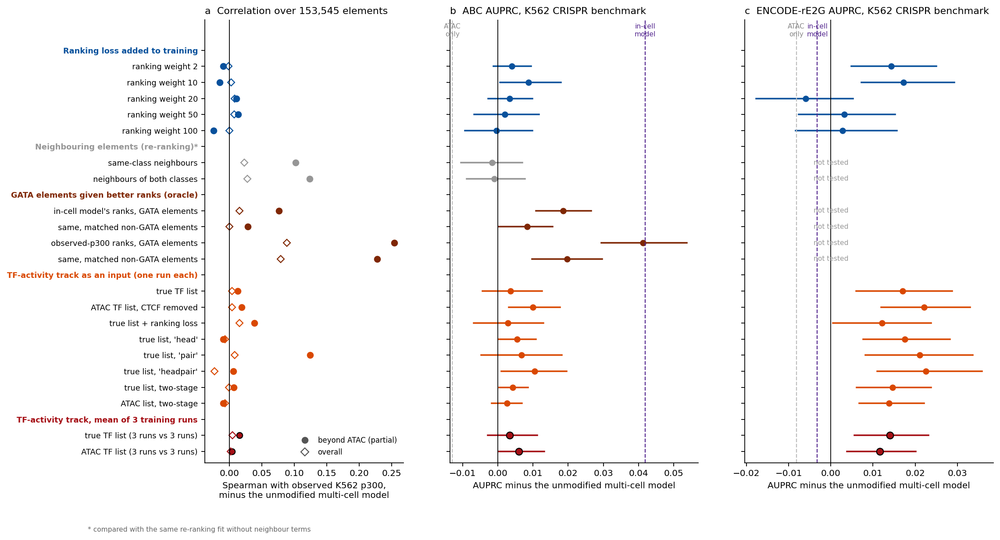

**Figure 1 | Several changes raise correlation with p300 by 0.1 or more, but none moves ABC by more than 0.011 AUPRC, against a 0.042 gap to the in-cell model.** **Headline figure.**

<details>
<summary>Full legend</summary>

**Figure 1 | Every variant tried since report 5, scored on the K562 CRISPR benchmark.** Each row is one change to the multi-cell p300 model (trained on A549, GM12878, HepG2 and MCF-7 with K562 held out). The x value is that model's AUPRC minus the AUPRC of the same model without the change (the "unmodified multi-cell model", 0.4810 in ABC and 0.5516 in ENCODE-rE2G), from a paired bootstrap: 2,000 resamples of the element-gene pairs, the same resample applied to both arms. Bars are 95% percentile intervals. **b**, ABC with the predicted p300 as the activity term (10,342 pairs, 466 regulated). **c**, ENCODE-rE2G retrained with the predicted p300 in its activity features (10,356 pairs, 471 regulated). Dashed lines: the ATAC-only floor and the in-cell model (a model trained on K562 itself). In ENCODE-rE2G the in-cell model scores below the unmodified multi-cell model (0.5484 against 0.5516). Rows marked with a black outline are the mean of three independent training runs per model against three runs of the unmodified model; all other rows are one training run. Neighbour rows are compared with the same re-ranking fit without neighbour terms. The GATA oracle rows use observed K562 information and are upper bounds, not deployable models. **a**, the same comparison on correlation: Spearman correlation of each arm's K562 activity track (the value ABC reads for each of 153,545 candidate elements) with observed K562 p300 counted the same way, minus the same quantity for the comparator. Filled circles: non-promoter candidates after removing ATAC rank and its square from both (the part beyond accessibility); open diamonds: all candidates. The unmodified multi-cell model scores 0.693 overall and 0.268 beyond ATAC. The largest correlation gains that did not become AUPRC gains: the 'pair' loss (+0.125 beyond ATAC, ABC +0.0068 not resolvable) and neighbour re-ranking (+0.10 and +0.12, ABC -0.0016 and -0.0010). Seed-averaged rows are means over three runs. Sources: `results/2026_0930_k562_correlation_by_arm.tsv` (`scripts/4.53`); `results/2026_09{26,27,28,29,30}_*auprc_pairs.tsv`, from `scripts/4.17` (ABC) and `scripts/4.34` (ENCODE-rE2G).
</details>

## Summary

- **The missing information is which transcription factors (TFs) are active in the target cell, but giving it to the model recovers little of it.** Elements carrying GATA motifs, the K562 master regulator, are ranked 9.5 percentile points too low by the transferred model and not by the in-cell model (Fig. 4). Re-ranking those elements directly recovers +0.022 AUPRC more than re-ranking matched non-GATA elements, yet the best model given a TF list gains only +0.006 in ABC when averaged over three runs (Fig. 1, Fig. 7).
- **Single training runs cannot separate these variants.** The same model trained three times varies with a standard deviation of 0.002 AUPRC in ABC and 0.005 in ENCODE-rE2G (Fig. 7). Every TF-track variant lies within that band of the others; the earlier single-run result that the ATAC-derived list beats the true list (+0.0065) fell to +0.0026 (not resolvable) with replicates.
- **A TF list estimated from the target cell's own ATAC works as well as the true list read from p300.** Seed-averaged, the two differ by +0.0026 in ABC and -0.0024 in ENCODE-rE2G (Fig. 1). The ATAC estimate needs no p300 in the new cell and no comparison with the training cells, so it is deployable as is.
- **Correlation gains do not become AUPRC gains, and the reverse also happens.** The 'pair' loss raises correlation beyond ATAC by +0.125 and neighbour re-ranking by +0.10 to +0.12 over 153,545 elements, with no resolvable ABC change; the ranking loss at weight 10 lowers it by 0.015 and gives the largest single-run ABC gain (+0.0087) (Fig. 1a, Fig. 3). Only the oracle re-rankings move both. Only the benchmark decides.
- **Neither expression nor fragment length adds deployable signal.** A TF list from RNA ties the ATAC-derived list when combined with it and loses alone (-0.005 ABC, -0.009 ENCODE-rE2G, three runs each), and fragment-size input channels lose to the flat input (Fig. 12a). Fragment features predict H3K27ac at the element level, but through where accessibility lies rather than nucleosome length (Figs 10-11), and correcting transferred H3K27ac with them does not reach the benchmark (Fig. 12c).
- **In ABC, the ATAC term costs observed marks AUPRC.** Observed p300 alone scores 0.591 against 0.566 as ATAC x p300, and H3K27ac 0.531 against 0.513; multiplying p300 by H3K27ac adds nothing in ABC, while in ENCODE-rE2G the combination is the best observed activity term (0.672 against 0.660 for p300, not resolved) (Fig. 12b).
- **The panel lacks cell types where GATA is active.** Of 19 ENCODE samples with p300 ChIP-seq, only stomach shows GATA activity comparable to K562's (Fig. 8). Adding cell types is the one lever not yet tried that targets the error directly.

## Goals

ABC predicts enhancer-gene links from an activity term times 3D contact. Replacing ABC's activity with p300 predicted from a cell's own ATAC and DNA sequence works when the model is trained on that cell (+0.055 AUPRC over ATAC alone, report 5), but a model trained on other cell types and applied to a new one ("transferred") recovers little of that. This report asks why the transferred model falls short and tests seven kinds of change meant to close the gap, all evaluated on the K562 CRISPR benchmark.

## The set-up and the variants in plain terms

**The model.** A BPNet-style convolutional network reads a 2,114 bp window of DNA sequence and the ATAC signal over it and predicts p300 ChIP-seq counts over the central 1 kb. The "multi-cell model" is trained on four cell types (A549, GM12878, HepG2, MCF-7) and applied to K562, which it never saw. It is scored by putting its K562 predictions into ABC and ENCODE-rE2G and measuring AUPRC (area under the precision-recall curve) against K562 CRISPR perturbation data. The "in-cell model" is the same network trained on K562; the "floor" is ABC or ENCODE-rE2G with ATAC alone.

**Terms used throughout.**

- *Partial correlation given ATAC*: the correlation between predicted and observed p300 after removing what ATAC alone explains. It measures what the model adds beyond accessibility.
- *TF-activity track*: a per-base input track equal to, at each base, the sum over motifs whose FIMO hit covers that base of a weight saying how important that motif's TF is for p300 in this cell. It is how a TF list is given to the model.
- *True TF list*: weights read from the cell's own p300 (each motif's association with p300 beyond ATAC). It is an upper bound, since a new cell has no p300.
- *ATAC TF list*: weights from the cell's own ATAC (each motif's association with accessibility), with CTCF removed. Deployable.
- *Seed replicate*: the same model trained again with a different random initialisation and batch order, on the same data.

| variant | what changes | in plain terms |
|---|---|---|
| ranking loss | a second loss term added to training (RankNet, weight 2-100) | also reward the model for putting elements in the right ORDER, since ABC keeps only ranks |
| neighbour re-ranking | a fitted re-ranking using predictions and ATAC of every element within 1 Mb | an element in a busy neighbourhood may be more active; tested as an upper bound fitted on K562 |
| GATA oracle | GATA-motif elements given their in-cell or observed-p300 ranks | how much would fixing only the GATA elements be worth? |
| TF-activity track | one extra input channel (true or ATAC TF list) | tell the model which TFs are active in this cell |
| 'head' | the track bypasses the network and adds to the predicted count through 4 weights | force the model to use the track the same way in every cell |
| 'pair' | an extra loss on the p300 difference for the same DNA in two training cells | the DNA is identical, so only ATAC and the track can explain the difference |
| two-stage | the unmodified network frozen; a 5,409-parameter network that sees only the track and ATAC adds a correction | the part that learns from the track cannot see DNA, so it cannot learn TF effects from DNA instead |

## Seven changes act at four places in the pipeline

**Q:** Where in the pipeline does each variant act?

**A:** Two change training (ranking loss, 'pair'), two re-rank the finished predictions (neighbours, GATA oracle), and three add or route the TF-activity track (track, 'head', two-stage).

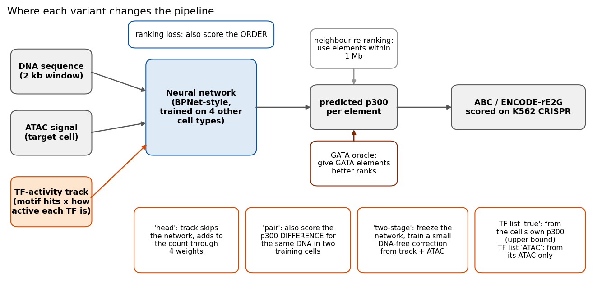

<details>
<summary>Figure 2 legend</summary>

**Figure 2 | Schematic of the variants.** The unmodified pipeline runs left to right: DNA sequence and target-cell ATAC enter the network, which predicts p300 per ABC candidate element; the predictions are scored in ABC and ENCODE-rE2G against K562 CRISPR data. Coloured boxes mark where each variant acts. Orange: the TF-activity track and the three ways of feeding it. Blue: the ranking loss. Grey: neighbour re-ranking. Brown: the GATA oracle. The two TF lists differ only in where the per-motif weights come from.
</details>

**Method.**

- Conceptual schematic; no data.

<details>
<summary>Full methods &amp; code</summary>

```bash
pixi run -e multimodal python scripts/5.3.plot_tf_activity_report_figures.py   # figures 1-8
```
Source: `scripts/5.3.plot_tf_activity_report_figures.py`, section "fig 27".
</details>

## A ranking loss gains 0.009 in ABC at weight 10; neighbour terms raise correlation but not AUPRC

**Q:** Do the two changes that do not use TF information move the benchmark?

**A:** The ranking loss at weight 10 gains +0.0087 in ABC and +0.0172 in ENCODE-rE2G in one run each, and neighbour terms change ABC by -0.0041 to +0.0039 despite raising partial correlation by up to +0.22.

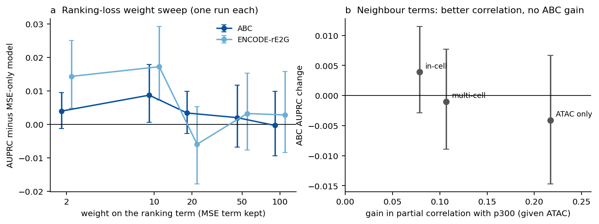

<details>
<summary>Figure 3 legend</summary>

**Figure 3 | Ranking loss and neighbour terms. a**, AUPRC of the multi-cell model trained with a RankNet pairwise ranking term (pairs of peaks within one cell type, log-count gap > 0.1) added to the counts MSE at five weights, minus the MSE-only model; one training run per weight, five chromosome folds each. Weight 10: ABC +0.0087 [+0.0006, +0.0179], ENCODE-rE2G +0.0172 [+0.0072, +0.0293]. Weights 20-100 fall back (ENCODE-rE2G weight 20: -0.0060). **b**, For three activity tracks (in-cell model, multi-cell model, ATAC alone), the gain in non-promoter partial Spearman correlation with observed p300 from adding power-law-weighted neighbour features (every candidate within 1 Mb, weight by ABC's power law; gradient boosting fitted to K562 p300 with five-fold chromosome cross-validation) against the change in ABC AUPRC from re-ranking by that fit. Partial correlation rises 0.291 to 0.397 (multi-cell), 0.437 to 0.516 (in-cell) and -0.014 to 0.203 (ATAC); ABC changes by -0.0010, +0.0039 and -0.0041, none resolvable. Sources: `results/2026_0926_ranksweep_auprc_pairs.tsv`, `results/2026_0926_re2g_ranksweep_auprc_pairs.tsv`, `results/2026_0924_neighbour_test_crossclass.tsv`, `results/2026_0926_nbrx_auprc_pairs.tsv`.
</details>

**Method.**

- Ranking loss: `train_multimodal_bpnet.py --rank-loss-weight`, `scripts/1.36`.
- Neighbour terms: `scripts/4.36` (fit), `scripts/4.37` (re-ranked tracks), ABC and CRISPR benchmark.

<details>
<summary>Full methods &amp; code</summary>

The ranking term is softplus of the negative predicted log-count difference, over every pair of training peaks in one cell type whose observed log counts differ by more than 0.1, averaged and added to the MSE term at the stated weight. Validation loss includes it, so early stopping differs between weights (best epoch 14.4 at weight 100 against 22-26 otherwise). The neighbour fit is an upper bound: it is trained on K562's own p300. A likely reason it does not help ABC is ABC's own formula, whose denominator already sums activity times contact over every element near the gene. ENCODE-rE2G was not tested with neighbour terms.

```bash
pixi run -e multimodal python scripts/4.36.neighbour_linear_test.py --graph cross
pixi run -e multimodal python scripts/4.17.paired_auprc_bootstrap.py <merged> --pair A B ...
```
Source: `scripts/5.3.plot_tf_activity_report_figures.py`, section "fig 28".
</details>

## The transferred model under-ranks GATA elements, and fixing only those would recover half the gap

**Q:** Which elements does the transferred model rank wrongly, and how much are they worth?

**A:** Elements with GATA motifs are ranked 8-10 percentile points too low relative to the in-cell model, and giving only those elements their observed-p300 ranks gains +0.022 AUPRC more than doing the same for matched non-GATA elements.

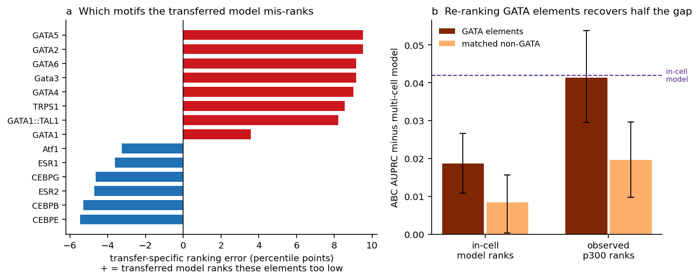

<details>
<summary>Figure 4 legend</summary>

**Figure 4 | Error anatomy and GATA oracle. a**, For each JASPAR 2024 motif, the ranking error attributable to transfer at non-promoter ABC candidates in K562. Per element, error = percentile rank of observed p300 minus percentile rank of prediction (positive = ranked too low); the transfer-specific error is the multi-cell model's error minus the in-cell model's. Bars are the regression coefficient of that error on motif presence (FIMO p < 1e-4, element centre +/- 250 bp), controlling for ATAC rank and its square, GC content, CpG observed/expected and log distance to the nearest TSS; 132,186 elements. The seven largest positive coefficients are all GATA-family matrices (GATA2 +9.52, GATA1::TAL1 +8.20); the largest negative are CEBP (CEBPB -5.29) and ESR (ESR2 -4.71), TFs active in HepG2, A549 and MCF-7 but weak in K562. **b**, ABC AUPRC when the 43,513 GATA-motif candidates (28.3%) take the in-cell model's ranks or observed p300's ranks, against the same number of non-GATA candidates matched on ATAC decile and element class taking the same ranks. GATA-specific gain (GATA minus matched): +0.0103 [-0.0001, +0.0213] with in-cell ranks, +0.0217 [+0.0060, +0.0385] with observed ranks. The in-cell model's full advantage is +0.0419 [+0.0278, +0.0556]. Sources: `results/2026_0925_p300_error_anatomy.features.tsv`, `results/2026_0927_gataoracle_auprc_pairs.tsv`.
</details>

**Method.**

- Residual screen over 153,545 K562 ABC candidates, `scripts/4.41`.
- GATA oracle tracks with matched controls, `scripts/4.42`, then ABC and the benchmark.

<details>
<summary>Full methods &amp; code</summary>

Each coefficient is computed by Frisch-Waugh-Lovell regression (covariates partialled out of both the error and the motif indicator), so it reads as "elements with this motif are ranked X points too low at matched accessibility and composition". With 132,186 elements almost every coefficient is nominally significant, so motifs are ranked by effect size. The oracle arms repaint the multi-cell track so the chosen elements take another track's within-class ranks while every other element keeps its own; they are upper bounds, since they use K562 information.

```bash
pixi run -e multimodal python scripts/4.41.p300_error_anatomy.py
pixi run -e multimodal python scripts/4.42.build_subset_oracle.py
```
Source: `scripts/5.3.plot_tf_activity_report_figures.py`, section "fig 29".
</details>

## The simplest TF-list estimate from ATAC keeps the cell-specific signal best

**Q:** How well can a cell's p300-important TFs be estimated from its ATAC and DNA alone?

**A:** Plain ATAC association with motif presence, with CTCF and similar motifs removed, keeps the cell-specific part best (Spearman 0.42), while learned estimators rank motifs better overall (up to 0.69) by learning what matters in every cell and lose the cell-specific part (0.11-0.37).

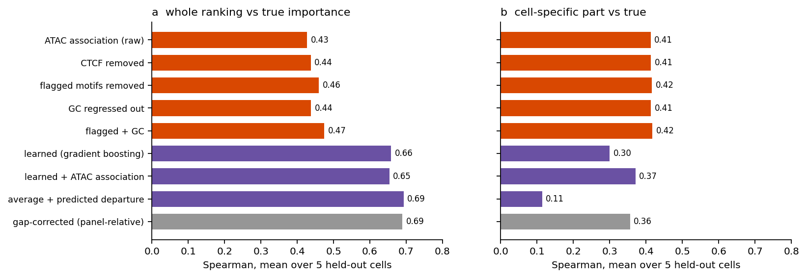

<details>
<summary>Figure 5 legend</summary>

**Figure 5 | TF-list estimators against the true TF importance, leave one cell type out.** Truth: each motif's coefficient for p300 beyond ATAC in that cell, from the cell's own p300 (782 JASPAR motifs, five cell types). Every estimator uses the held-out cell's ATAC and sequence only, plus, for the learned ones, the other four cells' p300. **a**, Spearman correlation across motifs with the truth, mean over the five held-out cells. **b**, The same for the cell-specific part: estimate and truth each minus the mean truth of the other four cells. Orange: ATAC association (coefficient of within-cell ATAC rank on motif presence, controlling for GC, CpG and TSS distance) and its corrections. "Flagged motifs removed" drops about 30 motifs whose ATAC association exceeds their true importance in at least three of the other four cells: CTCF/CTCFL and GC-rich, CpG-island-like motifs (KLF, SP, E2F, ZIC, ZBED4, ZNF417). "GC regressed out" removes motif GC, GC squared and CpG content. Purple: gradient boosting on eight motif-level ATAC features (association, top-decile association, promoter fraction, prevalence, CTCF co-occurrence, footprint depth and flank height, motif GC); "learned + ATAC association" mixes the two with weights fitted on the training cells; "average + predicted departure" adds a model of each cell's departure to the training cells' mean truth. Grey: "gap-corrected" subtracts each motif's average (association minus truth) over the training cells, which is algebraically the training cells' mean truth plus the target's association minus the training cells' mean association, i.e. a reference-based estimate. In K562 the GATA family scores +3.88 in the truth, +3.22 raw, +3.69 flagged + GC and +1.15 learned. Sources: `results/2026_0928_learned_importance_variants.scores.tsv`, `results/2026_0929_corrected_tf_list.scores.tsv`.
</details>

**Method.**

- Truth and ATAC association over the union of the five cells' ABC candidates, `scripts/4.43`.
- Learned estimators `scripts/4.47`, `scripts/4.48`; corrections `scripts/4.50`.

<details>
<summary>Full methods &amp; code</summary>

The learned estimators gain overall Spearman by learning which motifs matter for p300 beyond ATAC in every cell (AP-1 tops the learned K562 list), which the transferred model already has from sequence. The cell-specific part is what F-032 says is missing, and plain ATAC association carries it best (K562 departure Spearman 0.77). Raw association's one large K562 error is CTCF: rank 1 by association, rank 741 of 782 in the truth. Removed motifs are set to weight 0 ("no information"), as in the TF-activity track. Motif-level scores are proxies: they weight all 782 motifs equally, while the benchmark depends on how the track changes the ranking of 3,406 CRISPR-tested elements.

```bash
pixi run -e multimodal python scripts/4.47.learned_motif_importance.py
pixi run -e multimodal python scripts/4.48.learned_importance_variants.py
pixi run -e multimodal python scripts/4.50.corrected_tf_list.py --remove-to zero
```
Source: `scripts/5.3.plot_tf_activity_report_figures.py`, section "fig 30".
</details>

## Given the true TF list, the model removes a third of the GATA error; the cross-cell 'pair' loss removes two thirds

**Q:** Does the TF-activity track fix the GATA, CEBP and ESR errors it was designed to fix?

**A:** Partly: the GATA error falls from +5.7 to +3.1 percentile points with the true TF list and to +2.1 with the 'pair' loss, the in-cell model is at -2.6, and none of these reductions changed ABC by a resolvable margin over the track alone.

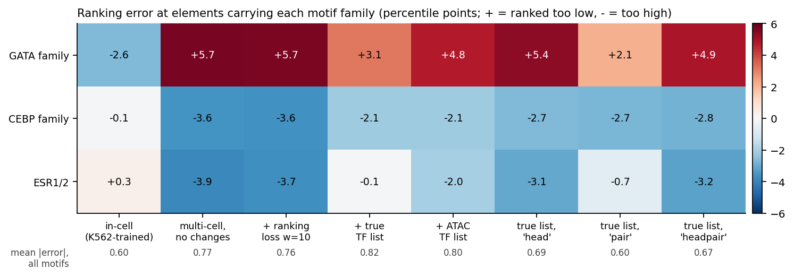

<details>
<summary>Figure 6 legend</summary>

**Figure 6 | Ranking error at elements carrying each motif family, per model.** Each cell is the mean regression coefficient (as in Fig. 4a, but for each model's own error rather than the transfer-specific difference) over the motifs in that family: GATA (8 matrices including TRPS1 and GATA1::TAL1), CEBP (CEBPA/B/D/E/G) and ESR1/2; positive = elements ranked too low. Columns: the in-cell model; the unmodified multi-cell model; with the ranking loss at weight 10; with the TF-activity track from the true list; with the ATAC list; and the three ways of teaching the model to use the true-list track. The row below the heatmap is the mean absolute coefficient over all motifs, a measure of how much motif-linked error remains overall: 0.60 in-cell, 0.77 unmodified, 0.60 with 'pair'. The ranking loss leaves every family unchanged. Source: `results/2026_0928_p300_error_anatomy_teach.features.tsv`, from `scripts/4.41 --extra`.
</details>

**Method.**

- Error screen (`scripts/4.41 --extra`) rerun on each model's K562 ABC run.
- 'head', 'pair', 'headpair': `scripts/1.38`; two-stage: `scripts/1.39`.

<details>
<summary>Full methods &amp; code</summary>

'head' routes the track around the network into four weights on the predicted log count: positive and negative motif weights averaged over the counts window, each also multiplied by softplus(ATAC). The learned weights have the expected signs (positive motifs +0.09 to +0.30, negative motifs -0.49 to -1.24). 'pair' samples 20,000 training-peak windows, extracts each in all four training cells, and adds a loss, weight 10, on the predicted minus observed log-count difference between two cells, centred within each cell pair so library depth cancels. 'headpair' does both. Two-stage freezes the unmodified multi-cell model fold by fold and trains only a DNA-free network (21 bp convolution and six dilated residual layers, 16 channels) on the track and ATAC, zero-initialised so it starts as the frozen model. The head alone barely changes the GATA error, which suggests the track has to interact with sequence and ATAC inside the network. The 'pair' result shows the error screen and the benchmark coming apart: the screen covers all 153,545 candidates, the benchmark only the 3,406 CRISPR-tested elements.

```bash
sbatch scripts/1.38.submit_multicell_p300_teach.sh        # head, pair, headpair
WEIGHTING=oracle sbatch scripts/1.39.submit_multicell_p300_twostage.sh
```
Source: `scripts/5.3.plot_tf_activity_report_figures.py`, section "fig 31".
</details>

## Three training runs per model put the noise at 0.002 AUPRC in ABC and 0.005 in ENCODE-rE2G

**Q:** How large are the differences between training runs of one model, and what is left of the TF-track gain once they are averaged?

**A:** Runs of one model differ with a standard deviation of 0.0016-0.0021 in ABC and 0.0030-0.0064 in ENCODE-rE2G, and seed-averaged the ATAC TF list gains +0.0059 [+0.0001, +0.0132] in ABC and +0.0116 [+0.0038, +0.0202] in ENCODE-rE2G.

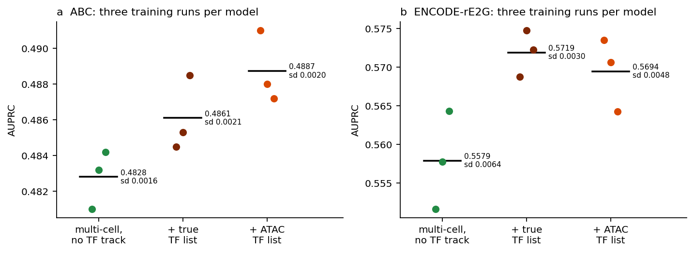

<details>
<summary>Figure 7 legend</summary>

**Figure 7 | Seed replicates.** Three models, each trained three times (the original run and seeds 1 and 2; `--seed` sets torch, numpy and batch order, same data), each run through its own K562 prediction, ABC run and ENCODE-rE2G training. Points are individual runs; the bar is the mean. **a**, ABC AUPRC. **b**, ENCODE-rE2G AUPRC. Seed-averaged contrasts (mean AUPRC of three runs, computed inside each of 2,000 paired bootstrap draws): true TF list minus unmodified, ABC +0.0033 [-0.0029, +0.0112], ENCODE-rE2G +0.0140 [+0.0056, +0.0232]; ATAC TF list minus unmodified, ABC +0.0059 [+0.0001, +0.0132], ENCODE-rE2G +0.0116 [+0.0038, +0.0202]; ATAC minus true list, ABC +0.0026 [-0.0012, +0.0063], ENCODE-rE2G -0.0024 [-0.0073, +0.0027]. Two runs of the identical unmodified model differ resolvably in ENCODE-rE2G (seed 2 minus original, +0.0126 [+0.0024, +0.0243]). The single-run ATAC-list result in Fig. 1 (+0.0100 ABC) was the highest of its three runs. Per-run values from the logs of `scripts/4.17 --group` (`log/seeds_boot.46073940.txt`) and `scripts/4.34 --group` (`log/re2g_seeds_boot.46073942.txt`); contrasts in `results/2026_0930_seeds_auprc_pairs.tsv` and `results/2026_0930_re2g_seeds_auprc_pairs.tsv`.
</details>

**Method.**

- `scripts/1.37` with `SEED=1,2` (and `WEIGHTING=none` for the unmodified model).
- Seed-averaged paired bootstrap, `scripts/4.17 --group`, `scripts/4.34 --group`.

<details>
<summary>Full methods &amp; code</summary>

With a run-to-run standard deviation of 0.002, two single runs differ by about 0.003 by chance, so a real difference of that size needs about three runs per model to resolve. The two-stage models were compared with their one frozen base model, not seed-averaged: true TF list +0.0042 [+0.0003, +0.0086] in ABC and +0.0146 [+0.0062, +0.0238] in ENCODE-rE2G; ATAC TF list +0.0027 [-0.0017, +0.0069] and +0.0138 [+0.0068, +0.0222]. They gain as much as the end-to-end track model. The two-stage model was built to test one concern: within a training cell the track says nothing the DNA does not, so a network that sees both could learn TF effects from the DNA and ignore the track. Its correction cannot see DNA, and it gains no more, so that shortcut does not explain the small gain; the limit is the information the track itself carries.

```bash
WEIGHTING=none SEED=1 sbatch scripts/1.37.submit_multicell_p300_motifact.sh    # and SEED=2; oracle; assoc_noctcf
pixi run -e multimodal python scripts/4.17.paired_auprc_bootstrap.py <merged> --group mse=A,B,C --group ctcf=D,E,F --pair ctcf mse
```
Source: `scripts/5.3.plot_tf_activity_report_figures.py`, section "fig 32".
</details>

## Among 19 ENCODE samples with p300, only stomach shows K562-like GATA activity

**Q:** Which cell types with public p300 data would add the TF programmes the training panel lacks?

**A:** Among ATAC samples, ovary (NR3C1, NR5A1, PGR), transverse colon (CDX1/2, HNF4A) and gastro-oesophageal sphincter (MEF2, SRF) add the most new TF families, and stomach is the only one adding the GATA2 family, raising coverage of K562's top-10 families from 60% to 70%.

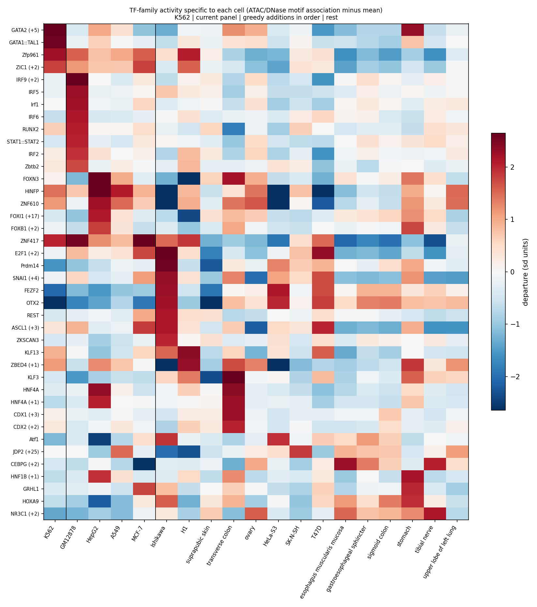

<details>
<summary>Figure 8 legend</summary>

**Figure 8 | TF-family activity specific to each candidate cell type.** Rows: the 40 motif families with the largest reliable activity anywhere; columns: K562, the current panel, then the remaining candidates in the order a coverage-maximising greedy selection including the DNase samples picked them. Colour: family score (mean standardised ATAC or DNase association of its motifs, as in Fig. 5) minus the family's mean over all 19 candidates. Candidates: every ENCODE biosample with released human EP300 ChIP-seq and ATAC or DNase (19; ENCODE pseudoreplicated ATAC peaks or DNase peaks, up to 300,000 per sample). Motifs clustered into 434 families by co-occurrence of their FIMO hits (Pearson r >= 0.5). A family counts as active in a cell only as far as the odd and even chromosomes agree (the minimum of the two halves; split-half Spearman 0.42-0.86 by cell). The estimate recovers K562's GATA1::TAL1 and GATA2 families as its top two and agrees with the p300-based truth-panel scores at Spearman 0.80-0.85 (MCF-7 0.47). The block lighting up Ishikawa, HeLa-S3 and T47D (FEZF2, OTX2, Prdm14) is specific to the DNase samples as a group, i.e. the assay. Sources: `results/2026_0929_panel_tf_diversity_loose.*`, `results/2026_0930_panel_selection_variants.tsv`.
</details>

| step | add (ATAC candidates only) | main new TF families | K562 top-10 covered |
|---|---|---|---|
| 0 | current panel | | 60% |
| 1 | ovary | NR3C1, NR5A1, PGR | 60% |
| 2 | transverse colon | CDX1/2, KLF, HNF4A | 60% |
| 3 | gastro-oesophageal sphincter | MEF2B, SRF | 60% |
| 4 | stomach | GATA2 family, HOXA9 | 70% |
| 5 | tibial nerve | CEBPA, HLF/DBP | 70% |
| 6 | SK-N-SH | MAFK, NKX2-3, PAX3 | 70% |

**Method.**

- Per candidate: ATAC or DNase association with motif presence at non-promoter peaks, `scripts/4.49`.
- Greedy facility-location selection over reliable family departures, restricted to ATAC samples, `scripts/4.52`.

<details>
<summary>Full methods &amp; code</summary>

Coverage of a panel is the sum over families of the largest positive reliable departure among its cells, so a cell earns credit for families no chosen cell already has. K562 is never a candidate; its top 10 families measure what a panel covers (a family is covered when some panel cell reaches half K562's departure). With GC-rich and zinc-finger families removed, the current panel covers 40% of K562's top 10 and adding stomach and tibial nerve raises it to 80%. The erythroid pair GATA1::TAL1 is active in no candidate. Tissues are mixtures of cell types, so their p300 signal will be blurrier than a cell line's. The p300 and donor-matched ATAC alignments for stomach (ENCSR684NJD, ENCSR851SBY), transverse colon (ENCSR429JTR, ENCSR668VCT) and ovary (ENCSR696LQU, ENCSR490MSG) have been downloaded (`reference/p300_tissue_manifest.tsv`) and not yet processed.

```bash
sbatch scripts/4.49.submit_panel_tf_diversity.sh
pixi run -e multimodal python scripts/4.52.panel_selection_variants.py
```
Source: `scripts/4.49.panel_tf_diversity.py` (heatmap), copied by `scripts/5.3` as figure 33.
</details>

## Nucleosome arrangement from ATAC fragment lengths adds 0.06-0.16 partial correlation with p300 but not a better TF list

**Q:** Does the nucleosome arrangement around an element, read from paired-end ATAC fragment lengths, carry p300 signal beyond accessibility?

**A:** A score combining nine fragment-length features, with weights fitted on the other four cell types, adds partial Spearman 0.06-0.16 with p300 beyond ATAC (K562 0.16), but the individual features change sign between cell types and, used to rank motifs, the score keeps less of the cell-specific signal than ATAC association (0.19 against 0.41).

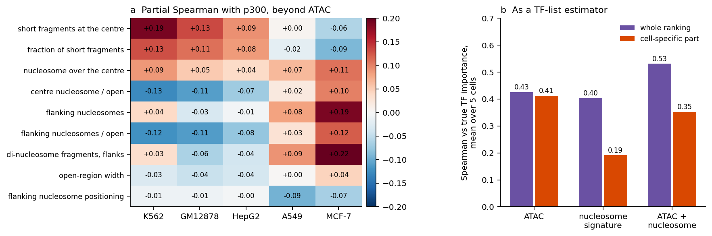

<details>
<summary>Figure 9 legend</summary>

**Figure 9 | Nucleosome signature. a**, Partial Spearman correlation of each fragment-length feature with observed p300 at non-promoter ABC candidates (121,219-126,124 per cell with at least 10 fragments), after removing ATAC (rank, rank squared), GC, CpG observed/expected and log distance to TSS. Features from paired-end fragments with MAPQ >= 30 and midpoint within 1 kb of the element centre: short fragments (< 120 bp) within 100 bp of the centre; mono-nucleosome fragments (150-250 bp) over the centre or in the 100-450 bp flanks; di-nucleosome fragments (300-450 bp) in the flanks; the distance between the strongest flanking dyads; and the fraction of flanking mono-nucleosome midpoints within 40 bp of those dyads. In K562, GM12878 and HepG2 an open centre (short fragments) goes with more p300; in MCF-7 flanking nucleosomes do and short fragments do not, the library dependence F-005 found for fragment-size input channels. A joint score (least-squares weights fitted on the other four cells) gives leave-one-cell-out partial correlation 0.162 (K562), 0.082, 0.062, 0.127 and 0.065 (GM12878, HepG2, A549, MCF-7); for reference the in-cell sequence + ATAC model reaches 0.43 and the transferred multi-cell model 0.27 in K562. **b**, Motif association with the joint score used as a TF list, scored as in Fig. 5. Adding it to ATAC association raises the whole-ranking Spearman from 0.43 to 0.53 and ranks the GATA family exactly as the truth does in K562 (+3.89 against +3.88), but lowers the cell-specific part from 0.41 to 0.35. Source: `results/2026_0930_nucleosome_signature.*`, from `scripts/4.51`.
</details>

**Method.**

- Fragment scan of each cell's ATAC BAMs over its ABC candidates, `scripts/4.51 features`.
- Partial correlation and TF-list scoring, `scripts/4.51 analyze`.

<details>
<summary>Full methods &amp; code</summary>

K562 used the three paired-end ATAC BAMs behind its ATAC track (ENCFF077FBI, ENCFF128WZG, ENCFF534DCE), GM12878 ENCFF440GRZ, ENCFF962FMH and ENCFF981FXV, and the other three cells their panel ATAC BAMs. The signature is a within-cell signal, so library differences between cells matter less here than for a model input, but the sign changes in panel a show they still matter for the weights. As a model input the nucleosome score would need its own training run; it has not been tried.

```bash
sbatch scripts/4.51.submit_nucleosome_signature.sh
pixi run -e multimodal python scripts/4.51.nucleosome_signature.py analyze
```
Source: `scripts/5.3.plot_tf_activity_report_figures.py`, section "fig 34".
</details>

## At matched accessibility, H3K27ac-high elements sit in broad accessible domains, while p300-high elements have a sharper open centre

**Q:** Do the same fragment features predict H3K27ac beyond ATAC, and what do the fragments look like at elements with more p300 or more H3K27ac than their ATAC predicts?

**A:** The joint fragment score predicts H3K27ac beyond ATAC about three times as well as p300 (partial Spearman 0.52 against 0.22 in K562, 0.48 against 0.16 in GM12878, weights from the other cell), with the opposite sign: H3K27ac-high elements have their accessibility spread over +/- 1 kb, H3K27ac-low elements are one narrow central peak, and p300-high elements have a taller central peak.

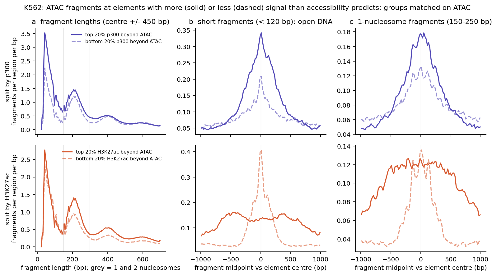

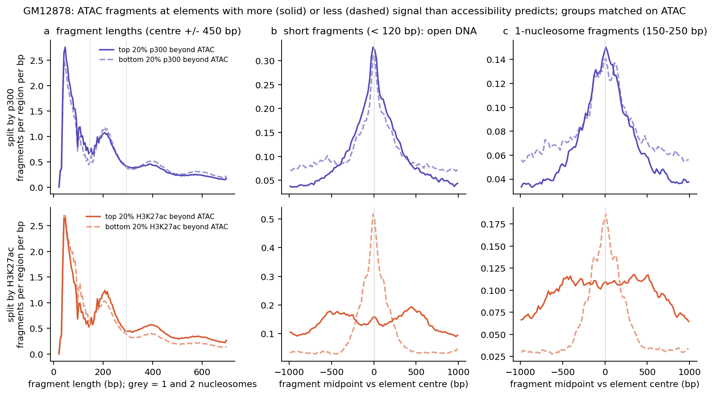

<details>
<summary>Figure 10 legend</summary>

**Figure 10 | ATAC fragment profiles at elements with more or less p300 or H3K27ac than accessibility predicts. Top, K562; bottom, GM12878.** In each cell, non-promoter ABC candidates with at least 10 fragments (121,219 in K562, 124,613 in GM12878) were ranked by the residual of observed p300 (upper row of each figure, purple) or observed H3K27ac over the candidate (lower row, orange) after removing ATAC over the candidate (rank, rank squared), GC, CpG observed/expected and log distance to TSS. 3,000 regions were sampled from the top 20% (solid) and bottom 20% (dashed) of each residual; mean ATAC percentile over the candidate is 0.46-0.51 in every group, so the groups are matched on accessibility. Paired-end ATAC fragments with MAPQ >= 30 and midpoint within 1 kb of the centre, per region. **a**, Fragment-length distribution for midpoints within 450 bp; grey lines at one (147 bp) and two (294 bp) nucleosomes. **b**, Midpoints of short fragments (< 120 bp, nucleosome-free DNA), 20 bp bins. **c**, Midpoints of one-nucleosome fragments (150-250 bp). p300-high elements have a taller central peak of short fragments (K562 249 against 171 short fragments per region; in GM12878 the centres match and the p300-low group has more distant fragments). H3K27ac-high elements have no central peak: short and nucleosome fragments spread over +/- 1 kb with short-fragment maxima near +/- 450 bp, while H3K27ac-low elements are one narrow central peak. The fragment features therefore measure mainly how accessibility is spread around the element. In the same regions the joint score of the nine fragment features (least-squares weights fitted in the other cell) gives partial Spearman 0.521 (K562) and 0.476 (GM12878) with H3K27ac over the candidate, 0.454 and 0.397 with H3K27ac within 1 kb of the centre, and 0.224 and 0.162 with p300; in-cell weights add at most 0.012. Eight of nine features have the same sign in both cells for H3K27ac, seven of nine for p300. Only K562 and GM12878 have H3K27ac ChIP-seq in this project. Source: `results/2026_0930_nucleosome_vs_h3k27ac.*` (`scripts/4.55`) and `results/2026_0930_nucleosome_profiles.tsv.gz` (`scripts/4.56`); F-039.
</details>

**Method.**

- Fragment features from `scripts/4.51`; residuals and partial correlations for p300 and H3K27ac, `scripts/4.55`.
- Profiles of top and bottom residual quintiles from the ATAC BAMs, `scripts/4.56`.

<details>
<summary>Full methods &amp; code</summary>

Targets are 5' ChIP-seq bigwigs (plus and minus strands) summed over the candidate: p300 as in Fig. 9; H3K27ac from the model training targets (`data/h3k27ac_5p_*.bw`, `data/gm12878_h3k27ac_5p_*.bw`), over the candidate and within 1 kb of its centre. The joint score is an ordinary least-squares fit of the target residual on the nine rank-transformed, residualised features. Sampling uses a fixed seed (0). The fragment scan reads the same BAMs as Fig. 9.

A benchmark test of the ranked features is running (`scripts/4.57`): the transferred H3K27ac prediction (GM12878 model applied to K562) corrected with ATAC, composition, ATAC within 1 kb and the fragment features, with weights fitted in GM12878 on the K562 model's prediction there. At the element level in K562 it raises Spearman with observed H3K27ac from 0.732 to 0.787 (the in-cell K562 model reaches 0.791), but recalibration with ATAC and composition alone gives 0.774, and ATAC within 1 kb matches the fragment features. ABC and CRISPR results are pending.

```bash
sbatch scripts/4.55.submit_nucleosome_vs_h3k27ac.sh
pixi run -e multimodal python scripts/4.56.nucleosome_profiles.py
```
Source: `scripts/4.56.nucleosome_profiles.py`.
</details>

## Nucleosome-length fragments in the flanks are not longer next to H3K27ac-high elements, even at the adjacent nucleosome

**Q:** Are one-nucleosome ATAC fragments in the flanks of H3K27ac-high (or p300-high) peaks ~10-15 bp longer than in the flanks of inactive peaks, as expected if acetylated nucleosomes protect or are spaced by more DNA?

**A:** No: matched on ATAC, H3K27ac-high flanks are 0.2 bp (whole 1 kb flank) to 1.3 bp (adjacent nucleosome) shorter than H3K27ac-low flanks, with 95% intervals of about +/- 0.5 bp; the only consistent differences are ~2 bp longer fragments next to weak inactive peaks and the shortest fragments (203 bp) next to CTCF.

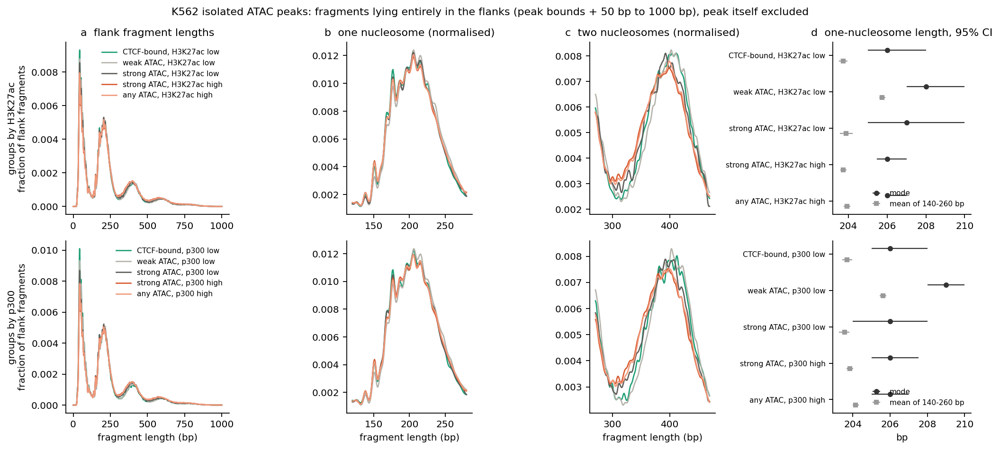

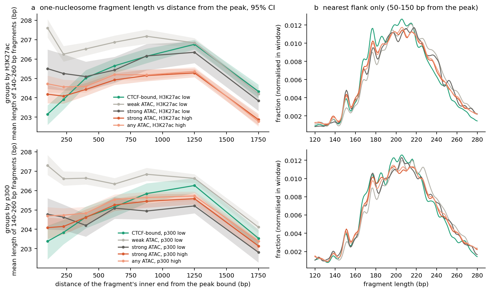

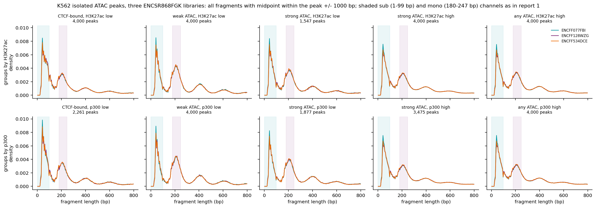

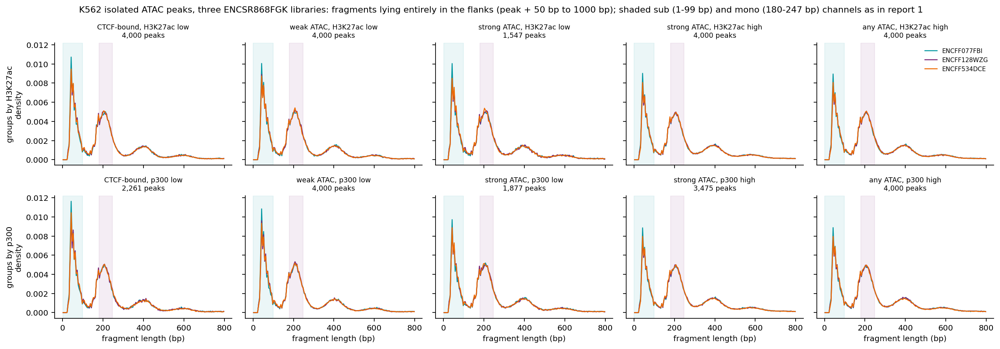

<details>
<summary>Figure 11 legend</summary>

**Figure 11 | ATAC fragment lengths in the flanks of isolated K562 peaks, by H3K27ac, p300 and CTCF.** Peaks: K562 ATAC MACS2 calls from the July ABC run, one row per distinct peak, -log10 q >= 2, more than 1 kb from a GENCODE v43 TSS and with no other confident peak within 2 kb of either bound (91,528 peaks; 62,537 at 3 kb isolation for the 2 kb window). Classification among these peaks: ATAC = 5' ATAC over summit +/- 250 bp (strong = top third, weak = bottom third); H3K27ac = 5' ChIP over summit +/- 1 kb; p300 = 5' ChIP over summit +/- 250 bp (low = bottom 40%, high = top 20%); CTCF-bound = FIMO CTCF motif (MA0139.2, MA1929.2 or MA1930.2, -log10 p >= 5) within 100 bp of the summit and CTCF ChIP-seq (ENCFF216XRV) reads within 250 bp in the top quarter; all other groups are CTCF-free (no motif, ChIP below median). Up to 4,000 peaks sampled per group (1,145-4,000). Fragments: proper pairs, MAPQ >= 30, not duplicates, from the three ENCSR868FGK libraries. **Top (fig36, 1 kb flanks)**: fragments lying entirely between the MACS2 bound + 50 bp and 1 kb out. **a**, length distribution per group (upper row grouped by H3K27ac, lower by p300); **b**, one-nucleosome peak and **c**, two-nucleosome peak, each normalised within the window; **d**, one-nucleosome length per group, mode of the smoothed histogram in 130-260 bp (dark) and mean of 140-260 bp fragments (grey), 95% intervals from 300 bootstrap resamples of peaks. **Second (fig38, 2 kb flanks)**: **a**, mean length of 140-260 bp fragments against the distance of the fragment's inner end from the peak bound, with 95% intervals; **b**, length distribution in the nearest bin (50-150 bp out). The outermost bin is biased short because a fragment must end inside the window. Nearest bin: strong ATAC, H3K27ac low 205.5 [204.5, 206.5] against H3K27ac high 204.2 [203.7, 204.7]; weak ATAC, H3K27ac low 207.6 [207.1, 208.1]; CTCF-bound 203.2 [202.6, 203.6], rising to 206.8 at 1-1.5 kb. Flank GC 0.41-0.45 in every group. **Third and fourth (fig37)**: per-library fragment-length density in the style of report 1 Fig. 5 (5 bp bins, sub 1-99 bp and mono 180-247 bp shaded), all fragments with midpoint within the peak +/- 1 kb (third) and flank-only fragments (fourth). The three libraries superimpose in every group; the groups differ in the standard view and nearly converge once the peak is excluded, so those differences come from the peak itself. Source: `results/2026_0930_flank_fragment_lengths_w{1000,2000}.*` from `scripts/4.59`; F-040.
</details>

**Method.**

- Isolated non-promoter K562 ATAC peaks grouped by ATAC, H3K27ac or p300 and CTCF.
- Lengths of fragments lying entirely in the flanks, overall and by distance from the peak; bootstrap over peaks.

<details>
<summary>Full methods &amp; code</summary>

The hypothesis predicts a shift of the one-nucleosome peak (more DNA protected per nucleosome) or of the two-nucleosome peak (longer linkers). The two-nucleosome peak is too broad to resolve the repeat length (intervals about 10 bp), so the test rests on the one-nucleosome peak, whose mean is resolved to about +/- 0.5 bp. Because H3K27ac sits mostly on the nucleosomes next to the open site, lengths are also reported by distance from the peak bound (50-150, 150-300, 300-500, 500-750, 750-1000, 1000-1500 and 1500-2000 bp); the effect is absent in the nearest bin. ATAC fragment length reflects where Tn5 can cut in the linkers rather than the nucleosome footprint itself; MNase-seq would test the footprint directly.

```bash
sbatch -p engreitz,normal -c 2 --mem 24G -t 3:00:00 --wrap "pixi run -e multimodal python scripts/4.59.flank_fragment_lengths.py --window 1000 --isolation 2000 --out-prefix results/2026_0930_flank_fragment_lengths_w1000"
sbatch -p engreitz,normal -c 2 --mem 24G -t 3:00:00 --wrap "pixi run -e multimodal python scripts/4.59.flank_fragment_lengths.py --window 2000 --isolation 3000 --out-prefix results/2026_0930_flank_fragment_lengths_w2000"
```
Source: `scripts/4.59.flank_fragment_lengths.py`.
</details>

## RNA TF lists and fragment channels do not help; observed p300 and H3K27ac do best without ATAC in ABC

**Q:** Do TF lists from RNA, fragment-size input channels, or combining p300 with H3K27ac improve the K562 benchmark?

**A:** RNA and fragment channels do not (best: RNA + ATAC TF list ties the ATAC list, -0.0001 ABC); among observed marks, removing ATAC from ABC's activity raises p300 from 0.566 to 0.591, and p300 x H3K27ac adds nothing in ABC but leads in ENCODE-rE2G (0.672 against 0.660); the deployable combination loses to predicted p300 alone (-0.010 ABC).

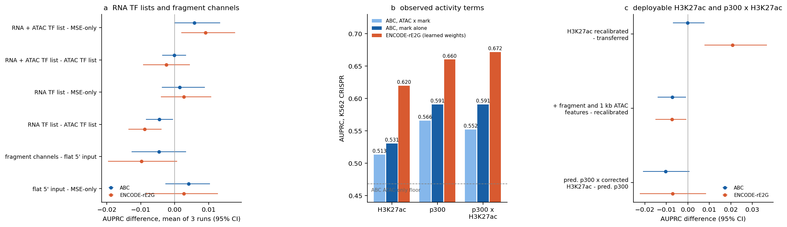

<details>
<summary>Figure 12 legend</summary>

**Figure 12 | Benchmark results for RNA TF lists, fragment channels and p300 x H3K27ac.** All arms on the K562 CRISPR benchmark (ABC: 10,342 element-gene pairs, 466 regulated; ENCODE-rE2G: 10,356 pairs, 471 regulated); paired bootstrap, 2,000 resamples of the pairs, 95% percentile intervals. **a**, Seed-averaged differences (mean AUPRC of three training runs inside every resample). RNA TF list: each motif weighted by the log TPM of its TF, maximum over its motif co-occurrence family (ENCODE Gingeras poly(A) RNA-seq, both replicates, five cell types; `scripts/4.54`); RNA + ATAC: z-sum of that and the ATAC-association weight (CTCF removed). ATAC TF list = the assoc_noctcf channel (Fig. 7). Fragment channels: 5' ATAC insertions split into sub (<= 139 bp), mono (140-329), di (330-620) and poly (>= 621) fragments plus total, against total 5' insertions only (flat 5'), both with the multi-cell architecture. **b**, Observed activity terms, each painted over the July K562 candidates from 5' ChIP-seq bigwigs (p300 ENCSR000EGE; H3K27ac, the H3K27ac-model targets) so all go through ABC's bigwig counting path. Light blue: ABC activity = geometric mean of ATAC and the mark (ABC's default); dark blue: the mark alone as activity; orange: ENCODE-rE2G retrained with the mark in its activity features (rE2G always includes ATAC features). p300 x H3K27ac = square root of the product of the two marks after mapping each to ABC's quantile reference. Dashed: ABC ATAC-only floor (0.468). ABC differences: p300 alone - ATAC x p300 +0.025 [+0.007, +0.043]; H3K27ac alone - ATAC x H3K27ac +0.017 [+0.002, +0.032]; p300 x H3K27ac alone - p300 alone +0.0001 [-0.018, +0.018]. ENCODE-rE2G: p300 x H3K27ac - p300 +0.012 [-0.003, +0.026]; - H3K27ac +0.052 [+0.031, +0.074]. Painting costs 0.016 (ABC) and 0.007 (rE2G) for H3K27ac against read-count arms, so compare within the painted set. **c**, Deployable arms (single runs). H3K27ac transferred from the GM12878 model, recalibrated with K562 ATAC and sequence composition using weights fitted in GM12878 on the K562 model's predictions there; then with fragment features and ATAC within 1 kb added (`scripts/4.57`). Predicted p300 (multi-cell, MSE-only) x corrected H3K27ac (`scripts/4.58`), against predicted p300 alone. Recalibration helps rE2G (+0.021) but only to its ATAC-only level (0.541 against 0.544). Sources: `results/2026_1001_{rna,frag,k27frag,k27frag_obsonly,re2g}_auprc_pairs.tsv`; F-041 to F-043.
</details>

**Method.**

- Three training runs per TF-list and fragment-channel model; seed-averaged paired bootstrap (`scripts/4.17`, `scripts/4.34 --group`).
- Observed and predicted p300 x H3K27ac tracks painted over the shared candidates (`scripts/4.58`).

<details>
<summary>Full methods &amp; code</summary>

RNA weights: `scripts/4.54` (gene symbols from GENCODE v43; a heterodimer motif takes the lower of its partners' expression), then `scripts/4.45 --weighting rnafam|rnaatac` and `scripts/1.37 WEIGHTING=... SEED=0,1,2`. Fragment channels: `scripts/0.23` (5' insertions by fragment size) and `scripts/1.40 ARM=flat5p|frag5p SEED=0,1,2`. H3K27ac correction: `scripts/4.57` after the mirror prediction (K562 model applied to GM12878 candidates, `scripts/4.1`). Combinations: `scripts/4.58`. ABC: `scripts/4.3 --arms rna|frag|k27frag`, `scripts/4.5`; CRISPR: `scripts/4.6`, `scripts/4.7`; ENCODE-rE2G: `scripts/4.32 --stage-new`, `scripts/4.33`.

```bash
pixi run -e multimodal python scripts/5.4.plot_benchmark_round2.py
```
Source: `scripts/5.4.plot_benchmark_round2.py`.
</details>

## Datasets

| dataset | assay / system | source |
|---|---|---|
| K562 CRISPR benchmark | CRISPRi element-gene pairs in K562, the ENCODE-rE2G training set; 10,342 pairs (466 regulated) in ABC, 10,356 (471) in ENCODE-rE2G | Gschwind et al. 2023 (ENCODE-rE2G); scored with EngreitzLab/CRISPR_comparison |
| p300 ChIP-seq, training panel and K562 | ENCODE EP300 ChIP-seq | K562 ENCSR000EGE; A549 ENCSR686BQM; HepG2 ENCSR000EDV; MCF-7 ENCSR000BTR; GM12878 peaks ENCFF926AKK |
| ATAC-seq, same cell types | ENCODE ATAC-seq, paired-end, Snyder lab | K562 ENCSR868FGK; A549 ENCSR032RGS; HepG2 ENCSR291GJU; MCF-7 ENCSR422SUG; GM12878 ENCFF440GRZ, ENCFF962FMH, ENCFF981FXV |
| H3K27ac and CTCF ChIP-seq, K562 and GM12878 | ENCODE ChIP-seq; H3K27ac as the H3K27ac-model training targets (5' bigwigs); K562 CTCF ENCFF216XRV | used in Figs 10-11 |
| motif matrices | JASPAR 2024 CORE vertebrates, non-redundant (879 matrices) | Rauluseviciute et al. 2024, Nucleic Acids Res |
| motif hits | FIMO, p < 1e-4, both strands; hits on N bases dropped | memelite implementation of FIMO (Grant et al. 2011) |
| enhancer-gene models | ABC (Fulco et al. 2019; Nasser et al. 2021); ENCODE-rE2G (Gschwind et al. 2023) | EngreitzLab repositories, versions under `ABC_working` and `ENCODE_rE2G` |
| panel candidates | 19 ENCODE ATAC or DNase peak files for every biosample with released human EP300 ChIP-seq | `config/panel_candidates_loose.tsv`, accessed 2026-09-29 |
| TSS annotation | GENCODE v43 collapsed gene TSSs, +/- 250 bp | scE2G resources |

## Open questions / next steps

- Train with the three tissues added (stomach, transverse colon, ovary; data downloaded) and score transfer to K562. This is the one untried change that targets the GATA error directly.
- The corrected TF list (flagged motifs removed + GC) would need three runs to resolve the likely small gain; deprioritised until the panel is expanded.
- Does dropping ATAC from ABC's activity term help the deployable predicted p300 as it helps observed p300 (+0.025)? Running, three runs each, with observed H3K4me1 with and without ATAC in ABC and in ENCODE-rE2G (F-044).
- A two-target (p300 + H3K27ac) model is worth building only if its H3K27ac output transfers much better than the GM12878 H3K27ac model, which carries nothing beyond ATAC in K562.
- The GATA error screen and the benchmark disagree for 'pair'. Would an error screen restricted to the 3,406 CRISPR-tested elements agree better with the benchmark?

## Methods

**Prediction.** `scripts/4.1` via `scripts/4.4` over 153,545 K562 ABC candidate regions, one fold model per chromosome, reverse-complement averaged. Transferred models are normalised with K562's own ATAC statistics over the candidates (log1p mean 3.7232, sd 1.1428, from `scripts/4.26`). TF-track models read K562's own track (`MOTIF_BW`).

**TF-activity track.** Genome-wide FIMO scan (`scripts/4.44`, 640 million hits). For each cell, each base's value is the sum over covering hits of the motif's weight, weights standardised within the cell and the whole track rescaled to genome-wide sd 1 (`scripts/4.45`). The track is the last input channel and enters unnormalised; ATAC channels are normalised as without it.

**ABC and benchmark.** `scripts/4.3` then `scripts/4.5` (shared candidate regions, re-stamped Peaks), `scripts/4.6` then `scripts/4.7`; paired bootstrap `scripts/4.17`. ENCODE-rE2G: `scripts/4.32 --stage-new`, `scripts/4.33`, paired bootstrap `scripts/4.34`, which adds CRISPR pairs outside every candidate back with score 0 as rE2G does.

**Findings.** F-030 to F-043 in `.living/findings/predicting-regulatory-element-function-at-scale.md` record each result with its job IDs.

### Regenerate

Environment: pixi env `multimodal` (`EP300_BPNet/pixi.toml`), `pixi.lock` sha256 `069960d36312`.

```bash
cd /oak/stanford/groups/engreitz/Users/sheth/EP300_BPNet/2026_0824_H3K27ac_model
pixi run -e multimodal python scripts/5.3.plot_tf_activity_report_figures.py
python3 render_report.py report6_improving_transfer.qmd
```
