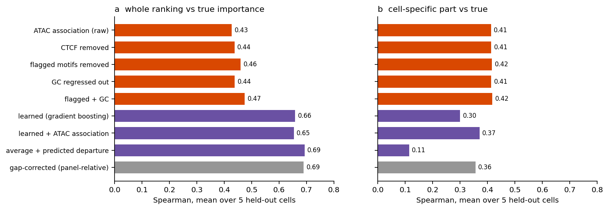
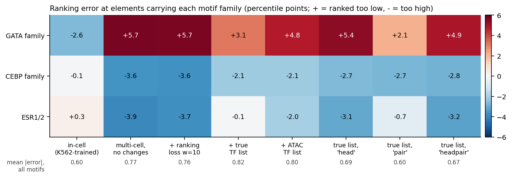
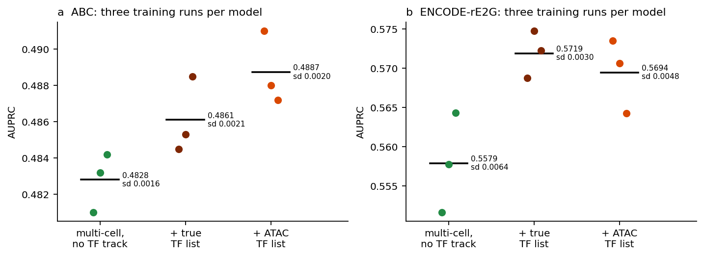
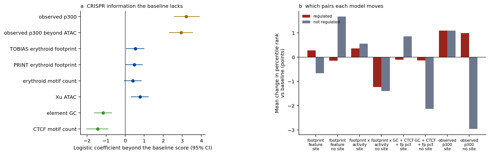
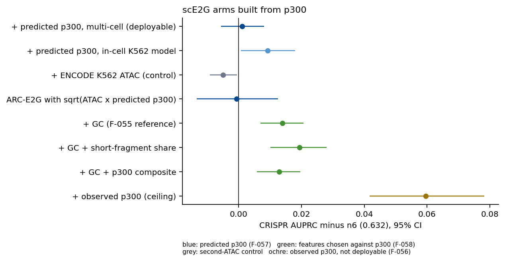
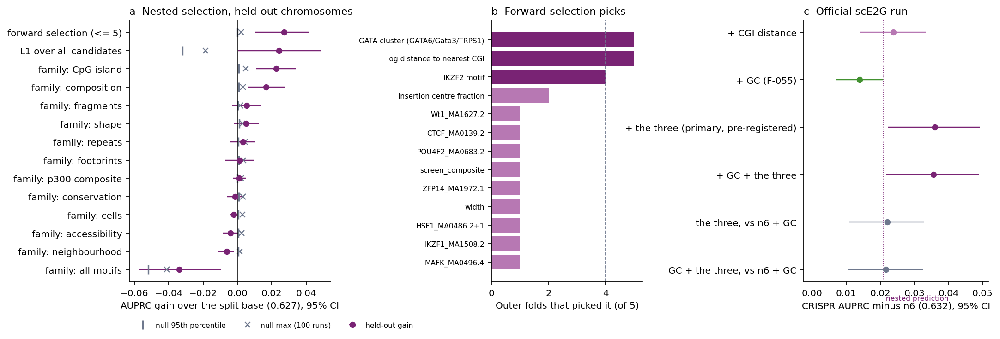
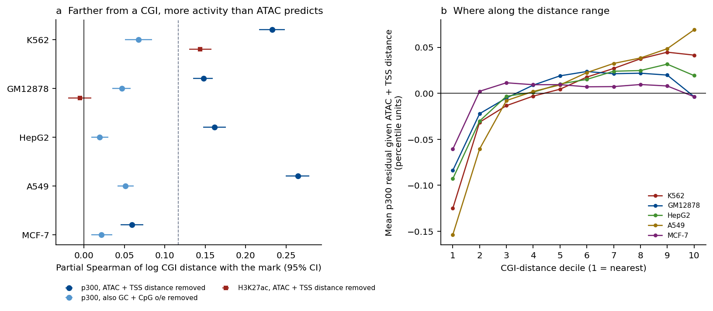
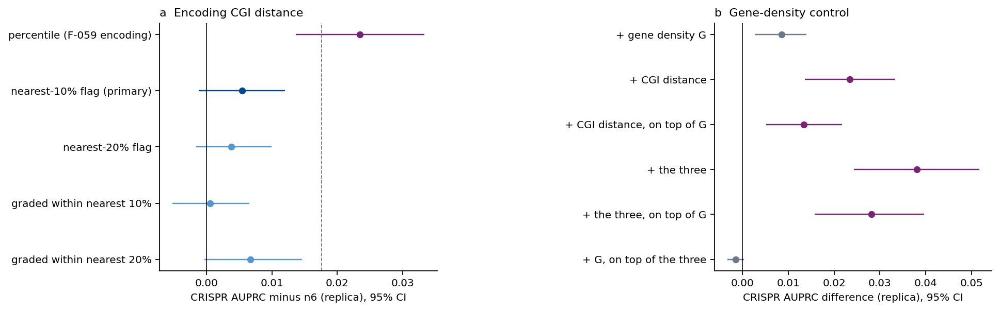
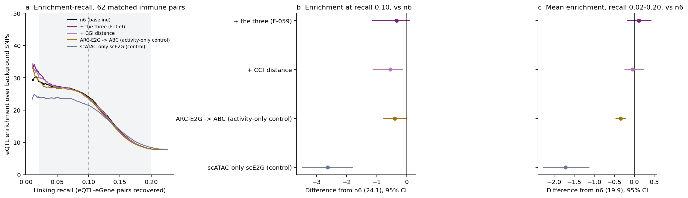

```{=html}
<style>
html { -webkit-text-size-adjust: 100%; }
body {
  font-family: Arial, Calibri, "Helvetica Neue", Helvetica, sans-serif;
  font-size: 15px;
  line-height: 1.6;
  color: #1a1a1a;
  max-width: 980px;
  margin: 0 auto;
  padding: 2.5rem 1.5rem 4rem;
  background: #fff;
}
h1 { font-size: 1.7rem; font-weight: 600; line-height: 1.3; margin: 0 0 .3rem; }
h2 { font-size: 1.15rem; font-weight: 600; margin: 2.6rem 0 .6rem;
     padding-top: 1.1rem; border-top: 1px solid #e4e4e4; }
h3 { font-size: 1rem;   font-weight: 600; margin: 1.6rem 0 .4rem; }
p.date, .date { color: #666; font-size: .85rem; }

img {
  display: block;
  max-width: 100%;
  height: auto;
  margin: 1.1rem auto 0.4rem;
}

#TOC, nav#TOC { font-size: .9rem; background: #fafafa; border: 1px solid #eaeaea;
  border-radius: 6px; padding: .8rem 1.2rem; margin: 1.5rem 0 2rem; }
#TOC ul { margin: .2rem 0; padding-left: 1.1rem; }
#TOC a { color: #235; text-decoration: none; }
#TOC a:hover { text-decoration: underline; }

p > strong:first-child { color: #111; }

table { border-collapse: collapse; font-size: .88rem; margin: 1rem 0; width: 100%; }
th, td { border-bottom: 1px solid #e8e8e8; padding: .38rem .6rem; text-align: left;
         vertical-align: top; }
th { background: #f6f6f6; font-weight: 600; }

code, pre { font-family: "SF Mono", Menlo, Consolas, monospace; font-size: .82rem; }
pre { background: #f7f7f8; border: 1px solid #ececec; border-radius: 5px;
      padding: .7rem .9rem; overflow-x: auto; }
code { background: #f2f2f3; padding: .07em .32em; border-radius: 3px; }
pre code { background: none; padding: 0; }

blockquote { border-left: 3px solid #ddd; margin-left: 0; padding-left: 1rem;
             color: #444; }
</style>
```

## Headline figure


**Figure 1 | Erythroid footprints track p300 beyond accessibility but do not help scE2G; observed p300 would add +0.06 AUPRC, and features selected against CRISPR reach +0.036 in-sample (about +0.021 out of sample).** **Headline figure.**

<details>
<summary>Full legend</summary>

**Figure 1 | Element-level TF evidence from the Xu K562 multiome, against observed K562 p300 (a) and on the K562 CRISPR benchmark (b).** **a**, Partial Spearman correlation with observed K562 p300 (ENCSR000EGE, element centre +/- 250 bp) among non-promoter scE2G candidate elements that carry the motif, after removing Xu pseudobulk ATAC (rank and its square), GC content, CpG observed/expected, log distance to the nearest TSS, and the element's motif count and best motif match. Dark: those controls; light: the same plus ENCODE K562 ATAC, which absorbs noise in the multiome pseudobulk ATAC. Footprint rows: the element's best footprint score over its erythroid sites (GATA1, GATA1::TAL1, NFE2, MAF::NFE2, TAL1::TCF3; 85,720 elements). HNF4A is not expressed in K562, so its rows show how much of the signal is generic footprint shape. Kendall row: the strict test of feature A (Fig. 10b; 135,932 elements). For scale, observed H3K27ac gives 0.376 with p300 beyond ATAC in K562 (F-045, a different element set). 95% intervals from 200 bootstraps over elements. **b**, scE2G `multiome_powerlaw_n6` (six features including ARC-E2G) retrained on the Xu K562 run with each change, scored on held-out chromosomes against the K562 CRISPR benchmark (10,342 element-gene pairs, 466 regulated; pairs with no candidate element enter at score 0, as scE2G does). x = AUPRC minus the baseline model's 0.632, paired bootstrap of 2,000 resamples of the pairs. Blue: footprint or motif count as an extra feature. Red: element activity multiplied by 1 + weight x footprint percentile before ABC and ARC-E2G are recomputed (exact reweighting, Fig. 9), replacing ARC-E2G. Green: sequence corrections chosen from the error analysis (Fig. 11). Teal: predicted p300 from the multi-cell model with K562 held out, the deployable form of the ceiling (Fig. 12). Purple: features selected against the CRISPR labels inside nested chromosome cross-validation (Fig. 13): log distance to the nearest CpG island alone, and with the GATA and IKZF2 motif counts, the pre-registered arm; these use the pairs they were chosen on, and the nested out-of-sample estimate is about +0.021. Ochre: observed K562 p300 as an extra feature or inside the activity term, an upper bound that is not deployable. Sources: `2026_1002_sce2g_tf_activity/results/2026_1003_footprint_p300_gate*.beyond_motif.tsv`, `2026_1004_featA_peak_tf_kendall*.beyond_motif.tsv`, `2026_1003_featB_tobias_paired_bootstrap.tsv`, `2026_1004_featB_print_paired_bootstrap.tsv`, `2026_1004_activity_paired_bootstrap.tsv`, `2026_1004_corr_paired_bootstrap.tsv`, `2026_1005_predp300_paired_bootstrap.tsv`, `2026_1007_discovery_paired_bootstrap.tsv`.
</details>

## Summary

- **The p300 model's transfer error is concentrated at GATA elements, and telling it which TFs are active recovers only part of it.** GATA-motif elements are ranked 8-10 percentile points too low by the transferred model (Fig. 2). A TF-activity input estimated from the target cell's own ATAC gains +0.006 ABC AUPRC averaged over three runs, a seventh of the 0.042 gap to the in-cell model, and does as well as the true TF list (Figs 3-5). Only stomach among 19 ENCODE samples with p300 adds K562-like GATA activity to the panel (Fig. 6).
- **Erythroid footprints track p300 beyond ATAC but move scE2G by nothing.** TOBIAS and PRINT detect GATA1 binding at matched accessibility (AUROC 0.674 and 0.605, Fig. 7) and add about 0.1 partial correlation with p300 beyond ATAC and motif presence (Fig. 8), yet change CRISPR AUPRC by -0.004 to +0.001 as features or inside the activity term (Figs 1b, 9). Peak-TF expression correlation adds only 0.015 against p300 (Fig. 10).
- **Element activity is not saturated: observed p300 would add +0.056 to +0.060, but no p300-derived deployable feature recovers it.** Observed p300 works by demoting accessible, not-regulated elements without erythroid motifs (Fig. 11b). Predicted p300 adds +0.001, and features chosen because they track p300 add at most +0.005 (Fig. 12). Element GC and CTCF sites, chosen from an error analysis, add +0.015 together (Fig. 11).
- **Selecting against the CRISPR labels directly, with the selection inside cross-validation, finds what the p300 route did not.** Three features (log distance to the nearest CpG island, GATA and IKZF2 motifs) gain about +0.021 out of sample and +0.036 in the pre-registered scE2G run; CpG-island distance alone gives +0.024 and absorbs the GC gain (Fig. 13).
- **The CpG-island effect on activity is partly shared across cells, the part that carries the K562 CRISPR gain is not, and eQTLs cannot settle it.** Elements nearest an island are under-active relative to ATAC in all five panel cells (Fig. 14b), yet flagging only those keeps 23% of the K562 gain; the rest comes from a far-range trend that differs by cell (Fig. 15). On fine-mapped eQTLs in unseen immune cell types the features show no gain, but an activity-term change worth -0.05 AUPRC moves mean eQTL enrichment by only 1.7%, five times less than removing RNA (Fig. 16), so a CRISPR set in a second cell remains the test for activity features.

## Goals

The activity term of an enhancer-gene model should say which accessible elements are active. Two lines of work asked whether TF motif and binding information supplies what accessibility lacks. Part A (from report 6): the BPNet-style p300 model transferred to an unseen cell type misses which TFs are active there, chiefly GATA in K562, and a TF-activity input was tested as the fix. Part B: scE2G predicts enhancer-gene links from single-cell multiome; element-level TF evidence read from the target cell's own multiome (footprints, peak-TF expression correlation) was tested in its activity side, with observed p300 as a ceiling and an error analysis of why the TF features fail. Part C: because features that track p300 did not help, features were selected against the CRISPR labels directly, with the selection cross-validated by chromosome, and the one cell-independent feature found was checked against activity in four other cells. Every result is judged on the K562 CRISPR benchmark.

## Terms in plain words

- *Partial correlation given ATAC*: the correlation between predicted and observed p300 after removing what ATAC alone explains. It measures what the model adds beyond accessibility.
- *TF-activity track*: a per-base input track equal to, at each base, the sum over motifs whose FIMO hit covers that base of a weight saying how important that motif's TF is for p300 in this cell. It is how a TF list is given to the model.
- *True TF list*: weights read from the cell's own p300 (each motif's association with p300 beyond ATAC). It is an upper bound, since a new cell has no p300.
- *ATAC TF list*: weights from the cell's own ATAC (each motif's association with accessibility), with CTCF removed. Deployable.
- *Seed replicate*: the same model trained again with a different random initialisation and batch order, on the same data.
- *Footprint*: a dip in Tn5 insertions at a motif inside an open element, left where a bound TF protects the DNA. Tn5 has its own sequence preference, so a footprint score needs a bias model. Homemade: an 8-mer bias from the sample's own insertions. TOBIAS (Bentsen et al. 2020): bias correction and footprint scores on a pseudobulk insertion track. PRINT (scPrinter, Buenrostro lab): multiscale footprints with a learned Tn5 bias model and a pretrained TF-binding model.
- *Within accessibility deciles*: sites are split into ten groups by accessibility and the footprint is scored within each group, so it gets no credit for openness. AUROC 0.5 = chance.
- *Peak-TF Kendall (feature A)*: for each peak and each expressed TF with a motif in it, Kendall's tau between peak accessibility and TF RNA across 7,821 cells.
- *scE2G variants*: "extra feature" adds a column to the six-feature model; "inside the activity term" multiplies each element's activity by a weight, recomputes ABC and ARC-E2G exactly, and swaps that score in for ARC-E2G.
- *n6*: scE2G's six-feature multiome model (`multiome_powerlaw_n6`), AUPRC 0.632 on this benchmark; the baseline throughout Parts B and C.
- *Nested cross-validation*: feature selection is repeated inside each training split of a five-group chromosome split, and the gain is measured only on the held-out group, so it is the gain of the selection procedure, not of features already known to work.
- *Pre-registered*: the test, the comparison and the pass rule were written in `.living/decisions.md` before the run.
- *Replica*: a Python copy of scE2G's model fit (`A2/scripts/8.0`) that matches the pipeline within 0.0005 AUPRC; used to compare variants in seconds.
- *CGI*: CpG island (UCSC cpgIslandExt); *CGI distance*: log distance from an element's midpoint to the nearest CGI midpoint.

# Part A: TF motifs in the transferred p300 model

The sections in this part moved here unchanged from report 6 (figure numbers remapped). RNA-based TF lists, which also feed the TF-activity track, are in report 6, Fig. 7a: an RNA TF list ties the ATAC-derived list when combined with it and loses alone (-0.005 ABC, -0.009 ENCODE-rE2G, three runs each).

## The transferred model under-ranks GATA elements, and fixing only those would recover half the gap

**Q:** Which elements does the transferred model rank wrongly, and how much are they worth?

**A:** Elements with GATA motifs are ranked 8-10 percentile points too low relative to the in-cell model, and giving only those elements their observed-p300 ranks gains +0.022 AUPRC more than doing the same for matched non-GATA elements.


<details>
<summary>Figure 2 legend</summary>

**Figure 2 | Error anatomy and GATA oracle. a**, For each JASPAR 2024 motif, the ranking error attributable to transfer at non-promoter ABC candidates in K562. Per element, error = percentile rank of observed p300 minus percentile rank of prediction (positive = ranked too low); the transfer-specific error is the multi-cell model's error minus the in-cell model's. Bars are the regression coefficient of that error on motif presence (FIMO p < 1e-4, element centre +/- 250 bp), controlling for ATAC rank and its square, GC content, CpG observed/expected and log distance to the nearest TSS; 132,186 elements. The seven largest positive coefficients are all GATA-family matrices (GATA2 +9.52, GATA1::TAL1 +8.20); the largest negative are CEBP (CEBPB -5.29) and ESR (ESR2 -4.71), TFs active in HepG2, A549 and MCF-7 but weak in K562. **b**, ABC AUPRC when the 43,513 GATA-motif candidates (28.3%) take the in-cell model's ranks or observed p300's ranks, against the same number of non-GATA candidates matched on ATAC decile and element class taking the same ranks. GATA-specific gain (GATA minus matched): +0.0103 [-0.0001, +0.0213] with in-cell ranks, +0.0217 [+0.0060, +0.0385] with observed ranks. The in-cell model's full advantage is +0.0419 [+0.0278, +0.0556]. Sources: `results/2026_0925_p300_error_anatomy.features.tsv`, `results/2026_0927_gataoracle_auprc_pairs.tsv`.
</details>

**Method.**

- Residual screen over 153,545 K562 ABC candidates, `scripts/4.41`.
- GATA oracle tracks with matched controls, `scripts/4.42`, then ABC and the benchmark.

<details>
<summary>Full methods &amp; code</summary>

Each coefficient is computed by Frisch-Waugh-Lovell regression (covariates partialled out of both the error and the motif indicator), so it reads as "elements with this motif are ranked X points too low at matched accessibility and composition". With 132,186 elements almost every coefficient is nominally significant, so motifs are ranked by effect size. The oracle arms repaint the multi-cell track so the chosen elements take another track's within-class ranks while every other element keeps its own; they are upper bounds, since they use K562 information.

```bash
pixi run -e multimodal python scripts/4.41.p300_error_anatomy.py
pixi run -e multimodal python scripts/4.42.build_subset_oracle.py
```
Source: `scripts/5.3.plot_tf_activity_report_figures.py`, section "fig 29".
</details>

## The simplest TF-list estimate from ATAC keeps the cell-specific signal best

**Q:** How well can a cell's p300-important TFs be estimated from its ATAC and DNA alone?

**A:** Plain ATAC association with motif presence, with CTCF and similar motifs removed, keeps the cell-specific part best (Spearman 0.42), while learned estimators rank motifs better overall (up to 0.69) by learning what matters in every cell and lose the cell-specific part (0.11-0.37).



<details>
<summary>Figure 3 legend</summary>

**Figure 3 | TF-list estimators against the true TF importance, leave one cell type out.** Truth: each motif's coefficient for p300 beyond ATAC in that cell, from the cell's own p300 (782 JASPAR motifs, five cell types). Every estimator uses the held-out cell's ATAC and sequence only, plus, for the learned ones, the other four cells' p300. **a**, Spearman correlation across motifs with the truth, mean over the five held-out cells. **b**, The same for the cell-specific part: estimate and truth each minus the mean truth of the other four cells. Orange: ATAC association (coefficient of within-cell ATAC rank on motif presence, controlling for GC, CpG and TSS distance) and its corrections. "Flagged motifs removed" drops about 30 motifs whose ATAC association exceeds their true importance in at least three of the other four cells: CTCF/CTCFL and GC-rich, CpG-island-like motifs (KLF, SP, E2F, ZIC, ZBED4, ZNF417). "GC regressed out" removes motif GC, GC squared and CpG content. Purple: gradient boosting on eight motif-level ATAC features (association, top-decile association, promoter fraction, prevalence, CTCF co-occurrence, footprint depth and flank height, motif GC); "learned + ATAC association" mixes the two with weights fitted on the training cells; "average + predicted departure" adds a model of each cell's departure to the training cells' mean truth. Grey: "gap-corrected" subtracts each motif's average (association minus truth) over the training cells, which is algebraically the training cells' mean truth plus the target's association minus the training cells' mean association, i.e. a reference-based estimate. In K562 the GATA family scores +3.88 in the truth, +3.22 raw, +3.69 flagged + GC and +1.15 learned. Sources: `results/2026_0928_learned_importance_variants.scores.tsv`, `results/2026_0929_corrected_tf_list.scores.tsv`.
</details>

**Method.**

- Truth and ATAC association over the union of the five cells' ABC candidates, `scripts/4.43`.
- Learned estimators `scripts/4.47`, `scripts/4.48`; corrections `scripts/4.50`.

<details>
<summary>Full methods &amp; code</summary>

The learned estimators gain overall Spearman by learning which motifs matter for p300 beyond ATAC in every cell (AP-1 tops the learned K562 list), which the transferred model already has from sequence. The cell-specific part is what F-032 says is missing, and plain ATAC association carries it best (K562 departure Spearman 0.77). Raw association's one large K562 error is CTCF: rank 1 by association, rank 741 of 782 in the truth. Removed motifs are set to weight 0 ("no information"), as in the TF-activity track. Motif-level scores are proxies: they weight all 782 motifs equally, while the benchmark depends on how the track changes the ranking of 3,406 CRISPR-tested elements.

```bash
pixi run -e multimodal python scripts/4.47.learned_motif_importance.py
pixi run -e multimodal python scripts/4.48.learned_importance_variants.py
pixi run -e multimodal python scripts/4.50.corrected_tf_list.py --remove-to zero
```
Source: `scripts/5.3.plot_tf_activity_report_figures.py`, section "fig 30".
</details>

## Given the true TF list, the model removes a third of the GATA error; the cross-cell 'pair' loss removes two thirds

**Q:** Does the TF-activity track fix the GATA, CEBP and ESR errors it was designed to fix?

**A:** Partly: the GATA error falls from +5.7 to +3.1 percentile points with the true TF list and to +2.1 with the 'pair' loss, the in-cell model is at -2.6, and none of these reductions changed ABC by a resolvable margin over the track alone.



<details>
<summary>Figure 4 legend</summary>

**Figure 4 | Ranking error at elements carrying each motif family, per model.** Each cell is the mean regression coefficient (as in Fig. 2a, but for each model's own error rather than the transfer-specific difference) over the motifs in that family: GATA (8 matrices including TRPS1 and GATA1::TAL1), CEBP (CEBPA/B/D/E/G) and ESR1/2; positive = elements ranked too low. Columns: the in-cell model; the unmodified multi-cell model; with the ranking loss at weight 10; with the TF-activity track from the true list; with the ATAC list; and the three ways of teaching the model to use the true-list track. The row below the heatmap is the mean absolute coefficient over all motifs, a measure of how much motif-linked error remains overall: 0.60 in-cell, 0.77 unmodified, 0.60 with 'pair'. The ranking loss leaves every family unchanged. Source: `results/2026_0928_p300_error_anatomy_teach.features.tsv`, from `scripts/4.41 --extra`.
</details>

**Method.**

- Error screen (`scripts/4.41 --extra`) rerun on each model's K562 ABC run.
- 'head', 'pair', 'headpair': `scripts/1.38`; two-stage: `scripts/1.39`.

<details>
<summary>Full methods &amp; code</summary>

'head' routes the track around the network into four weights on the predicted log count: positive and negative motif weights averaged over the counts window, each also multiplied by softplus(ATAC). The learned weights have the expected signs (positive motifs +0.09 to +0.30, negative motifs -0.49 to -1.24). 'pair' samples 20,000 training-peak windows, extracts each in all four training cells, and adds a loss, weight 10, on the predicted minus observed log-count difference between two cells, centred within each cell pair so library depth cancels. 'headpair' does both. Two-stage freezes the unmodified multi-cell model fold by fold and trains only a DNA-free network (21 bp convolution and six dilated residual layers, 16 channels) on the track and ATAC, zero-initialised so it starts as the frozen model. The head alone barely changes the GATA error, which suggests the track has to interact with sequence and ATAC inside the network. The 'pair' result shows the error screen and the benchmark coming apart: the screen covers all 153,545 candidates, the benchmark only the 3,406 CRISPR-tested elements.

```bash
sbatch scripts/1.38.submit_multicell_p300_teach.sh        # head, pair, headpair
WEIGHTING=oracle sbatch scripts/1.39.submit_multicell_p300_twostage.sh
```
Source: `scripts/5.3.plot_tf_activity_report_figures.py`, section "fig 31".
</details>

## Three training runs per model put the noise at 0.002 AUPRC in ABC and 0.005 in ENCODE-rE2G

**Q:** How large are the differences between training runs of one model, and what is left of the TF-track gain once they are averaged?

**A:** Runs of one model differ with a standard deviation of 0.0016-0.0021 in ABC and 0.0030-0.0064 in ENCODE-rE2G, and seed-averaged the ATAC TF list gains +0.0059 [+0.0001, +0.0132] in ABC and +0.0116 [+0.0038, +0.0202] in ENCODE-rE2G.



<details>
<summary>Figure 5 legend</summary>

**Figure 5 | Seed replicates.** Three models, each trained three times (the original run and seeds 1 and 2; `--seed` sets torch, numpy and batch order, same data), each run through its own K562 prediction, ABC run and ENCODE-rE2G training. Points are individual runs; the bar is the mean. **a**, ABC AUPRC. **b**, ENCODE-rE2G AUPRC. Seed-averaged contrasts (mean AUPRC of three runs, computed inside each of 2,000 paired bootstrap draws): true TF list minus unmodified, ABC +0.0033 [-0.0029, +0.0112], ENCODE-rE2G +0.0140 [+0.0056, +0.0232]; ATAC TF list minus unmodified, ABC +0.0059 [+0.0001, +0.0132], ENCODE-rE2G +0.0116 [+0.0038, +0.0202]; ATAC minus true list, ABC +0.0026 [-0.0012, +0.0063], ENCODE-rE2G -0.0024 [-0.0073, +0.0027]. Two runs of the identical unmodified model differ resolvably in ENCODE-rE2G (seed 2 minus original, +0.0126 [+0.0024, +0.0243]). The single-run ATAC-list result in report 6 Fig. 1 (+0.0100 ABC) was the highest of its three runs. Per-run values from the logs of `scripts/4.17 --group` (`log/seeds_boot.46073940.txt`) and `scripts/4.34 --group` (`log/re2g_seeds_boot.46073942.txt`); contrasts in `results/2026_0930_seeds_auprc_pairs.tsv` and `results/2026_0930_re2g_seeds_auprc_pairs.tsv`.
</details>

**Method.**

- `scripts/1.37` with `SEED=1,2` (and `WEIGHTING=none` for the unmodified model).
- Seed-averaged paired bootstrap, `scripts/4.17 --group`, `scripts/4.34 --group`.

<details>
<summary>Full methods &amp; code</summary>

With a run-to-run standard deviation of 0.002, two single runs differ by about 0.003 by chance, so a real difference of that size needs about three runs per model to resolve. The two-stage models were compared with their one frozen base model, not seed-averaged: true TF list +0.0042 [+0.0003, +0.0086] in ABC and +0.0146 [+0.0062, +0.0238] in ENCODE-rE2G; ATAC TF list +0.0027 [-0.0017, +0.0069] and +0.0138 [+0.0068, +0.0222]. They gain as much as the end-to-end track model. The two-stage model was built to test one concern: within a training cell the track says nothing the DNA does not, so a network that sees both could learn TF effects from the DNA and ignore the track. Its correction cannot see DNA, and it gains no more, so that shortcut does not explain the small gain; the limit is the information the track itself carries.

```bash
WEIGHTING=none SEED=1 sbatch scripts/1.37.submit_multicell_p300_motifact.sh    # and SEED=2; oracle; assoc_noctcf
pixi run -e multimodal python scripts/4.17.paired_auprc_bootstrap.py <merged> --group mse=A,B,C --group ctcf=D,E,F --pair ctcf mse
```
Source: `scripts/5.3.plot_tf_activity_report_figures.py`, section "fig 32".
</details>

## Among 19 ENCODE samples with p300, only stomach shows K562-like GATA activity

**Q:** Which cell types with public p300 data would add the TF programmes the training panel lacks?

**A:** Among ATAC samples, ovary (NR3C1, NR5A1, PGR), transverse colon (CDX1/2, HNF4A) and gastro-oesophageal sphincter (MEF2, SRF) add the most new TF families, and stomach is the only one adding the GATA2 family, raising coverage of K562's top-10 families from 60% to 70%.


<details>
<summary>Figure 6 legend</summary>

**Figure 6 | TF-family activity specific to each candidate cell type.** Rows: the 40 motif families with the largest reliable activity anywhere; columns: K562, the current panel, then the remaining candidates in the order a coverage-maximising greedy selection including the DNase samples picked them. Colour: family score (mean standardised ATAC or DNase association of its motifs, as in Fig. 3) minus the family's mean over all 19 candidates. Candidates: every ENCODE biosample with released human EP300 ChIP-seq and ATAC or DNase (19; ENCODE pseudoreplicated ATAC peaks or DNase peaks, up to 300,000 per sample). Motifs clustered into 434 families by co-occurrence of their FIMO hits (Pearson r >= 0.5). A family counts as active in a cell only as far as the odd and even chromosomes agree (the minimum of the two halves; split-half Spearman 0.42-0.86 by cell). The estimate recovers K562's GATA1::TAL1 and GATA2 families as its top two and agrees with the p300-based truth-panel scores at Spearman 0.80-0.85 (MCF-7 0.47). The block lighting up Ishikawa, HeLa-S3 and T47D (FEZF2, OTX2, Prdm14) is specific to the DNase samples as a group, i.e. the assay. Sources: `results/2026_0929_panel_tf_diversity_loose.*`, `results/2026_0930_panel_selection_variants.tsv`.
</details>

| step | add (ATAC candidates only) | main new TF families | K562 top-10 covered |
|---|---|---|---|
| 0 | current panel | | 60% |
| 1 | ovary | NR3C1, NR5A1, PGR | 60% |
| 2 | transverse colon | CDX1/2, KLF, HNF4A | 60% |
| 3 | gastro-oesophageal sphincter | MEF2B, SRF | 60% |
| 4 | stomach | GATA2 family, HOXA9 | 70% |
| 5 | tibial nerve | CEBPA, HLF/DBP | 70% |
| 6 | SK-N-SH | MAFK, NKX2-3, PAX3 | 70% |

**Method.**

- Per candidate: ATAC or DNase association with motif presence at non-promoter peaks, `scripts/4.49`.
- Greedy facility-location selection over reliable family departures, restricted to ATAC samples, `scripts/4.52`.

<details>
<summary>Full methods &amp; code</summary>

Coverage of a panel is the sum over families of the largest positive reliable departure among its cells, so a cell earns credit for families no chosen cell already has. K562 is never a candidate; its top 10 families measure what a panel covers (a family is covered when some panel cell reaches half K562's departure). With GC-rich and zinc-finger families removed, the current panel covers 40% of K562's top 10 and adding stomach and tibial nerve raises it to 80%. The erythroid pair GATA1::TAL1 is active in no candidate. Tissues are mixtures of cell types, so their p300 signal will be blurrier than a cell line's. The p300 and donor-matched ATAC alignments for stomach (ENCSR684NJD, ENCSR851SBY), transverse colon (ENCSR429JTR, ENCSR668VCT) and ovary (ENCSR696LQU, ENCSR490MSG) have been downloaded (`reference/p300_tissue_manifest.tsv`) and not yet processed.

```bash
sbatch scripts/4.49.submit_panel_tf_diversity.sh
pixi run -e multimodal python scripts/4.52.panel_selection_variants.py
```
Source: `scripts/4.49.panel_tf_diversity.py` (heatmap), copied by `scripts/5.3` as figure 33.
</details>

# Part B: TF binding evidence from multiome in scE2G

## TOBIAS and PRINT footprints detect GATA1 binding at matched accessibility; the homemade score does not

**Q:** Do footprints from the Xu multiome pseudobulk distinguish ChIP-bound from unbound motif sites once accessibility is held fixed?

**A:** For CTCF all three methods do (best PRINT, 0.851); for GATA1 only the published methods do (TOBIAS 0.674, PRINT 0.605), while the homemade score is below chance (0.419).


<details>
<summary>Figure 7 legend</summary>

**Figure 7 | Footprint score validated against ChIP-seq within accessibility deciles.** AUROC of the footprint score for ChIP-bound against unbound motif sites, computed within deciles of the site's accessibility and averaged, so a score gets no credit for openness. CTCF sites (MA0139.2) against K562 CTCF ChIP (ENCFF519CXF); GATA1 (MA0035.5) and GATA1::TAL1 (MA0140.3) sites against K562 GATA1 ChIP peaks (4,603 peaks). Grey, homemade: core-versus-flank insertion depletion with an 8-mer Tn5 bias estimated from the sample's own insertions, over genome-wide FIMO hits with >= 10 insertions (CTCF 313,773 hits, 40,537 bound; GATA1 67,741, 270; GATA1::TAL1 184,480, 2,157). Blue, TOBIAS 0.17.5 footprint scores at BINDetect sites inside scE2G's 155,134 candidate regions (CTCF 83,492 sites, 28,726 bound; GATA1 14,903, 263; GATA1::TAL1 42,262, 2,165). Red, PRINT TF-binding scores at the same sites (pretrained TFBS model, hg38 v2 Tn5 bias, 7,821 cells as one pseudobulk). Bars on TOBIAS and PRINT: 95% intervals from 200 within-decile bootstraps. The homemade and published site sets differ, so the comparison is not hit-matched. Sources: `results/2026_1002_footprint_validation.chip.tsv`, `2026_1002_tobias_validation.chip.tsv`, `2026_1002_print_validation.chip.tsv` (A2).
</details>

**Method.**

- Homemade footprints `A2/scripts/1.1`, validation `1.2`; TOBIAS `2.1`-`2.3`; PRINT `3.1`, validated with `2.3 --score print`.

<details>
<summary>Full methods &amp; code</summary>

TOBIAS ran ATACorrect (`--read_shift 0 0` on an insertion BAM built from the fragments), ScoreBigwig and BINDetect over 879 JASPAR 2024 motifs. BINDetect's "bound" call covers 82% of ChIP-bound GATA1 sites and 9% of unbound ones. PRINT scored each BINDetect site of seven motifs at its 10 bp centre on its strand with motif score fixed at 1, so the score is footprint only. The first full PRINT run lost three of four shards to scPrinter's in-memory result handling and was rerun in backed mode (identical scores on a 2,000-site check).

| motif rank by mean footprint score | homemade (782 motifs) | TOBIAS (879 motifs) |
|---|---|---|
| top 5 | TCFL5, ZBTB33, KLF15, TFDP1, ELK3 | KLF15, ZBED4, ELK3, NRF1, ETV5 |
| CTCF (MA0139.2) | 166 | 77 |
| GATA1::TAL1 | 533 | 274 |
| GATA1 | 765 | 534 |
| HNF4A (MA0114.5, not expressed) | 540 | 516 |

**Table 1 | Per-motif mean footprint scores favour GC-rich motifs.** Both methods put GC- and CpG-rich motifs at the top and rank GATA1 below a TF that is not expressed in K562, so per-motif averages are composition-biased and are not used as TF activity.

```bash
cd $OAK/Users/sheth/EP300_BPNet/2026_1002_sce2g_tf_activity
sbatch scripts/2.1.submit_insertion_bam.sh && sbatch scripts/2.2.submit_tobias.sh
sbatch scripts/2.3.submit_validate_tobias.sh
sbatch scripts/3.1.submit_scprinter_tfbs.sh
```
Source: `scripts/5.5.plot_tf_evidence_report_figures.py`, section "fig41".
</details>

## Erythroid footprints add about 0.1 partial correlation with p300 beyond ATAC and motif presence

**Q:** Among elements that carry a motif, does the footprint at that motif say more about p300 than accessibility and motif presence already do?

**A:** Yes for the erythroid set (TOBIAS 0.086, PRINT 0.111), above the HNF4A control (0.031, 0.052), and CTCF footprints point the other way.


<details>
<summary>Figure 8 legend</summary>

**Figure 8 | Footprints against observed K562 p300, per motif.** Partial Spearman correlation of the element's best footprint score at that motif with observed K562 p300 (ENCSR000EGE, +/- 250 bp), among non-promoter scE2G candidates that carry at least one site of the motif (count in brackets). **a**, Controls: Xu ATAC rank and its square, GC content, CpG observed/expected, log distance to TSS, motif count and best motif match in the element. **b**, The same plus ENCODE K562 ATAC rank and its square. Blue TOBIAS, red PRINT, same sites. Erythroid = the union of GATA1, GATA1::TAL1, NFE2, MAF::NFE2 and TAL1::TCF3 sites. HNF4A (not expressed in K562) estimates the part of the signal that is generic footprint shape. CTCF footprints are negatively related to p300 once ENCODE ATAC is removed (TOBIAS -0.044), consistent with CTCF sites being insulators rather than enhancers. Across all non-promoter elements, ENCODE ATAC itself adds 0.248 [0.242, 0.254] beyond Xu ATAC, more than any footprint: the pseudobulk ATAC is noisy. On the 2,679 CRISPR-tested elements that carry a site, the footprint partial correlation is 0.066 [0.029, 0.098] (TOBIAS) and 0.086 [0.050, 0.121] (PRINT) (6.1). 95% intervals from 200 bootstraps over elements. Sources: `A2/results/2026_1003_footprint_p300_gate{,.print}{,.z_encode_atac}.beyond_motif.tsv`, `A2/results/2026_1004_sce2g_tf_error_analysis.gate_crispr_elements.tsv`.
</details>

**Method.**

- `A2/scripts/2.4` (TOBIAS) and `2.4 --score print`, each with and without `--z-encode-atac`.

<details>
<summary>Full methods &amp; code</summary>

All signals are percentile-ranked, so each number is a partial Spearman. The erythroid motif set is chosen with knowledge of K562, so a transfer version would need expression-weighted motif sets. The passing rule, set before the test, was that the erythroid interval in this test excludes 0.

```bash
cd $OAK/Users/sheth/EP300_BPNet/2026_1002_sce2g_tf_activity
sbatch scripts/2.4.submit_footprint_p300_gate.sh                     # and --z-encode-atac, --score print
```
Source: `scripts/5.5.plot_tf_evidence_report_figures.py`, section "fig42".
</details>

## Footprints do not improve scE2G as a feature or inside the activity term

**Q:** Do footprints help scE2G when they change the activity term itself, rather than enter as an extra feature?

**A:** No: inside the activity term the change is +0.001 at weight 1 for both methods and -0.010 to -0.011 at weight 4; as extra features it is -0.004 (TOBIAS) and -0.002 (PRINT).


<details>
<summary>Figure 9 legend</summary>

**Figure 9 | Footprint-weighted activity in scE2G.** Each element's activity becomes ATAC x (1 + weight x q), with q the percentile of its erythroid footprint sum among the 93,941 of 155,134 elements that have an erythroid site, and 0 otherwise. ABC is recomputed exactly from the published scores: scE2G sets the self-promoter's ABC to 1 and every other pair to numerator / sum of numerators over the gene's candidates (self-promoter included), so the non-self scores are shares and the self-promoter's share is 1 minus their sum. In scE2G's output ARC-E2G is exactly ABC x exp(21.5 x Kendall) (R^2 = 1.0000), so ARC-E2G takes the same per-pair factor. That score replaces ARC-E2G in the six-feature model; weight 0 is the baseline. **a**, CRISPR AUPRC minus baseline (0.632), paired bootstrap as in Fig. 1b: weight 1, TOBIAS +0.0011 [-0.0063, +0.0087], PRINT +0.0013 [-0.0061, +0.0088]; weight 4, -0.0098 [-0.0239, +0.0038] and -0.0114 [-0.0260, +0.0023]. **b**, The model's coefficient on the activity score falls as the weight rises (1.73 at weight 0, 1.58-1.59 at weight 1, 1.25-1.26 at weight 4). Run `$SCRATCH/sce2g_runs/2026_1004_k562_xu_activity`. A first run with an approximate per-gene factor (which treated the self-promoter's ABC = 1 as a share) gave +0.004 and +0.005 at weight 1; part of that was the normalisation error. Sources: `A2/results/2026_1004_activity_paired_bootstrap.tsv`, `A2/results/2026_1004_sce2g_coefficients.tsv`.
</details>

**Method.**

- Exact reweighting `A2/scripts/abc_reweight.py`, pairs `4.9`; generic setup `4.8` with `config/spec_activity.tsv`; training `log/sce2g_train.sh`; paired bootstrap `4.2`.

<details>
<summary>Full methods &amp; code</summary>

The two weights were set before the run and not tuned. As extra features (Fig. 1b, blue), the footprint sum entered with the erythroid motif count (`4.0`, `4.1`); its coefficient was +0.30 to +0.36 while ARC-E2G's fell from 1.73 to 1.59-1.69, so the footprint re-expresses part of what ARC-E2G carries. The motif count alone lowered AUPRC by -0.0022 [-0.0037, -0.0007]. Genes with more than one self-promoter candidate (1,672 extra rows) take the larger weight for all of them.

```bash
cd $OAK/Users/sheth/EP300_BPNet/2026_1002_sce2g_tf_activity
python scripts/4.9.make_activity_pairs.py --out $SCRATCH/sce2g_external/activity_pairs.tsv.gz
TAG=activity PAIRS=$SCRATCH/sce2g_external/activity_pairs.tsv.gz SPEC=config/spec_activity.tsv sbatch scripts/4.8.setup_extra_features.sh
CFG=$PWD/config/config_training_activity.yaml sbatch log/sce2g_train.sh
```
Source: `scripts/5.5.plot_tf_evidence_report_figures.py`, section "fig43".
</details>

## Peak-TF Kendall mostly reflects how variable a peak is, not which TF binds it

**Q:** Does the correlation between a peak's accessibility and the expression of TFs whose motifs it carries track p300 beyond ATAC?

**A:** Barely: a peak's best correlation with its own motif's TFs adds 0.042, but its best correlation with any TF adds 0.048, and after removing that and a permuted-label score the motif-specific part is 0.015 [0.009, 0.019].


<details>
<summary>Figure 10 legend</summary>

**Figure 10 | Feature A against observed K562 p300.** Kendall tau-b between binarised peak accessibility and log1p(CP10k) RNA across the 7,821 Xu cells, for 157,587 scE2G Kendall peaks x 348 TFs that have a JASPAR motif and are detected in >= 5% of cells; 10.9 million peak-TF pairs where the TF's motif (FIMO p < 1e-4) lies in the peak. Element features take the maximum over overlapping peaks (96.7% of candidates overlap one). **a**, Partial Spearman of each feature with p300 beyond Xu ATAC and composition (dark) or also ENCODE ATAC (light), 135,932 non-promoter elements. Own-motif TFs: TFs with a motif in the peak. Permuted: the motif-to-TF assignment shuffled among the 348 TFs, which keeps each peak's number of TFs and breaks the motif match. Any TF: best tau over all 348. **b**, The own-motif maximum with controls added in turn. Tau is small throughout (median 0.010, maximum 0.175 over 1 million random peak-TF pairs). Sources: `A2/results/2026_1004_featA_peak_tf_kendall{,.z_encode_atac}.{all_elements,beyond_motif}.tsv`.
</details>

**Method.**

- ATAC matrix export `A2/scripts/5.0`; Kendall, element mapping and gate `5.1`.

<details>
<summary>Full methods &amp; code</summary>

With a binary x, Kendall tau-b is a Mann-Whitney U on the midranks of y, so every peak x TF tau comes from one sparse product of the peak x cell matrix with the cell x TF rank matrix; it matches `scipy.stats.kendalltau` to 1.6e-9 on random pairs. ATAC is binarised (80% of non-zero counts are 1). K562 is a cell line with little TF expression variation between cells, so this feature may behave differently in a heterogeneous sample; that is the condition for reopening it.

```bash
cd $OAK/Users/sheth/EP300_BPNet/2026_1002_sce2g_tf_activity
Rscript scripts/5.0.export_atac_matrix.R $SCRATCH/sce2g_runs/2026_1002_k562_xu/K562_Xu_pl/Kendall/atac_matrix.rds $SCRATCH/featA/atac_matrix
sbatch scripts/5.1.submit_peak_tf_kendall.sh                         # and --z-encode-atac
```
Source: `scripts/5.5.plot_tf_evidence_report_figures.py`, section "fig44".
</details>

## Observed p300 would add +0.06 AUPRC, mostly by demoting accessible elements without erythroid motifs; footprints capture a sixth of its signal, and GC and CTCF corrections a quarter of its gain

**Q:** How much could a better activity measurement add to scE2G, why do the TF features not deliver it, and are there systematic errors to correct?

**A:** Observed p300 adds +0.056 to +0.060; its residual CRISPR signal is about six times the footprints', it works by demoting not-regulated elements that lack erythroid motifs, and adding element GC and CTCF sites, which the baseline over-ranks, gains +0.015.



<details>
<summary>Figure 11 legend</summary>

**Figure 11 | Error analysis over the CRISPR pairs.** 9,267 pairs with a candidate element (429 regulated, 297 genes), held-out-chromosome predictions; element features are the maximum over candidates overlapping the CRISPR element. **a**, CRISPR information each feature carries beyond the baseline: logistic regression of the regulated label on logit(baseline E2G score) plus the feature's percentile; coefficient and 95% interval from 500 bootstraps over pairs. Observed p300 3.21 [2.56, 3.92] (beyond ATAC 2.95), TOBIAS footprint 0.54 [0.05, 1.01], PRINT 0.48 [0.02, 0.92], erythroid motif count 0.40 [-0.06, 0.86], element GC -1.16 [-1.64, -0.70], CTCF motif count -1.45 [-2.05, -0.89]. **b**, Mean change in within-model percentile rank against the baseline, for regulated (red) and not-regulated (grey) pairs, split by whether the element carries an erythroid site (75.7% of CRISPR elements do: 78.3% of regulated pairs, 71.7% of not-regulated). A model gains AUPRC only by moving regulated pairs up relative to not-regulated ones. The footprint feature raises not-regulated pairs without a site (+1.66): scE2G takes log(|x| + 0.01) of every feature, so a raw sum that is 0 at 39% of elements becomes a site / no-site step. Observed p300 demotes not-regulated no-site pairs by 2.96 points while raising regulated ones by 0.99. The table below gives the correction models (run `$SCRATCH/sce2g_runs/2026_1004_k562_xu_corr`) and the ceiling (run `..._activity`), paired bootstrap against the baseline 0.632. Sources: `A2/results/2026_1004_sce2g_tf_error_analysis.*`, `2026_1004_corr_paired_bootstrap.tsv`, `2026_1004_activity_paired_bootstrap.tsv`.
</details>

| model | AUPRC | vs baseline |
|---|---|---|
| + element GC (+/- 250 bp) | 0.646 | +0.0139 [+0.0069, +0.0206] |
| + CTCF motif count | 0.640 | +0.0083 [+0.0013, +0.0153] |
| + PRINT CTCF footprint max | 0.640 | +0.0085 [+0.0017, +0.0154] |
| + 1 + PRINT erythroid footprint percentile (no step at 0) | 0.630 | -0.0017 [-0.0040, +0.0005] |
| + GC + CTCF footprint + footprint percentile | 0.647 | +0.0151 [+0.0069, +0.0238] |
| + observed p300 (ceiling) | 0.691 | +0.0596 [+0.0417, +0.0782] |
| activity sqrt(ATAC x p300) (ceiling) | 0.688 | +0.0562 [+0.0393, +0.0736] |
| activity p300 (ceiling) | 0.687 | +0.0548 [+0.0310, +0.0798] |

**Table 2 | Corrections and the observed-p300 ceiling in scE2G.** GC is not a promoter proxy: only 133 benchmark pairs have a promoter element (none regulated), and among non-promoter elements GC raises AUPRC from 0.686 to 0.700, with gains in every distance bin. The CTCF footprint adds nothing over CTCF motif count (+0.0001 [-0.0012, +0.0015]). Observed p300 gains in every distance bin (< 10 kb 0.908 vs 0.863; > 100 kb 0.427 vs 0.344).

**Method.**

- Error analysis `A2/scripts/6.1`; corrections: element features `4.7`, generic setup `4.8` with `config/spec_corr.tsv`; ceiling as Fig. 9 (`config/spec_activity.tsv`).

<details>
<summary>Full methods &amp; code</summary>

The diagnostics in **a** fit two parameters on all pairs, so they are in-sample; they were used to choose GC and CTCF, which is why the correction gains carry selection bias despite held-out-chromosome training and need confirming on independent pairs. Observed p300 is element p300 from the footprint-gate table, pseudocount 2 (the 1st percentile of positive values); sqrt(ATAC x p300) is ABC's own form for ATAC plus a histone mark.

```bash
cd $OAK/Users/sheth/EP300_BPNet/2026_1002_sce2g_tf_activity
.pixi/envs/scprinter/bin/python scripts/6.1.sce2g_tf_error_analysis.py
python scripts/4.7.make_correction_pairs.py --out $SCRATCH/sce2g_external/corr_pairs.tsv.gz
TAG=corr PAIRS=$SCRATCH/sce2g_external/corr_pairs.tsv.gz SPEC=config/spec_corr.tsv sbatch scripts/4.8.setup_extra_features.sh
```
Source: `scripts/5.5.plot_tf_evidence_report_figures.py`, section "fig45".
</details>

# Part C: features selected against CRISPR for scE2G

Part B used observed p300 as the target for finding activity features: a feature had to track p300 beyond ATAC before it was tried in scE2G. This part first closes that route (Fig. 12), then selects features against the K562 CRISPR labels directly, with every selection step inside cross-validation so the reported gain is measured on chromosomes the selection never saw (Fig. 13). The one cell-independent feature it finds, distance to the nearest CpG island, is then checked against activity in five cells (Fig. 14) and dissected (Fig. 15), and all three are tested on eQTLs in unseen immune cell types (Fig. 16).

## Neither predicted p300 nor features chosen against p300 move scE2G: the deployable prediction adds +0.001 against +0.060 for observed p300

**Q:** Does p300 predicted from sequence and ATAC, or a feature chosen because it tracks observed p300 beyond ATAC, recover part of the observed-p300 ceiling in scE2G?

**A:** No: the deployable multi-cell p300 prediction adds +0.001 [-0.006, +0.008] AUPRC, and the best feature chosen against p300 adds +0.005 [-0.000, +0.011] on top of GC, against +0.060 for observed p300.



<details>
<summary>Figure 12 legend</summary>

**Figure 12 | scE2G arms built from p300.** scE2G `multiome_powerlaw_n6` (n6, six features including ARC-E2G) retrained on the Xu K562 run with one change per arm, scored on held-out chromosomes against the K562 CRISPR benchmark (10,342 element-gene pairs, 466 regulated; 1,075 pairs with no candidate element enter at score 0). x = AUPRC minus n6 (0.632); 95% intervals from a paired bootstrap of 2,000 resamples of the pairs. Blue (F-057): the mean of a predicted p300 track over each Xu element, from the multi-cell p300 model with K562 held out (mean of 3 seeds; deployable) or from a model trained on K562 p300 itself (not deployable); the tracks cover 75.6% of the 155,134 Xu elements and the rest read 0. "ARC-E2G with sqrt(ATAC x predicted p300)" recomputes the activity term with the multi-cell prediction. Grey: ENCODE K562 ATAC as the extra feature, the predicted tracks' input, as a control. Green (F-058): a label-free screen of 1,801 element features (sequence composition, 879 JASPAR motifs, conservation, repeats, CpG islands, Xu fragment and cell statistics) against observed K562 p300 ranked and residualised on Xu ATAC (+ square), log TSS distance, promoter status, mappability, GC and CpG o/e; discovery on odd autosomes, replication on even ones and X. Its fixed shortlist rule kept one feature, the share of Xu insertions from fragments < 100 bp (partial Spearman 0.19 [0.18, 0.20] on replication); gradient-boosted trees over all features recover 0.25 of the p300 residual variance, and their out-of-fold prediction is the "p300 composite". Both were pre-registered against n6 + GC (F-055): short-fragment share +0.0054 [-0.0001, +0.0109], composite -0.0011 [-0.0018, -0.0004], both failing the rule (interval above 0). Ochre: observed K562 p300 (ENCSR000EGE) as an extra feature, the ceiling from Fig. 11. The in-cell model, trained on K562 p300 itself, reaches +0.009 [+0.001, +0.018], which puts this model family's ceiling near +0.01. Sources: `A2/results/2026_1005_predp300_paired_bootstrap.tsv`, `2026_1005_screen_paired_bootstrap.tsv`, `2026_1005_feature_screen.*`, `2026_1004_activity_paired_bootstrap.tsv`.
</details>

**Method.**

- Predicted tracks painted on the July ENCODE candidates, element means `A2/scripts/4.10`; feature screen `7.1`, `7.2`, pairs `7.3`; scE2G arms via `4.8` (`config/spec_predp300.tsv`, `spec_screen.tsv`); paired bootstrap `4.2`.

<details>
<summary>Full methods &amp; code</summary>

Both arms reuse the baseline run's files (`4.0`, `4.8`), so only the added feature differs. The screen's shortlist rule (partial |rho| >= 0.15 on the replication chromosomes, lasso selection frequency >= 0.8, and not redundant with another shortlisted feature) and the pass rule for the two scE2G arms were written in `.living/decisions.md` [2026-10-05] before the runs. Recovering a quarter of p300's residual over the genome bought nothing on the CRISPR pairs, so the p300 variation these features predict is not the variation that separates regulated from not-regulated pairs; observed p300 was therefore dropped as the selection target.

```bash
cd $OAK/Users/sheth/EP300_BPNet/2026_1002_sce2g_tf_activity
bash log/predp300_launch.sh            # F-057: 4.10 -> 4.8 -> driver -> 4.2
sbatch scripts/7.0.submit_feature_screen.sh   # F-058 screen: 7.1, 7.2
bash log/screen_launch.sh              # F-058 scE2G arms: 7.3 -> 4.8 -> driver -> 4.2
```
Source: `scripts/5.6.plot_crispr_discovery_report_figures.py`, section "fig46".
</details>

## Features selected against CRISPR inside nested chromosome cross-validation add about +0.02 out of sample, and +0.036 in the pre-registered scE2G run

**Q:** If features are selected against the CRISPR labels directly, with the selection inside cross-validation, do any help on held-out chromosomes, beat what a search of this size finds by chance, and survive scE2G's own pipeline?

**A:** Yes: forward selection gains +0.027 [+0.011, +0.042] on held-out chromosomes (null maximum +0.002 over 100 runs), and its three consistent picks raise official scE2G AUPRC from 0.632 to 0.668, +0.036 [+0.022, +0.049].



<details>
<summary>Figure 13 legend</summary>

**Figure 13 | Nested CRISPR feature discovery (F-059).** **a**, Held-out AUPRC gain of each pre-specified selection procedure over the base model (n6 with ARC-E2G split into ABC and exp(Kendall), AUPRC 0.627, 0.004 below n6). Outer loop: five chromosome groups balanced for regulated pairs; each procedure selects and refits on four groups and predicts the fifth; held-out predictions are pooled and compared to the base with the paired bootstrap. Candidates: 564 label-free features in 12 families (528 JASPAR motif clusters, sequence composition, CpG islands, fragments, DNA shape, repeats, footprints, the Fig. 12 p300 composite, conservation, cell-level accessibility, accessibility, neighbourhood), each encoded as 1 + its percentile over all 155,134 Xu elements. Procedures: forward selection of at most 5 features by inner-CV AUPRC; L1-penalised logistic regression over all candidates; one family at a time. Null (grey): the whole procedure rerun 100 times with candidate vectors shuffled among pairs within TSS-distance bins, so the null keeps each feature's distribution and its relation to distance; bar, 95th percentile; cross, maximum. Adding uninformative features costs AUPRC, so null values sit below 0, and beating the null is a lower bar than a gain above 0. Forward +0.027 [+0.011, +0.042], CpG-island family +0.023 [+0.011, +0.034], composition family +0.017 [+0.006, +0.027], all with p = 1/101; with log distance to the target TSS added to the base, forward +0.032 [+0.015, +0.048] with the same picks. **b**, Features chosen by forward selection in each of the five outer folds: log distance to the nearest CpG island (5/5), the GATA motif cluster led by GATA6 (with Gata3 and TRPS1; 5/5) and the IKZF2 motif (4/5); dashed line, the >= 4 of 5 rule for Phase 4. **c**, The official scE2G run, pre-registered in `.living/decisions.md` [2026-10-07]: n6 plus the three features (1 + percentile) against n6, PASS if the paired interval lies above 0. Purple: the three, and CpG-island distance alone (+0.024 [+0.014, +0.033]); green: GC alone (+0.014 [+0.007, +0.021], reproducing F-055); grey: against n6 + GC. GC adds nothing once the three are in (+0.036 either way). The run uses the pairs the features were chosen on, so +0.036 includes selection optimism; the nested estimate, about +0.021 over n6 (dotted line, the pre-registered prediction), is the expected gain. Run `$SCRATCH/sce2g_runs/2026_1007_k562_xu_discovery`. Sources: `A2/results/2026_1006_nested_null.tsv`, `2026_1006_nested_real.chosen.tsv`, `2026_1007_discovery_paired_bootstrap.tsv`.
</details>

**Method.**

- Offline replica of scE2G's logistic regression (`A2/scripts/8.0`, matches the pipeline within 0.0005 AUPRC); candidates `8.2`; nested selection `8.3`; null `8.4`, `8.5`; official run `8.6` + `4.8`.

<details>
<summary>Full methods &amp; code</summary>

scE2G fits an unpenalised logistic regression on log(|x| + 0.01) features with one model per held-out chromosome; `8.0` reproduces it from each run's training table, so procedures can be screened in seconds. ARC-E2G was split into ABC and exp(Kendall) (`8.1`) because ARC-E2G = ABC x exp(21.5 x Kendall) in scE2G's output, and the split lets candidate features interact with each part. A within-gene label shuffle was rejected as the null: 218 of 429 regulated pairs sit in genes where it cannot move a label, and it moves regulated pairs distal (median 28 to 45 kb). A promoter-side test (`8.7`; GC, CpG o/e and CpG-island overlap at the target TSS) was null: +0.005 [-0.003, +0.013] on top of the three element features.

```bash
cd $OAK/Users/sheth/EP300_BPNet/2026_1002_sce2g_tf_activity
.pixi/envs/tobias/bin/python scripts/8.2.build_crispr_candidates.py
.pixi/envs/tobias/bin/python scripts/8.3.nested_selection.py           # and --base-logdist
sbatch scripts/8.4.submit_permutations.sh && .pixi/envs/tobias/bin/python scripts/8.5.compare_null.py
bash log/discovery_launch.sh                                           # Phase 4: 8.6 -> 4.8 -> driver -> 4.2
```
Source: `scripts/5.6.plot_crispr_discovery_report_figures.py`, section "fig47".
</details>

## In all five panel cells, elements nearest a CpG island have less p300 than their ATAC predicts

**Q:** CpG-island distance is the selected feature that does not depend on the cell; does it track activity beyond ATAC in other cells, as a sign that the correction is not K562-specific?

**A:** Yes for p300: its partial correlation with log CGI distance is +0.233 [+0.217, +0.249] in K562 and +0.148 to +0.265 in GM12878, HepG2 and A549 (MCF-7 +0.059); the part shared by all five cells is the nearest decile.



<details>
<summary>Figure 14 legend</summary>

**Figure 14 | CpG-island distance against activity beyond ATAC in five cells (F-060).** Regions: the union of ABC candidate regions called from each cell's own ENCODE ATAC (356,587), each cell's own non-promoter candidates (GENCODE v43 TSS +/- 250 bp removed; 122,645-126,762 per cell). Signals over the region midpoint +/- 250 bp: ENCODE ATAC and p300 ChIP-seq in all five cells, H3K27ac in K562 and GM12878. CGI distance: log10(1 + bp) from the region midpoint to the nearest UCSC cpgIslandExt midpoint, as in the Fig. 13 feature. **a**, Partial Spearman correlation of CGI distance with each mark: both ranked, residualised on ATAC rank and its square and log distance to the nearest TSS (dark blue, p300; red squares, H3K27ac), or additionally on GC and CpG observed/expected over +/- 250 bp (light blue). 95% intervals from a bootstrap over 1 Mb blocks (1,000 resamples; residuals not refitted per resample, so slightly narrow). Dashed line: half the K562 p300 value. Reading fixed before the run: shared if K562 is above 0 and at least 3 of the 4 other cells reach half of K562 with the interval above 0; GM12878 (+0.148), HepG2 (+0.162) and A549 (+0.265) do, MCF-7 (+0.059) does not, so shared. GC and CpG o/e absorb 64-88% of the correlation, consistent with GC adding nothing on top of CGI distance in scE2G (Fig. 13c). H3K27ac follows p300 in K562 (+0.144) but not in GM12878 (-0.005). **b**, Mean p300 residual (percentile units) by CGI-distance decile. The nearest decile (within about 0.4 kb of an island midpoint for Xu elements) is below 0 in every cell (-0.06 to -0.15); beyond it the residual rises steadily in K562, HepG2 and A549, is flat in MCF-7, and falls at the far end in GM12878. Over the K562 CRISPR pairs, the nearest decile is regulated at 0.026 against 0.031-0.060 for the other nine. Sources: `A2/results/2026_1009_cgi_activity_panel.partial.tsv`, `.deciles.tsv`.
</details>

**Method.**

- Five-cell panel and caches from report 6 (F-045, `2026_0824_H3K27ac_model/scripts/4.43`, `4.60`); partial Spearman with block bootstrap, `A2/scripts/8.8`.

<details>
<summary>Full methods &amp; code</summary>

A label-free proxy for a CRISPR test in another cell, which no available dataset supports: if ATAC over-ranks elements near CpG islands relative to their activity, CGI distance should correlate positively with p300 once ATAC is removed. Agreement across cells shows a shared mechanism, not a shared CRISPR gain; Fig. 12 shows that p300 patterns need not carry to CRISPR. Near-CGI non-promoter regions may include unannotated or alternative promoters, since only GENCODE TSS +/- 250 bp is removed. H3K4me1 (all five cells, in the source table) is positive in K562, HepG2, A549 and MCF-7 (+0.12 to +0.26) and near 0 in GM12878 (-0.014).

```bash
cd $OAK/Users/sheth/EP300_BPNet/2026_1002_sce2g_tf_activity
sbatch scripts/8.8.submit_cgi_activity_panel.sh
```
Source: `scripts/5.6.plot_crispr_discovery_report_figures.py`, section "fig48".
</details>

## The K562 gain from CpG-island distance comes from its far range, and about half of it is beyond local gene density

**Q:** Which part of the CGI-distance range carries the K562 CRISPR gain, and is that part just a proxy for how gene-dense the neighbourhood is?

**A:** The far range: flagging only the nearest decile keeps 23% of the gain (+0.005 of +0.023), and with gene density in the model CGI distance still adds +0.013 [+0.005, +0.022], 57% of its gain.



<details>
<summary>Figure 15 legend</summary>

**Figure 15 | How the CpG-island distance gain arises (F-061, F-062).** Offline replica of scE2G (`A2/scripts/8.0`) on the 2026_1007 discovery run's training table: 9,267 pairs with a candidate element (429 regulated) plus 1,075 without one at score 0; held-out-chromosome predictions; 95% intervals from a paired bootstrap of 2,000 resamples. Every encoding and covariate is label-free, defined by percentiles over all 155,134 Xu elements. **a**, AUPRC gain over n6 for five encodings of CGI distance, fixed before the run: percentile (the Fig. 13 feature), a flag for the nearest 10% (within 418 bp of an island midpoint; the primary comparison, chosen from Fig. 14b) or 20% (2,914 bp), and distance graded within the nearest 10% or 20% and flat beyond. Dashed line: 75% of the percentile encoding's gain, the pre-set bar; the nearest-10% flag gives +0.005 [-0.001, +0.012], 23%. **b**, Gene-density control. G = log distance to the nearest TSS of any gene and the number of gene TSSs within +/- 500 kb (GENCODE v43, 20,531 genes; median 10 per element), each 1 + percentile; CRISPR elements map to the overlapping Xu element with the highest Xu ATAC, as for the candidates. Over Xu elements CGI distance has Spearman 0.589 with nearest-TSS distance and -0.373 with gene count. G alone adds +0.009 [+0.003, +0.014]; CGI distance on top of G adds +0.013 [+0.005, +0.022] (57% of its +0.023 without G; pre-set bar 50% with the interval above 0, so it survives); G on top of the three features adds -0.002 [-0.003, +0.000]. So about 43% of the CGI-distance gain overlaps gene density and the rest is beyond it; whether that remainder carries to other cells, given the cell-dependent far range in Fig. 14b, is untested on CRISPR. Sources: `A2/results/2026_1009_near_cgi_encoding.tsv`, `2026_1009_gene_density_control.tsv`.
</details>

**Method.**

- Encodings `A2/scripts/8.9`; gene-density control `8.10`; both on the `8.0` replica with the reading fixed in each docstring.

<details>
<summary>Full methods &amp; code</summary>

Both tests compare pre-specified variants on the pairs the CGI feature was chosen on, so only the primary comparison of each is read; the other encodings are descriptive. The replica refits scE2G's logistic regression with its own training parameters (`training_params.pkl`) and leave-one-chromosome-out predictions.

```bash
cd $OAK/Users/sheth/EP300_BPNet/2026_1002_sce2g_tf_activity
.pixi/envs/tobias/bin/python scripts/8.9.near_cgi_encoding.py
.pixi/envs/tobias/bin/python scripts/8.10.gene_density_control.py
```
Source: `scripts/5.6.plot_crispr_discovery_report_figures.py`, section "fig49".
</details>

## On eQTLs in unseen immune cells the selected features show no gain, but an activity-term change of their size is below what this benchmark can see

**Q:** Do the three features selected on K562 CRISPR (Fig. 13) improve scE2G's eQTL enrichment in immune cell types it was not trained on, and could this benchmark detect a gain of their size?

**A:** No gain, +0.11 [-0.18, +0.43] mean enrichment against a predicted +0.15, because replacing ARC-E2G with ABC (-0.050 AUPRC on CRISPR) moves it only -0.35 [-0.47, -0.20] of 19.9.



<details>
<summary>Figure 16 legend</summary>

**Figure 16 | eQTL transfer test of the Fig. 13 features, with two positive controls (F-063 to F-065).** Fine-mapped eQTLs from the eQTL Catalogue release 7 (SuSiE, PIP >= 0.5), distal noncoding (coding, UTR, splice-site and promoter variants removed), eGene in the GENCODE v43 gene universe, scored as the lab's eQTLEnrichment pipeline does and pooled over 62 matched (scE2G cluster, eQTL cell type) pairs from its fine-grained matching: PBMC and bone-marrow (BMMC) multiome clusters and GM12878, 59,053 variant-eGene pairs; K562, the training cell, is excluded (reported in the source table). Each arm is scE2G's logistic regression fitted on all K562 CRISPR pairs and applied to each cluster's saved predictions; new features are 1 + percentile over that cluster's own elements, so no cell type's score depends on another's. Scores are put on scE2G's quantile scale (reproducing its published E2G.Score.qnorm, Spearman > 0.9999999). **a**, Enrichment (fraction of eQTL variants inside predicted elements over the fraction of 9.75 M distal noncoding 1000 Genomes SNPs) against linking recall (fraction of eQTL-eGene pairs whose variant lies in an element linked to that eGene) as the threshold falls; shaded, the recall range of the R2 readout; dotted, recall 0.10 (R1). **b, c**, Difference from n6 in R1 (enrichment at recall 0.10) and R2 (mean enrichment over recall 0.02-0.20), 95% intervals from 1,000 paired bootstrap resamples of eGenes. Purple: the three features (pre-registered in `.living/decisions.md` [2026-10-12]: R1 -0.34 [-1.15, +0.11], R2 +0.11 [-0.18, +0.43], FAIL) and CGI distance alone (R1 -0.56 [-1.14, -0.13], R2 -0.04 [-0.24, +0.23], WORSE). Grey: scE2G's published scATAC-only predictions, -0.049 AUPRC on K562 CRISPR, R1 -2.63 [-3.48, -1.79], R2 -1.72 [-2.27, -1.12]; this model also lacks RNA (the TPM >= 1 gene filter and Kendall). Ochre: n6 with ARC-E2G replaced by ABC, the same -0.050 AUPRC on K562 CRISPR from the activity term alone, R1 -0.40 [-0.78, +0.01], R2 -0.35 [-0.47, -0.20]. Per 0.01 AUPRC of activity-term change, R2 moves about 0.07, so the three features' out-of-sample +0.021 predicts about +0.15, inside their interval. The refitted n6 reproduces scE2G's published v3 scores (R1 difference -0.012 [-0.031, +0.013]). Sources: `A2/results/2026_1013_eqtl_activity_control.readouts.tsv`, `.primary_curves.tsv` (all arms); `2026_1012_eqtl_transfer.*` and `2026_1013_eqtl_positive_control.*` hold the same numbers.
</details>

**Method.**

- Rescoring of saved scE2G cluster predictions against matched eQTLs, `A2/scripts/9.0`-`9.3` (one pass per cluster, minutes per arm); pre-registered primary comparison and readouts.

<details>
<summary>Full methods &amp; code</summary>

`9.0` fits the arms on K562, rebuilds the three features with the functions applied to clusters (CGI distance identical to 7.1; GATA counts from the genome-wide FIMO scan, Spearman 0.957 with the BINDetect counts; IKZF2 as exact consensus matches, since its 6-bp motif cannot pass FIMO p < 1e-4; amendment recorded before any cluster was scored), and filters variants and background SNPs once. `9.1` scores one cluster per arm and reduces it to per-variant element and link quantiles and background counts per threshold; `9.3` does the same for a published prediction file; `9.2` pools counts over matched pairs, computes both readouts and bootstraps eGenes. eQTL enrichment rewards getting the gene right (expression filter) far more than ranking accessible elements, which is why the scATAC control moves it five times more than the activity swap.

```bash
cd $OAK/Users/sheth/EP300_BPNet/2026_1002_sce2g_tf_activity
bash log/eqtl_transfer_launch.sh                                   # 9.0 -> 9.1 array -> 9.2
sbatch --array=0-31 --export=ALL,METHOD=scE2G_ATAC,ARM=scatac_published scripts/9.3.submit_eqtl_transfer_published_arm.sh
.pixi/envs/tobias/bin/python scripts/9.2.eqtl_transfer_gather.py --extra-arms scatac_published --results results/2026_1013_eqtl_activity_control
```
Source: `scripts/5.6.plot_crispr_discovery_report_figures.py`, section "fig50".
</details>

## Datasets

| dataset | assay / system | source |
|---|---|---|
| Xu K562 multiome | 10x single-cell ATAC + RNA, 7,821 cells after scE2G filtering | `$OAK/Projects/scE2G/data/K562_260122/K562_Xu/` |
| K562 CRISPR benchmark | CRISPRi element-gene pairs; 10,342 pairs (466 regulated) in ABC and scE2G, 10,356 (471) in ENCODE-rE2G | ENCODE-rE2G training set (Gschwind et al. 2023); scored with EngreitzLab/CRISPR_comparison and scE2G |
| p300 ChIP-seq | ENCODE EP300 ChIP-seq | K562 ENCSR000EGE; A549 ENCSR686BQM; HepG2 ENCSR000EDV; MCF-7 ENCSR000BTR; GM12878 peaks ENCFF926AKK |
| ATAC-seq | ENCODE ATAC-seq | K562 ENCSR868FGK; A549 ENCSR032RGS; HepG2 ENCSR291GJU; MCF-7 ENCSR422SUG; GM12878 ENCFF440GRZ, ENCFF962FMH, ENCFF981FXV |
| CTCF and GATA1 ChIP-seq, K562 | ENCODE CTCF ENCFF519CXF; GATA1 peaks used to train the K562 GATA1 BPNet model (4,603) | `K562_GATA1_BPNet/data/peaks_inliers.bed.gz` |
| panel candidates | 19 ENCODE ATAC or DNase peak files for every biosample with released human EP300 ChIP-seq | `config/panel_candidates_loose.tsv`, accessed 2026-09-29 |
| motifs | JASPAR 2024 CORE vertebrates, non-redundant (879 matrices); FIMO p < 1e-4, both strands, hits on N dropped | Rauluseviciute et al. 2024; memelite FIMO (Grant et al. 2011) |
| footprinting | TOBIAS 0.17.5 (Bentsen et al. 2020); scPrinter / PRINT, pretrained TFBS model | conda `tobias`; github.com/buenrostrolab/scPrinter |
| enhancer-gene models | ABC (Fulco et al. 2019; Nasser et al. 2021); ENCODE-rE2G (Gschwind et al. 2023); scE2G `multiome_powerlaw_v3` | EngreitzLab repositories; scE2G local branch `local-with-pr118` |
| H3K27ac and H3K4me1 ChIP-seq (Part C panel) | ENCODE H3K27ac K562 ENCSR000AKP, GM12878 ENCSR000AKC; ENCODE H3K4me1 in the five panel cells, 12 files (ENCFF050COQ, ENCFF162FGL, ENCFF204MWI, ENCFF379DBF, ENCFF524BOJ, ENCFF563VWO, ENCFF579EEP, ENCFF665JSC, ENCFF699BSB, ENCFF748FEE, ENCFF757IRH, ENCFF987GWM) | tracks built by `2026_0824_H3K27ac_model/scripts/0.14`, `0.47` |
| CpG islands, conservation, repeats | UCSC hg38 cpgIslandExt (file dated 2022-10-18), phyloP100way, RepeatMasker | hgdownload.soe.ucsc.edu, accessed 2026-10-05 |
| gene TSSs | GENCODE v43 collapsed gene bounds, TSS +/- 250 bp (20,531 genes) | scE2G `resources/genome_annotations/` |
| fine-mapped eQTLs | eQTL Catalogue release 7, SuSiE fine-mapping, fine-grained cell types (processed 2024-10-03) | ebi.ac.uk/eqtl; `Data/eQTL_Catalogue_v7/results/2024_1003_fine_tissues/` |
| background SNPs | 1000 Genomes SNPs from the LDSC baseline v1.1 annotations, hg38 (9,991,229; 9,746,610 distal noncoding) | alkesgroup.broadinstitute.org/LDSCORE; `hg38_resources/backgroundSNPs/` |
| scE2G cluster predictions | multiome_powerlaw_v3 and scATAC_powerlaw_v3 predictions for 32 PBMC, BMMC, GM12878 and K562 clusters, matched to eQTL cell types by eQTLEnrichment's fine-grained config | `scE2G_temp/scE2G/results/2025_0318_all_clusters/`; `eQTLEnrichment/config/mine/config_predictions_hd_fine.tsv` |

## Open questions / next steps

- [Q for Maya] Which CRISPR set in a second cell could test activity features? eQTL enrichment cannot resolve activity-term changes below about 0.05 AUPRC (Fig. 16); an eQTL readout restricted to expressed genes, where the activity term decides the ranking, is the alternative to build and calibrate with the ABC arm.
- Confirm the GC and CTCF gains on pairs they were not chosen on (ENCODE-rE2G, pre-registered, deferred); add CGI distance as an arm, since it absorbs GC in scE2G (Fig. 13c).
- Predicted p300 is closed as a scE2G feature (Fig. 12); reopen only with a p300 model whose in-cell version clears about +0.03.
- From Corgi (Aksu & Vingron 2026, Nat Commun): train the multi-cell p300 model to predict the change from the training-cell mean, with the mean p300 and the target's ATAC change from the mean ATAC as inputs; and weight the RNA TF list by expression z-score across cells instead of log TPM, since Corgi's per-cell TF importance tracks z-score. Both are queued as P1 items in the project task list.
- The element-level TF evidence line (footprints as features or in the activity term, peak-TF Kendall) is closed on the K562 benchmark; reopen footprints only with a signal several times stronger against p300, and Kendall only in a heterogeneous sample.

## Methods

**Part A.** Prediction `scripts/4.1` via `scripts/4.4` over 153,545 K562 ABC candidates; TF-activity track from the genome-wide FIMO scan (`scripts/4.44`, 640 million hits) weighted per cell (`scripts/4.45`); ABC `scripts/4.3`, `4.5`; CRISPR `4.6`, `4.7`; paired bootstrap `4.17`; ENCODE-rE2G `4.32`-`4.34`. Details in each section and in report 6's Methods.

**Part B.** scE2G candidate regions from the Xu run (155,134; 135,965 non-promoter, GENCODE TSS +/- 250 bp removed); signals over the midpoint +/- 250 bp; gate statistics are partial Spearman correlations with 200 element bootstraps (`A2/scripts/2.4`, `5.1`). scE2G main (7cb2af7) with EngreitzLab/scE2G#118 applied locally, training workflow, `--rerun-triggers mtime`; each run is seeded from the baseline run's files (`A2/scripts/4.0`, `4.8`). Feature names must be unique across the models of one run, since scE2G keeps one feature table per run. Paired bootstrap `A2/scripts/4.2`, 2,000 resamples, CRISPR pairs outside every candidate added at score 0.

**Part C.** Predicted p300 and the p300 feature screen as in Fig. 12; the CRISPR selection runs on the offline replica (`A2/scripts/8.0`) with candidates from `8.2`, nested selection `8.3`, null `8.4`-`8.5`, official run `8.6` + `4.8`; the five-cell panel test `8.8`; encodings `8.9`; gene-density control `8.10`; eQTL transfer `9.0`-`9.3` (Fig. 16). Replica comparisons use the same paired bootstrap as `4.2`.

**Findings.** F-032 to F-041 (Part A), F-047 to F-056 (Part B) and F-057 to F-065 (Part C) in `.living/findings/predicting-regulatory-element-function-at-scale.md` record each result with its job IDs.

### Regenerate

Environment: pixi env `multimodal` (`EP300_BPNet/pixi.toml`), `pixi.lock` sha256 `069960d36312`; analysis envs `tobias` and `scprinter` (`2026_1002_sce2g_tf_activity/pixi.toml`), `pixi.lock` sha256 `e32b6a713472`.

```bash
cd /oak/stanford/groups/engreitz/Users/sheth/EP300_BPNet/2026_0824_H3K27ac_model
pixi run -e multimodal python scripts/5.3.plot_tf_activity_report_figures.py   # Part A figures
pixi run -e multimodal python scripts/5.5.plot_tf_evidence_report_figures.py   # Part B figures + headline
pixi run -e multimodal python scripts/5.6.plot_crispr_discovery_report_figures.py   # Part C figures
python3 render_report.py report7_tf_evidence_multiome.qmd   # Part A moved from report 6 by build_report_tf_split.py (2026-10-05)
```
