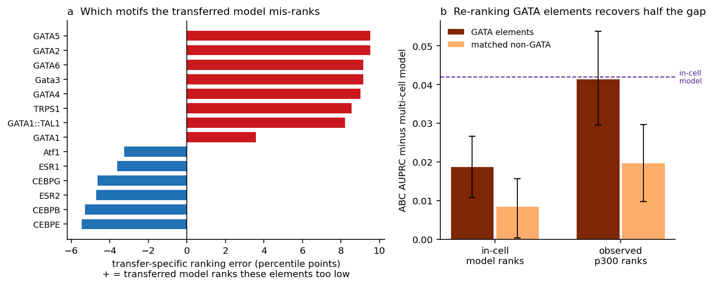
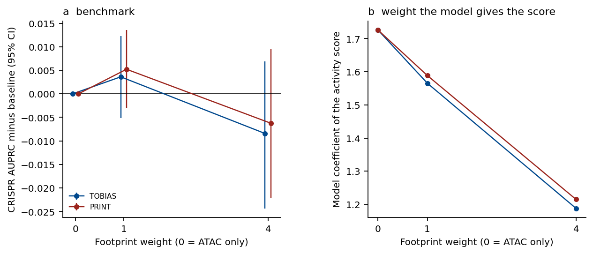

```{=html}
<style>
html { -webkit-text-size-adjust: 100%; }
body {
  font-family: Arial, Calibri, "Helvetica Neue", Helvetica, sans-serif;
  font-size: 15px;
  line-height: 1.6;
  color: #1a1a1a;
  max-width: 980px;
  margin: 0 auto;
  padding: 2.5rem 1.5rem 4rem;
  background: #fff;
}
h1 { font-size: 1.7rem; font-weight: 600; line-height: 1.3; margin: 0 0 .3rem; }
h2 { font-size: 1.15rem; font-weight: 600; margin: 2.6rem 0 .6rem;
     padding-top: 1.1rem; border-top: 1px solid #e4e4e4; }
h3 { font-size: 1rem;   font-weight: 600; margin: 1.6rem 0 .4rem; }
p.date, .date { color: #666; font-size: .85rem; }

img {
  display: block;
  max-width: 100%;
  height: auto;
  margin: 1.1rem auto 0.4rem;
}

#TOC, nav#TOC { font-size: .9rem; background: #fafafa; border: 1px solid #eaeaea;
  border-radius: 6px; padding: .8rem 1.2rem; margin: 1.5rem 0 2rem; }
#TOC ul { margin: .2rem 0; padding-left: 1.1rem; }
#TOC a { color: #235; text-decoration: none; }
#TOC a:hover { text-decoration: underline; }

p > strong:first-child { color: #111; }

table { border-collapse: collapse; font-size: .88rem; margin: 1rem 0; width: 100%; }
th, td { border-bottom: 1px solid #e8e8e8; padding: .38rem .6rem; text-align: left;
         vertical-align: top; }
th { background: #f6f6f6; font-weight: 600; }

code, pre { font-family: "SF Mono", Menlo, Consolas, monospace; font-size: .82rem; }
pre { background: #f7f7f8; border: 1px solid #ececec; border-radius: 5px;
      padding: .7rem .9rem; overflow-x: auto; }
code { background: #f2f2f3; padding: .07em .32em; border-radius: 3px; }
pre code { background: none; padding: 0; }

blockquote { border-left: 3px solid #ddd; margin-left: 0; padding-left: 1rem;
             color: #444; }
</style>
```

## Headline figure


**Figure 1 | Footprints of erythroid TFs track p300 beyond accessibility, but no way of giving them to scE2G moves CRISPR AUPRC beyond noise.** **Headline figure.**

<details>
<summary>Full legend</summary>

**Figure 1 | Element-level TF evidence from the Xu K562 multiome, against observed K562 p300 (a) and on the K562 CRISPR benchmark (b).** **a**, Partial Spearman correlation with observed K562 p300 (ENCSR000EGE, element centre +/- 250 bp) among non-promoter scE2G candidate elements that carry the motif, after removing Xu pseudobulk ATAC (rank and its square), GC content, CpG observed/expected, log distance to the nearest TSS, and the element's motif count and best motif match. Dark: those controls; light: the same plus ENCODE K562 ATAC, which absorbs noise in the multiome pseudobulk ATAC. Footprint rows: the element's best footprint score over its erythroid sites (GATA1, GATA1::TAL1, NFE2, MAF::NFE2, TAL1::TCF3; 85,720 elements). HNF4A is not expressed in K562, so its footprint rows show how much of the signal is generic footprint shape rather than TF binding. Kendall row: the strict test of feature A, which also removes a permuted-label score and the best correlation with any TF (Fig. 6b; 135,932 elements). For scale, observed H3K27ac gives 0.376 with p300 beyond ATAC in K562 (report 6, F-045, a different element set). 95% intervals from 200 bootstraps over elements. **b**, scE2G `multiome_powerlaw_n6` (six features including ARC-E2G) retrained on the Xu K562 run with each change, scored on held-out chromosomes against the K562 CRISPR benchmark (10,342 element-gene pairs, 466 regulated; pairs with no candidate element enter at score 0, as scE2G does). x = AUPRC minus the baseline model's 0.632, paired bootstrap of 2,000 resamples of the pairs. Blue: footprint or motif count added as an extra feature. Red: element activity multiplied by 1 + weight x footprint percentile before ABC and ARC-E2G are computed, with that score replacing ARC-E2G. Feature A was not taken to scE2G because its signal in **a** is a fifth of the footprints'. Sources: `2026_1002_sce2g_tf_activity/results/2026_1003_footprint_p300_gate*.beyond_motif.tsv`, `2026_1004_featA_peak_tf_kendall*.beyond_motif.tsv`, `2026_1003_featB_tobias_paired_bootstrap.tsv`, `2026_1004_featB_print_paired_bootstrap.tsv`, `2026_1004b_abcfp_paired_bootstrap.tsv`.
</details>

## Summary

- **Missing TF information is the transfer problem, and this report tests the most direct way to get it from multiome data.** The transferred p300 model under-ranks elements with GATA motifs, and fixing only those would recover about half of its gap to an in-cell model (report 6; Fig. 2). Here, element-level evidence of TF binding is read from the target cell's own multiome data instead and given to scE2G.
- **Published footprinting methods detect GATA1 binding at matched accessibility; a simple homemade score does not.** Among sites of similar accessibility, TOBIAS separates GATA1 ChIP-bound from unbound sites with AUROC 0.674 and PRINT with 0.605, against 0.419 for an 8-mer bias-corrected score (Fig. 3). Per-motif averages are dominated by GC-rich motifs and should not be read as TF activity (Table 1).
- **Erythroid footprints carry about 0.1 partial correlation with p300 beyond ATAC and motif presence.** TOBIAS 0.086 and PRINT 0.111 (0.104 and 0.126 when ENCODE ATAC is also removed), of which roughly 0.06-0.08 is above the HNF4A control (Fig. 4).
- **None of this reaches the CRISPR benchmark.** As extra scE2G features the footprints change AUPRC by -0.004 (TOBIAS) and -0.002 (PRINT). Inside the activity term they give +0.004 and +0.005 at weight 1, and a stronger weight hurts, -0.012 [-0.021, -0.004] compared with weight 1 (Fig. 1b, Fig. 5). Every interval against the baseline includes 0. The model gives the footprint score weight, but takes the same weight away from ARC-E2G, which already carries the information.
- **Peak-TF expression correlation (feature A) is mostly generic.** A peak that co-varies with any TF predicts p300 nearly as well as one that co-varies with its own motif's TF; the motif-specific part is 0.015 [0.009, 0.019] (Fig. 6), too small to test in scE2G.

## Goals

scE2G predicts enhancer-gene links from single-cell multiome data. Its activity side is ATAC plus ARC-E2G, which multiplies ABC by a factor from the correlation between element accessibility and gene expression across cells (Kendall). Report 6 showed that the p300 model transferred to a new cell lacks which TFs are active there, chiefly GATA in K562. This report asks whether element-level TF evidence read from the target cell's own multiome (TF footprints, and the correlation between an element's accessibility and the expression of TFs whose motifs it carries) improves scE2G on the K562 CRISPR benchmark. Each candidate first had to track observed p300 beyond ATAC.

## The evidence types and tests in plain terms

- *Footprint*: a dip in Tn5 insertions at a motif inside an open element, left where a bound TF protects the DNA. Tn5 has its own sequence preference, so a footprint score needs a bias model. Homemade: an 8-mer bias estimated from the sample's own insertions. TOBIAS (Bentsen et al. 2020): bias correction and footprint scores on a pseudobulk insertion track. PRINT (scPrinter, Buenrostro lab): multiscale footprints with a learned Tn5 bias model and a pretrained TF-binding model.
- *Within accessibility deciles*: sites are split into ten groups by accessibility, and the footprint is scored within each group, so it gets no credit for openness. AUROC 0.5 = chance.
- *Partial Spearman with p300*: correlation of a feature with observed p300 after removing what ATAC and DNA composition explain (and, in the stricter tests, motif count and strength). It measures the information the feature adds.
- *Peak-TF Kendall (feature A)*: for each peak and each expressed TF with a motif in it, Kendall's tau between peak accessibility and TF RNA across 7,821 cells.
- *scE2G variants*: "extra feature" adds a column to the six-feature model; "inside the activity term" changes each element's activity to ATAC x (1 + weight x footprint percentile), recomputes ABC and ARC-E2G, and swaps that score in for ARC-E2G.

## The p300 model's transfer error is concentrated at GATA elements (report 6)

**Q:** Which TF information is the transferred p300 model missing in K562?

**A:** GATA: GATA-motif elements are ranked 8-10 percentile points too low relative to the in-cell model, and giving only those elements their observed-p300 ranks gains +0.022 AUPRC more than doing the same for matched non-GATA elements.



<details>
<summary>Figure 2 legend</summary>

**Figure 2 | Error anatomy and GATA oracle (report 6, Fig. 4, reproduced unchanged).** **a**, Per JASPAR motif, the transfer-specific ranking error at 132,186 non-promoter K562 ABC candidates (multi-cell model error minus in-cell model error, regressed on motif presence with ATAC and composition controls); the seven largest are GATA-family matrices (GATA2 +9.52, GATA1::TAL1 +8.20). **b**, ABC AUPRC when the 43,513 GATA-motif candidates take in-cell or observed-p300 ranks, against matched non-GATA candidates: GATA-specific gain +0.0217 [+0.0060, +0.0385] with observed ranks. Giving the model a TF-activity input track from the ATAC-derived TF list gained +0.006 ABC AUPRC, seed-averaged, and a TF list from RNA did not beat it (report 6, F-035 to F-041). Sources: `results/2026_0925_p300_error_anatomy.features.tsv`, `results/2026_0927_gataoracle_auprc_pairs.tsv`.
</details>

**Method.**

- Residual screen `scripts/4.41`; GATA oracle `scripts/4.42`; see report 6 for the TF-track models.

<details>
<summary>Full methods &amp; code</summary>

This figure is report 6's Fig. 4 and is regenerated by report 6's figure script. It is included because it motivates looking for GATA binding evidence at individual elements.

```bash
pixi run -e multimodal python scripts/5.3.plot_tf_activity_report_figures.py
```
Source: `scripts/5.3.plot_tf_activity_report_figures.py`, section "fig 29".
</details>

## TOBIAS and PRINT footprints detect GATA1 binding at matched accessibility; the homemade score does not

**Q:** Do footprints from the Xu multiome pseudobulk distinguish ChIP-bound from unbound motif sites once accessibility is held fixed?

**A:** For CTCF all three methods do (best PRINT, 0.851); for GATA1 only the published methods do (TOBIAS 0.674, PRINT 0.605), while the homemade score is below chance (0.419).


<details>
<summary>Figure 3 legend</summary>

**Figure 3 | Footprint score validated against ChIP-seq within accessibility deciles.** AUROC of the footprint score for ChIP-bound against unbound motif sites, computed within deciles of the site's accessibility and averaged, so a score gets no credit for openness. CTCF sites (MA0139.2) against K562 CTCF ChIP (ENCFF519CXF); GATA1 (MA0035.5) and GATA1::TAL1 (MA0140.3) sites against K562 GATA1 ChIP peaks (4,603 peaks). Grey, homemade: core-versus-flank insertion depletion with an 8-mer Tn5 bias estimated from the sample's own insertions, over genome-wide FIMO hits with >= 10 insertions (CTCF 313,773 hits, 40,537 bound; GATA1 67,741, 270; GATA1::TAL1 184,480, 2,157). Blue, TOBIAS 0.17.5 footprint scores at BINDetect sites inside scE2G's 155,134 candidate regions (CTCF 83,492 sites, 28,726 bound; GATA1 14,903, 263; GATA1::TAL1 42,262, 2,165). Red, PRINT TF-binding scores at the same sites (pretrained TFBS model, hg38 v2 Tn5 bias, 7,821 cells as one pseudobulk). Bars on TOBIAS and PRINT: 95% intervals from 200 within-decile bootstraps. The homemade and published site sets differ, so the comparison is not hit-matched. Sources: `results/2026_1002_footprint_validation.chip.tsv`, `2026_1002_tobias_validation.chip.tsv`, `2026_1002_print_validation.chip.tsv` (A2).
</details>

**Method.**

- Homemade footprints `A2/scripts/1.1`, validation `1.2`; TOBIAS `2.1`-`2.3`; PRINT `3.1`, validated with `2.3 --score print`.

<details>
<summary>Full methods &amp; code</summary>

TOBIAS ran ATACorrect (`--read_shift 0 0` on an insertion BAM built from the fragments), ScoreBigwig and BINDetect over 879 JASPAR 2024 motifs. BINDetect's "bound" call covers 82% of ChIP-bound GATA1 sites and 9% of unbound ones. PRINT scored each BINDetect site of seven motifs at its 10 bp centre on its strand with motif score fixed at 1, so the score is footprint only. The first full PRINT run lost three of four shards to scPrinter's in-memory result handling and was rerun in backed mode (identical scores on a 2,000-site check).

| motif rank by mean footprint score | homemade (782 motifs) | TOBIAS (879 motifs) |
|---|---|---|
| top 5 | TCFL5, ZBTB33, KLF15, TFDP1, ELK3 | KLF15, ZBED4, ELK3, NRF1, ETV5 |
| CTCF (MA0139.2) | 166 | 77 |
| GATA1::TAL1 | 533 | 274 |
| GATA1 | 765 | 534 |
| HNF4A (MA0114.5, not expressed) | 540 | 516 |

**Table 1 | Per-motif mean footprint scores favour GC-rich motifs.** Both methods put GC- and CpG-rich motifs at the top and rank GATA1 below a TF that is not expressed in K562, so per-motif averages are composition-biased and are not used as TF activity.

```bash
cd $OAK/Users/sheth/EP300_BPNet/2026_1002_sce2g_tf_activity
sbatch scripts/2.1.submit_insertion_bam.sh && sbatch scripts/2.2.submit_tobias.sh
sbatch scripts/2.3.submit_validate_tobias.sh
sbatch scripts/3.1.submit_scprinter_tfbs.sh
```
Source: `scripts/5.5.plot_tf_evidence_report_figures.py`, section "fig41".
</details>

## Erythroid footprints add about 0.1 partial correlation with p300 beyond ATAC and motif presence

**Q:** Among elements that carry a motif, does the footprint at that motif say more about p300 than accessibility and motif presence already do?

**A:** Yes for the erythroid set (TOBIAS 0.086, PRINT 0.111), above the HNF4A control (0.031, 0.052), and CTCF footprints point the other way.


<details>
<summary>Figure 4 legend</summary>

**Figure 4 | Footprints against observed K562 p300, per motif.** Partial Spearman correlation of the element's best footprint score at that motif with observed K562 p300 (ENCSR000EGE, +/- 250 bp), among non-promoter scE2G candidates that carry at least one site of the motif (count in brackets). **a**, Controls: Xu ATAC rank and its square, GC content, CpG observed/expected, log distance to TSS, motif count and best motif match in the element. **b**, The same plus ENCODE K562 ATAC rank and its square. Blue TOBIAS, red PRINT, same sites. Erythroid = the union of GATA1, GATA1::TAL1, NFE2, MAF::NFE2 and TAL1::TCF3 sites. HNF4A (not expressed in K562) estimates the part of the signal that is generic footprint shape. CTCF footprints are negatively related to p300 once ENCODE ATAC is removed (TOBIAS -0.044), consistent with CTCF sites being insulators rather than enhancers. Across all non-promoter elements, ENCODE ATAC itself adds 0.248 [0.242, 0.254] beyond Xu ATAC, more than any footprint: the pseudobulk ATAC is noisy. 95% intervals from 200 bootstraps over elements. Sources: `A2/results/2026_1003_footprint_p300_gate{,.print}{,.z_encode_atac}.beyond_motif.tsv`.
</details>

**Method.**

- `A2/scripts/2.4` (TOBIAS) and `2.4 --score print`, each with and without `--z-encode-atac`.

<details>
<summary>Full methods &amp; code</summary>

All signals are percentile-ranked, so each number is a partial Spearman. The erythroid motif set is chosen with knowledge of K562, so a transfer version would need expression-weighted motif sets. The passing rule, set before the test, was that the erythroid interval in this test excludes 0.

```bash
cd $OAK/Users/sheth/EP300_BPNet/2026_1002_sce2g_tf_activity
sbatch scripts/2.4.submit_footprint_p300_gate.sh                     # and --z-encode-atac, --score print
```
Source: `scripts/5.5.plot_tf_evidence_report_figures.py`, section "fig42".
</details>

## Footprints inside the ABC activity term do not improve scE2G, and a stronger weight hurts

**Q:** Do footprints help scE2G when they change the activity term itself, rather than enter as an extra feature?

**A:** No: at weight 1 the change is +0.004 (TOBIAS) and +0.005 (PRINT) with intervals including 0, at weight 4 it is -0.008 and -0.006, and weight 4 is worse than weight 1 by -0.012 [-0.021, -0.004] for TOBIAS.



<details>
<summary>Figure 5 legend</summary>

**Figure 5 | Footprint-weighted activity in scE2G.** Each element's activity becomes ATAC x (1 + weight x q), with q the percentile of its erythroid footprint sum among the 93,941 of 155,134 elements that have an erythroid site, and 0 otherwise. ABC is renormalised within each gene, which needs only the published ABC scores: ABC_fp = ABC x w x sum(ABC) / sum(ABC x w) over the gene's candidates. In scE2G's output ARC-E2G is exactly ABC x exp(21.5 x Kendall) (R^2 = 1.0000 over 1,188,355 pairs with ABC > 0.001), so ARC-E2G takes the same per-gene factor. That score replaces ARC-E2G in the six-feature model. Weight 0 is the baseline. **a**, CRISPR AUPRC minus baseline (0.632), paired bootstrap as in Fig. 1b. Weight 1 changes a pair's ARC-E2G by a median of about 10% (log correlation with the original 0.988); weight 4 by 20-30% (0.940). **b**, The model's coefficient on the activity score falls as the weight rises (1.73 at weight 0, 1.57-1.59 at weight 1, 1.19-1.22 at weight 4). Run `$SCRATCH/sce2g_runs/2026_1004b_k562_xu_abcfp`. A first run of this design is invalid and not shown: all four models shared one feature name, which scE2G treats as one column. Sources: `A2/results/2026_1004b_abcfp_paired_bootstrap.tsv`, `A2/results/2026_1004_sce2g_coefficients.tsv`.
</details>

**Method.**

- Weighted scores `A2/scripts/4.3`; run setup `4.4`; training `log/sce2g_train.sh`; paired bootstrap `4.2`.

<details>
<summary>Full methods &amp; code</summary>

The two weights were set before the run and not tuned. As extra features (Fig. 1b, blue), the footprint sum entered with the erythroid motif count (`4.0`, `4.1`); its coefficient was +0.30 to +0.36 while ARC-E2G's fell from 1.73 to 1.59-1.69, so the footprint re-expresses part of what ARC-E2G carries. The motif count alone lowered AUPRC by -0.0022 [-0.0037, -0.0007].

```bash
cd $OAK/Users/sheth/EP300_BPNet/2026_1002_sce2g_tf_activity
RUN_DATE=2026_1004b sbatch scripts/4.4.setup_abcfp.sh
CFG=$PWD/config/config_training_abcfp.yaml sbatch log/sce2g_train.sh
sbatch scripts/4.2.submit_paired_bootstrap.sh --run $SCRATCH/sce2g_runs/2026_1004b_k562_xu_abcfp/K562_Xu_pl ...
```
Source: `scripts/5.5.plot_tf_evidence_report_figures.py`, section "fig43".
</details>

## Peak-TF Kendall mostly reflects how variable a peak is, not which TF binds it

**Q:** Does the correlation between a peak's accessibility and the expression of TFs whose motifs it carries track p300 beyond ATAC?

**A:** Barely: a peak's best correlation with its own motif's TFs adds 0.042, but its best correlation with any TF adds 0.048, and after removing that and a permuted-label score the motif-specific part is 0.015 [0.009, 0.019].


<details>
<summary>Figure 6 legend</summary>

**Figure 6 | Feature A against observed K562 p300.** Kendall tau-b between binarised peak accessibility and log1p(CP10k) RNA across the 7,821 Xu cells, for 157,587 scE2G Kendall peaks x 348 TFs that have a JASPAR motif and are detected in >= 5% of cells; 10.9 million peak-TF pairs where the TF's motif (FIMO p < 1e-4) lies in the peak. Element features take the maximum over overlapping peaks (96.7% of candidates overlap one). **a**, Partial Spearman of each feature with p300 beyond Xu ATAC and composition (dark) or also ENCODE ATAC (light), 135,932 non-promoter elements. Own-motif TFs: TFs with a motif in the peak. Permuted: the motif-to-TF assignment shuffled among the 348 TFs, which keeps each peak's number of TFs and breaks the motif match. Any TF: best tau over all 348. **b**, The own-motif maximum with controls added in turn. Tau is small throughout (median 0.010, maximum 0.175 over 1 million random peak-TF pairs). Sources: `A2/results/2026_1004_featA_peak_tf_kendall{,.z_encode_atac}.{all_elements,beyond_motif}.tsv`.
</details>

**Method.**

- ATAC matrix export `A2/scripts/5.0`; Kendall, element mapping and gate `5.1`.

<details>
<summary>Full methods &amp; code</summary>

With a binary x, Kendall tau-b is a Mann-Whitney U on the midranks of y, so every peak x TF tau comes from one sparse product of the peak x cell matrix with the cell x TF rank matrix; it matches `scipy.stats.kendalltau` to 1.6e-9 on random pairs. ATAC is binarised (80% of non-zero counts are 1). K562 is a cell line with little TF expression variation between cells, so this feature may behave differently in a heterogeneous sample; that is the condition for reopening it.

```bash
cd $OAK/Users/sheth/EP300_BPNet/2026_1002_sce2g_tf_activity
Rscript scripts/5.0.export_atac_matrix.R $SCRATCH/sce2g_runs/2026_1002_k562_xu/K562_Xu_pl/Kendall/atac_matrix.rds $SCRATCH/featA/atac_matrix
sbatch scripts/5.1.submit_peak_tf_kendall.sh                         # and --z-encode-atac
```
Source: `scripts/5.5.plot_tf_evidence_report_figures.py`, section "fig44".
</details>

## Datasets

| dataset | assay / system | source |
|---|---|---|
| Xu K562 multiome | 10x single-cell ATAC + RNA, 7,821 cells after scE2G filtering | `$OAK/Projects/scE2G/data/K562_260122/K562_Xu/` |
| K562 CRISPR benchmark | CRISPRi element-gene pairs, 10,342 pairs (466 regulated) | ENCODE-rE2G training set (Gschwind et al. 2023), as packaged in scE2G `resources/` |
| p300 ChIP-seq, K562 | ENCODE EP300 ChIP-seq | ENCSR000EGE |
| ATAC-seq, K562 | ENCODE ATAC-seq | ENCSR868FGK |
| CTCF ChIP-seq, K562 | ENCODE | ENCFF519CXF |
| GATA1 ChIP-seq, K562 | peaks used to train the K562 GATA1 BPNet model (4,603 peaks) | `K562_GATA1_BPNet/data/peaks_inliers.bed.gz` |
| motifs | JASPAR 2024 CORE vertebrates, non-redundant (879 matrices); FIMO p < 1e-4 | Rauluseviciute et al. 2024; memelite FIMO |
| footprinting | TOBIAS 0.17.5 (Bentsen et al. 2020); scPrinter / PRINT, pretrained TFBS model | conda `tobias`; github.com/buenrostrolab/scPrinter |
| enhancer-gene model | scE2G, `multiome_powerlaw_v3` six-feature model | EngreitzLab/scE2G, local branch `local-with-pr118` |

## Open questions / next steps

- The multiome TF-evidence line (footprints as features, footprints in the activity term, peak-TF Kendall) is closed on the K562 benchmark. Reopen footprints only with a signal several times stronger against p300 (for example seq2PRINT trained on this sample), and Kendall only in a heterogeneous sample.
- The PRINT weight-1 point estimate (+0.005) is the only positive lead; it would need a second sample or cell type before it counts.
- Observed p300 as an scE2G activity feature would give a ceiling for what any element-level activity evidence could add to scE2G.

## Methods

**Candidates and signals.** scE2G candidate regions from the Xu run (155,134; 135,965 non-promoter, GENCODE TSS +/- 250 bp removed). Signals over the region midpoint +/- 250 bp. All gate statistics are partial Spearman correlations with 200 element bootstraps (`A2/scripts/2.4`, `5.1`).

**scE2G.** scE2G main (7cb2af7) with EngreitzLab/scE2G#118 applied locally, training workflow, Xu K562 cluster, `--rerun-triggers mtime`. Each variant run is seeded from the baseline run's files so nothing upstream reruns (`A2/scripts/4.0`, `4.4`). Paired bootstrap `A2/scripts/4.2`, 2,000 resamples, CRISPR pairs outside every candidate added at score 0.

**Findings.** F-047 to F-053 in `.living/findings/predicting-regulatory-element-function-at-scale.md` record each result with its job IDs.

### Regenerate

Environment: pixi env `multimodal` (`EP300_BPNet/pixi.toml`), `pixi.lock` sha256 `069960d36312`; analysis envs `tobias` and `scprinter` (`2026_1002_sce2g_tf_activity/pixi.toml`), `pixi.lock` sha256 `e32b6a713472`.

```bash
cd /oak/stanford/groups/engreitz/Users/sheth/EP300_BPNet/2026_0824_H3K27ac_model
pixi run -e multimodal python scripts/5.5.plot_tf_evidence_report_figures.py
python3 render_report.py report7_tf_evidence_multiome.qmd
```
